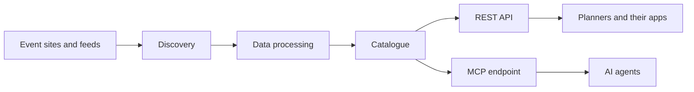

# magic-events

magic-events is a feed of what's on in a place: festivals, concerts, matches, markets, shows, exhibitions, and seasons
like whale season. Travel agencies and travel apps use it to plan trips, and so do their AI agents. Everyone gets the
same feed, over a REST API or an MCP endpoint. Version 1 covers Hermanus, South Africa.

> **New here, person or agent?** Everything is written down. Start with
> [docs/architecture.md](docs/architecture.md) for how the system is built, and [AGENTS.md](AGENTS.md) for the brief
> and the principles behind it. The rest is listed under [Documentation](#documentation).

## Highlights

- **Extensible.** Everything external sits behind a port. Swap a model, a queue or a source with one adapter.
- **Messy listings in, clean experiences out.** A language model extracts and classifies whatever a source publishes.
- **Search by meaning.** Embeddings rank results by what a traveller loves, not just the words they type.
- **Never miss a change.** Check back months later and see only what's new, moved or cancelled.
- **For people and agents.** One feed, over REST and MCP.
- **Just Postgres.** Data, embeddings and jobs in one database.

## How it works



1. **Discovery** fetches listings from the Hermanus sources (RSS feeds, PDF calendars and web pages) on a schedule,
   and keeps each one exactly as it was fetched.
2. **Data processing** turns each listing into clean experiences. A language model extracts them, and they are then
   categorised, tagged and matched against what is already there, so nothing shows up twice.
3. **Catalogue** publishes the experiences and answers searches by place, dates and interests. It also remembers every
   change, so a planner can come back months later and ask what's different.

Two more domains sit around those three: **Identity** checks API keys and decides what a caller may do, and
**Organizations** holds the tenants and their users.

## Architecture

The system is five domains on a ports-and-adapters (hexagonal) architecture, kept deliberately light. Each domain owns
its data and reaches the outside world (Postgres, the models, the job queue, the sources) through a port, so any of
them can be swapped by writing one adapter. REST, MCP and the scheduler are thin: they call the domains' services and
hold no business rules. ESLint enforces these boundaries, so they don't depend on anyone remembering them.

| Project | What's in it |
| --- | --- |
| [packages/core](packages/core/README.md) | The five domains, their ports, the outbound adapters and the wiring |
| [packages/db](packages/db/README.md) | The Drizzle schema, the migrations and the database client |
| [apps/api](apps/api/README.md) | The server: REST, MCP, and the scheduler that runs the background jobs |
| [apps/cli](apps/cli/README.md) | The seed, the pipeline run by hand, and the loader for captured pages |
| [apps/web](apps/web/README.md) | The web app (Next.js). A placeholder for now |

Each project's README covers its own layout and commands. The full picture is in
[docs/architecture.md](docs/architecture.md).

## Getting started

You'll need three things installed:

- **Node.js 24 or later**, from [nodejs.org](https://nodejs.org) or with `nvm install 24`.
- **pnpm**: `npm install -g pnpm`.
- **Docker**, for Postgres. [Docker Desktop](https://www.docker.com/products/docker-desktop/) is the easy route.

Then, from the repository root:

**1. Install the dependencies**

```sh
pnpm install
```

**2. Create your `.env`**

```sh
cp .env.example .env
openssl rand -base64 48    # paste the output into .env as BETTER_AUTH_SECRET
```

`BETTER_AUTH_SECRET` is the only value you have to set. The defaults cover the rest.

**3. Set up the database**

```sh
pnpm quickstart
```

One command, three jobs:

- It starts Postgres, the one container in [docker-compose.yml](docker-compose.yml). More on it under
  [The database](#the-database).
- It restores a snapshot of the feed: 283 experiences in and around Hermanus, already classified and embedded. No
  website is fetched and no model is called.
- It seeds two example tenants and their users, and prints five API keys, each starting with `mev_`.

**Copy the keys somewhere now.** They are stored only as a hash and can't be shown again, and seeding a second time
won't issue new ones.

Lost one? Issue a fresh key to the same user:

```sh
pnpm cli:admin key issue --user planner@agency.example.com --name "my key" --kind agent
```

`pnpm cli:admin` is also how you onboard a tenant, add its users and revoke a key. The API has no admin endpoints, so
it all happens here. The commands are in [apps/cli](apps/cli/README.md#commands).

**4. Start the server**

```sh
pnpm dev
```

The API is now on <http://localhost:4000>, and the web app on <http://localhost:3000>. Both restart when the code
changes.

**5. Check it works**

```sh
curl http://localhost:4000/health
```

That answers `{"status":"ok"}`. Now search for what's on in Hermanus over ten days in December:

```sh
curl http://localhost:4000/v1/experiences/search \
  -H "Authorization: Bearer <key>" \
  -H "Content-Type: application/json" \
  -d '{"location":"hermanus","from":"2026-12-10","to":"2026-12-20"}'
```

And ask what changed for a stay since a moment in the past, the way a planner checks back on a trip:

```sh
curl http://localhost:4000/v1/experiences/changes \
  -H "Authorization: Bearer <key>" \
  -H "Content-Type: application/json" \
  -d '{"location":"hermanus","from":"2026-12-01","to":"2027-09-30","since":"2026-11-23T17:10:00Z"}'
```

That returns nine experiences: one cancelled, one postponed, one rescheduled, and so on. Those nine changes were made
for demonstration and aren't true of the real events. What's in the snapshot, and what was changed, is in
[packages/db/snapshot](packages/db/snapshot/README.md).

Every endpoint is described in [apps/api](apps/api/README.md#endpoints) and in the OpenAPI document at
`/openapi.json`.

### Building the feed yourself

The snapshot is the shortcut. To build the same feed through the real pipeline, from the captured pages in
`data/hermanus`, swap step 3 for:

```sh
pnpm db:up
pnpm db:migrate     # creates the database and applies the migrations
pnpm db:seed        # Hermanus, its sources, the example tenants and users, and the API keys
pnpm cli:captures   # runs the captured pages through the pipeline
```

`pnpm quickstart` leaves a database that already has tables alone. To replace it with the snapshot, run
`pnpm db:restore --replace`, then `pnpm db:seed` for new users and keys.

## The database

Postgres is the only infrastructure, and Docker Compose runs it. Background jobs queue in the same database, so
there's nothing else to start.

| | |
| --- | --- |
| Image | `pgvector/pgvector:pg18`: Postgres 18 with pgvector, which stores the search embeddings |
| Address | `localhost:5434`, so it won't clash with a Postgres you already run on 5432 |
| Login | User `magic`, password `magic`, database `magic_events` |
| Data | The `pgdata` volume, which survives a restart |

```sh
pnpm db:up                         # start it in the background
pnpm db:down                       # stop it and keep the data
docker compose logs -f postgres    # watch its logs
docker compose down -v             # stop it and delete the data
```

The Compose project has a fixed name, `magic-events`, so the main checkout and every git worktree share one container
and one database. After `docker compose down -v`, run `pnpm quickstart` again to get back to a working setup.

## Connect Claude

The server speaks MCP at `/mcp`, so Claude can search the feed for you and check what changed since last time. It
signs in with the same API keys as REST. Use an **agent key** from the seed, such as the Agency Planner's
`seed agent key`, so the logs show that an agent is calling.

### Claude Desktop

Claude Desktop reaches MCP servers through a custom connector, and connectors call out from Anthropic's cloud, not
from your machine. So `http://localhost:4000` won't work: the server needs a public HTTPS address. A Cloudflare quick
tunnel gives it one for free, with no account.

**1. Install cloudflared**

```sh
brew install cloudflared
```

On Linux or Windows, see
[Cloudflare's downloads](https://developers.cloudflare.com/cloudflare-one/connections/connect-networks/downloads/).

**2. Open the tunnel**

With the server running, in a second terminal:

```sh
pnpm tunnel
```

It prints a public address like `https://<random-words>.trycloudflare.com`. Leave it running.

**3. Tell the server about the tunnel**

The MCP endpoint only answers to host names it knows. Add the tunnel's to `API_ALLOWED_HOSTS` in `.env`, without
`https://`, set `API_TRUST_PROXY` on the line below it, then restart the server:

```sh
API_ALLOWED_HOSTS=localhost,127.0.0.1,[::1],<random-words>.trycloudflare.com
API_TRUST_PROXY=loopback
```

`cloudflared` connects from your own machine, so without `API_TRUST_PROXY` every caller looks like localhost. With it,
the rate limit and the logs see each caller's real address.

A quick check that the tunnel reaches the server:

```sh
curl https://<random-words>.trycloudflare.com/health
```

**4. Add the connector**

1. In Claude Desktop, open **Customize**, then **Connectors**.
2. Click **Add**, then **Add custom connector**.
3. Name it `magic-events`, set the URL to `https://<random-words>.trycloudflare.com/mcp`, and click **Continue**.
4. For authentication, choose **No sign-in**.
5. Under **Request headers**, pick `authorization` and enter `Bearer <key>` as the value. Type the word `Bearer` and
   the space yourself: Claude sends the value exactly as you enter it.
6. Click **Add**.

On a Team or Enterprise plan, an owner adds it instead, under **Organization settings**, **Connectors**, **Add**,
**Custom**, **Web**. Members then find it under **Customize**, **Connectors** and click **Connect**.

**5. Use it**

In a chat, click **+**, open **Connectors**, and turn `magic-events` on. Then ask something like:

> What's on in Hermanus from 10 to 20 December 2026 for a couple who like art and wine?

The same connector works on claude.ai and in the mobile apps.

Good to know:

- **The address changes every time the tunnel starts.** After a restart, update `API_ALLOWED_HOSTS`, restart the
  server, then remove the connector and add it again with the new address.
- **A connector's sign-in can't be edited.** To change the key, remove the connector and add it again.
- **Request headers are in beta.** If the dialog has no **Request headers** section, your organisation doesn't have
  them yet, and a server that signs in with an API key can't be added. Version 1 has no OAuth.
- **The tunnel puts your local API on the internet.** Everything except `/health` needs an API key. Stop the tunnel
  with Ctrl+C when you're done.

### Claude Code

Claude Code runs on your machine, so it connects to localhost directly, with no tunnel:

```sh
claude mcp add --transport http magic-events http://localhost:4000/mcp --header "Authorization: Bearer <key>"
```

## Fetching live data

The snapshot is enough to explore. To fetch the real sources, add two things to `.env`:

- `ANTHROPIC_API_KEY`, for the language model that turns listings into experiences.
- `AWS_REGION` and AWS credentials, for the embedding model on Amazon Bedrock. Search uses it too, to embed the
  traveller's query: without the credentials, search still works and orders results by keyword alone.

`pnpm cli:pipeline run` then fetches every source, processes what it found and embeds the results. The commands are in
[apps/cli](apps/cli/README.md).

One thing to know: a running server does this by itself. Its scheduler looks for due sources every 15 minutes, so it
fetches real websites and calls the language model without being asked.

## Documentation

| Document | What it covers |
| --- | --- |
| [docs/architecture.md](docs/architecture.md) | The domains, their boundaries, the rules, the background jobs and the use cases. Start here |
| [docs/data-model.md](docs/data-model.md) | What the system stores, and the rules the data follows |
| [docs/discovery.md](docs/discovery.md) | How listings are fetched from sources |
| [docs/data-processing.md](docs/data-processing.md) | How a raw listing becomes experiences, and how search ranks them |
| [docs/domain-events.md](docs/domain-events.md) | The domain event log |
| [docs/sources.md](docs/sources.md) | The sources the system holds for Hermanus |
| [docs/hermanus-sources.md](docs/hermanus-sources.md) | Which Hermanus sites answer a plain fetch, checked one by one |
| [docs/end-to-end.md](docs/end-to-end.md) | What version 1 must do, as scenarios a tester runs from the outside |
| [docs/test-report.md](docs/test-report.md) | The end-to-end testing of 23 November 2026: what was tested, the results and the evidence |
| [docs/v1-decisions.md](docs/v1-decisions.md) | What version 1 leaves out, and why |
| [docs/issues.md](docs/issues.md) | The issues and open questions being worked on |

## Contributing

Before you push, run the three checks CI runs on every push and pull request:

```sh
pnpm lint         # ESLint, which also checks the architecture rules
pnpm typecheck
pnpm test
```

The tests need Postgres running and nothing else: the models are fakes. They use the database in `TEST_DATABASE_URL`,
which they create, migrate and empty themselves, so never point it at a database you want to keep.

Large changes happen in a separate git worktree and are squash-merged into `main`. The details are in
[AGENTS.md](AGENTS.md).
