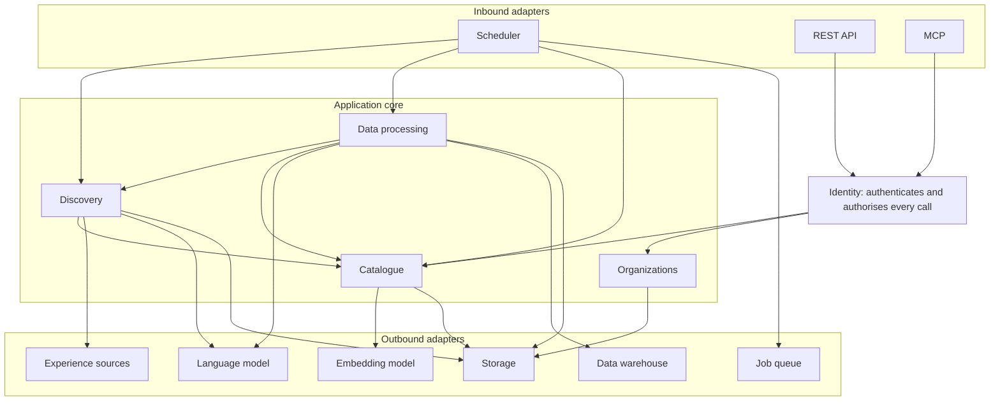

# Architecture

2026-11-23 · Meiring

## System overview

The system is a multi-tenant platform that finds, processes and serves experiences by location. Travel businesses query it to plan trips. Clients only read; they cannot create or change experiences. Clients reach it through a REST API and an MCP interface. This revision defines the domains, their boundaries and the main use cases, and makes no technology choices.

Version 1 is an experience feed. It holds no trip context and serves experiences from the search parameters the client sends.

| Capability | What it means | Owning domain |
| --- | --- | --- |
| Discover experiences | Find experiences in the locations the system covers and capture the raw data as received | Discovery |
| Process experiences | Clean, de-duplicate, categorise and tag raw data, then make it ready for the data warehouse | Data processing |
| Search experiences | Find processed experiences by location, dates and traveller interests | Catalogue |
| Track changes | Show what is new, confirmed, rescheduled, postponed, cancelled, removed or otherwise changed since a time the client gives | Catalogue |
| Authenticate and authorise | Know who is calling and decide what they may do | Identity |
| Manage tenants | Tenant setup and configuration, users, and their roles | Organizations |

## Actors and roles

Version 1 has two roles. Every person or agent that calls the system acts as one of them.

| Role | Kind | Who holds it | What they can do |
| --- | --- | --- | --- |
| System admin | System role | The platform operator | Onboard and configure tenants, manage users and roles, manage locations and sources, oversee discovery and processing |
| Client | User role | Users of a client tenant | Search experiences and track changes |

Client tenants come in two kinds. All of them hold the client role, and they use the system differently:

- **Travel agencies and travel agents** search for experiences to plan trips for their travellers.
- **Travel apps** search experiences on behalf of their own users.

A client can call through the REST API, or through MCP using an AI agent acting for that client. Both paths carry the same identity, tenant and role. Agents can do exactly what clients can and have no separate role. Identity knows whether a caller is an agent or a person.

## Domains

There are five domains: Discovery, Data processing, Catalogue, Identity and Organizations. Catalogue owns the processed experiences that clients search and track changes on. Each domain owns its own data, and no other domain changes that data directly. A domain that needs another domain's data calls its service; nothing is copied. How listings are fetched is in [discovery.md](discovery.md), and how they become experiences is in [data-processing.md](data-processing.md).

Version 1 is a tracer bullet through Discovery, Data processing and Catalogue: sources fetched, processed and published end to end. It defines five kinds of source and builds the three that need no API access (see [discovery.md](discovery.md)).

### Discovery

Finds experiences and captures the raw data as received.

- **Owns:** sources (where experiences are found, one location each), runs, listings (the lasting record of each item a source publishes, fetched again on every run), and raw listings (each version of a listing's content, exactly as fetched).
- **Boundary:** does not interpret, split, categorise or decide what clients see. It saves raw listings as pending for Data processing and stops there.

### Data processing

Turns raw listings into clean, categorised, tagged experiences ready for the data warehouse.

- **Owns:** the processing pipeline (extract, classify, match, save), one extractor per kind of source, the configurable attribute and tag definitions that experiences are classified with, the seasons of each location, and matching rules (is this the same experience as one we already have).
- **Boundary:** does not fetch from sources or answer client queries. It processes the raw listings Discovery captures.

### Catalogue

The experiences as clients see them, and everything clients do with them.

- **Owns:** published experiences, the locations the system covers and clients search by, search by location, dates and interests, and the change history clients track.
- **Boundary:** does not process or categorise. Every experience it publishes comes from Data processing.

All experiences are discoverable by every tenant.

### Identity

Knows who is calling and decides what they may do.

- **Owns:** credentials for people and for agents calling through MCP, whether each caller is an agent or a person, authentication, and authorisation decisions.
- **Boundary:** does not decide who belongs to which tenant or which role they hold. It reads that from Organizations and turns it into an allow or deny on each request.

### Organizations

The tenants and the people in them.

- **Owns:** tenants, tenant kind (travel agency, travel app), tenant configuration, users, membership and role assignment.
- **Boundary:** does not authenticate anyone or hold credentials. It does not hold experiences.

## Architecture

The API uses ports and adapters. Each domain defines inbound ports for what it offers and outbound ports for what it needs, with no technology in either. Adapters connect those ports to the outside world, and an adapter can be swapped without changing the domain.

System settings, such as how often things run, are environment variables. They are read through one settings provider, which reads them once at startup, applies defaults and stops the system when a value is invalid. A domain asks the provider for its settings and never reads an environment variable itself, so the store behind the provider can change later without touching the domains. Each domain's settings are listed in its own document: [discovery.md](discovery.md), [data-processing.md](data-processing.md) and [data-model.md](data-model.md) for Catalogue.

Models from outside providers sit behind ports like everything else. The domains name no provider and import no provider's SDK, so a provider is changed by writing one adapter and changing one setting.

| Port | Used by | Adapter in version 1 |
| --- | --- | --- |
| Language model | Data processing, to extract and classify experiences. Discovery, to find the current calendar file | Claude, through the Anthropic API |
| Embedding model | Catalogue, to embed experience profiles and search query texts | Amazon Titan Text Embeddings V2, through Amazon Bedrock |
| Job queue | The scheduler, to run background work on a schedule and to try failed work again | pg-boss, on queues in the same Postgres database |
| Domain events | Discovery and Catalogue, to publish each domain event once its change is saved | Node's event emitter, which reaches subscribers in the same process only |

The model ports and their adapters are defined in [data-processing.md](data-processing.md). The job queue is described under Background jobs, below, and publishing domain events in [domain-events.md](domain-events.md).

REST and MCP are two adapters on the same inbound ports, so a person and an agent get identical behaviour. The scheduler is the third inbound side. It starts discovery, processing, Catalogue's embedding, and Catalogue's upkeep, which moves finished experiences to Past and generates recurring sessions further ahead, without passing through Identity, because no client is involved.

### Background jobs

Work that no client asks for is a job: finding the sources that are due, fetching one source, processing the raw listings that are pending, embedding experiences, and Catalogue's upkeep. The scheduler runs inside the server.

- **The job queue is a port.** It keeps jobs, runs them, puts a job on a schedule and tries a failed job again. It names no technology.
- **A job handler says what a job does.** It is written against the domains' inbound ports and the job queue port, and nothing else. A handler calls a service the way a REST route does, and holds no business rules.
- **pg-boss is the first adapter.** It keeps the queues in the same Postgres database, in a schema of its own, so version 1 needs no other infrastructure. It is the only code that imports pg-boss.
- **Either side can be changed without the other.** Another queue, such as a durable workflow engine, is one new adapter: the handlers and the domains stay as they are. A handler can be changed or added without touching the queue.
- **The domains do not know the queue exists.** A service never adds a job. The hand-off from fetching to processing is still the raw listing's status, so the pipeline can also be run by hand, with no queue at all.

| Job | When | Does |
| --- | --- | --- |
| Find due sources | Every 15 minutes (`DISCOVERY_SCHEDULE_CRON`) | Asks Discovery which sources are due and adds a fetch job for each |
| Fetch a source | When a source is due | Runs Discovery for that source. A failed fetch is tried again by the queue (see [discovery.md](discovery.md)). A fetch that found a new, changed or gone listing adds a processing job |
| Process pending | After a fetch that found a new, changed or gone listing, and once an hour | Has Data processing process pending raw listings until none is left. A job that processed anything adds an embedding job |
| Embed experiences | After a processing job that processed anything, and every 15 minutes | Has Catalogue embed experiences, round after round, until none is left to embed (see [data-processing.md](data-processing.md)) |
| Catalogue upkeep | Every hour (`CATALOGUE_UPKEEP_CRON`) | Has Catalogue set finished experiences to Past, close bookings whose close time has passed, and generate the sessions of open-ended recurring experiences further ahead (see [data-model.md](data-model.md)) |

| Domain | Inbound ports (what it offers) | Outbound ports (what it needs) |
| --- | --- | --- |
| Discovery | Run discovery for a source; fetch every active source of a location; find the sources that are due; manage sources; get a listing; send listings back to be processed again; claim pending raw listings; mark them processed or failed; get the priority of each listing's source | Fetch from a source; store runs, listings and raw listings; get a location from Catalogue; ask the language model |
| Data processing | Process pending raw listings; process listings again; manage attribute and tag definitions and seasons | Claim and mark raw listings, get their sources' priorities, find a source and send listings back through Discovery; get a location, get an experience's listings, match and save experiences and remove source links through Catalogue; store attribute and tag definitions; ask the language model; load the data warehouse |
| Catalogue | Search experiences; get changes since; manage locations; get a location; get an experience; find an experience by source link or candidates; save an experience; remove a source link; embed experiences that have no embedding; keep up, which moves finished experiences to Past, closes bookings whose close time has passed and generates the sessions of recurring experiences further ahead | Store locations, published experiences and their history; embed texts; get the attribute definitions and the tag and season slugs from Data processing |
| Identity | Authenticate a caller; authorise an action; issue, list and revoke a user's credentials | Store credentials (Better Auth); get a user's tenant and its status from Organizations |
| Organizations | Create, change, list and get tenants; add and list a tenant's users; get a user's role and tenant | Store tenants and users |

### Rules

Static analysis checks these, so they hold by tooling and not by convention.

- A domain's core, which is its service, its ports and its types, imports no adapter, no provider's SDK and no database client.
- Everything outside the system is reached through an outbound port: sources, the language model, the embedding model, storage, the data warehouse and the job queue. An adapter implements the port and is the only code that imports its technology.
- An adapter imports the port it implements and the ports it is built with. Only the code that wires the system together at startup imports an adapter.
- A domain calls another domain only through that domain's inbound port, and only along the arrows in How domains talk.
- The settings provider, the language model port, the job queue port and the domain event port are shared and belong to no domain, so using them makes no domain depend on another.
- REST, MCP and the scheduler call the core through its inbound ports. They import no adapter, no database client and no queue library.
- One exception: Better Auth. Identity and Organizations use it and its tables directly, with no port over it.

## How domains talk

A domain that needs another domain's data calls that domain's service through its inbound port, and uses only that port and the types on it. Nothing is copied between domains and nothing is kept in sync. All tables are in one Postgres database.

| Service | Calls | For |
| --- | --- | --- |
| Discovery | Catalogue | The location of each source, and a location by its slug for a fetch on demand |
| Data processing | Discovery | Claiming pending raw listings, marking them processed or failed, sending listings back to be processed again |
| Data processing | Catalogue | A listing's location, matching listings to experiences, saving experiences, removing source links, the listings an experience is linked to |
| Catalogue | Data processing | The attribute definitions and the slugs of every tag and season, to check a search's attribute and tag filters against them |
| Identity | Organizations | A user's tenant and whether it is active |

A service that needs something another service has calls it. Catalogue and Data processing call each other: Data processing saves experiences through Catalogue, and Catalogue reads the attribute definitions and the tag and season slugs from Data processing. Organizations calls nobody. The hand-off from fetching to processing is the raw listing's status: Discovery saves it as pending, and Data processing marks it processed or failed.

## Use cases

Each step names the domain that does it, so you can see where every responsibility sits.

### UC1: A travel agent sources experiences for a luxury trip

A travel agent is planning a trip to Hermanus from 10 to 20 June 2027 for a couple who like art and nature. They ask the system what is on while the couple is there.

1. The agent calls through REST, or their AI agent calls through MCP.
2. **Identity** authenticates the caller, then authorises the search for a client in an active tenant.
3. **Catalogue** finds published experiences within the radius the agent gives around Hermanus that have a session inside 10 to 20 June 2027 and match art or nature. That includes single dates, shows with set dates, recurring markets and festivals. A show that is on only on Thursdays is returned only if a Thursday falls inside those dates.
4. **Catalogue** returns the experiences with their categories, tags, the sessions that fall inside those dates, status (expected, announced, confirmed or postponed) and whether they can be booked.

### UC2: The travel agent checks back months later

Eight months later, the agent refines the trip and books activities. They want only what changed.

1. **Identity** authenticates and authorises the caller, as in UC1.
2. **Catalogue** takes the same search parameters and the time of the agent's last search.
3. **Catalogue** returns what is new, confirmed, rescheduled, postponed, cancelled, removed or otherwise changed since then, including what was on during those dates then and has moved out of them since (see [data-model.md](data-model.md)).

### UC3: The system discovers experiences in a location

1. **Discovery** runs on its schedule for each active source, gets the source's location from Catalogue, and fetches every listing the source publishes, including the ones it has fetched before.
2. **Discovery** updates its record of each listing, saves each new or changed one as a raw listing with status pending, and logs the run.
3. **Data processing** claims pending raw listings, extracts the experiences each one describes, classifies them with the attribute and tag definitions, and matches each one to an experience through Catalogue.
4. **Catalogue** saves new experiences and changes to existing ones, with a change record that feeds UC2. Data processing marks the raw listing processed.

Because every run fetches the same listings again, a change at the source months later (new dates, booking opening, a cancellation) reaches the experience and shows up in UC2.

### UC4: A system admin onboards a travel agency

1. **Identity** authenticates the system admin and authorises tenant management.
2. **Organizations** creates the tenant as a travel agency and sets its configuration.
3. **Organizations** adds the agency's first user with the client role.
4. **Identity** issues that user's credentials for REST and MCP.

Onboarding is the action `tenants.manage`, and only a system admin may take it. Over REST and MCP alike, a system admin creates, lists, reads and changes tenants, suspending one included, adds users to a tenant with the client role, and issues, lists and revokes a user's API keys. A key is shown once, when it is issued. Revoking a key disables it: it is refused from then on, and stays in the user's list as disabled.

## Glossary

| Term | Meaning |
| --- | --- |
| Experience | Something a traveller can go to or do: a concert, a match, a market, a show with many dates, an exhibition, or a festival months away |
| Session | One unbroken stretch of time an experience is on: a show night, a market day, a three-day festival. An experience's dates are its sessions, and search by dates matches them |
| Season | A named period of the year in one location, such as whale season in Hermanus. Predefined data that Data processing owns, not an experience |
| Domain event | A stored record of something that happened inside the system, such as `experience.published`. Not an experience. |
| Listing | One item a source publishes: an API event, a web page, a post or a PDF calendar. Discovery keeps one record per listing and fetches it again on every run. It can describe one experience or several |
| Raw listing | One version of a listing's content, exactly as the source returned it, before any processing |
| Source | A place Discovery finds experiences, such as a ticketing site, tourism listing or venue page |
| Location | A place the system covers and clients search by, such as Hermanus |
| Tenant | A client organisation: a travel agency or travel app |
| Client | The user role. A person, or an agent acting for them, inside a tenant |
| System admin | The system role that operates the platform |
| Port | A domain's own definition of what it offers (inbound) or what it needs (outbound), with no technology in it |
| Adapter | A plug that connects a port to the outside world, such as REST, MCP, a scheduler, a source, storage, the data warehouse or the job queue |
| Job | A piece of background work the scheduler runs: finding due sources, fetching a source, processing pending raw listings, embedding experiences, Catalogue's upkeep |

## Decisions

| Question | Decision |
| --- | --- |
| Is Catalogue its own domain? | Yes |
| Is a location a place the system covers or a tenant's site? | A place the system covers, owned by Catalogue |
| Can every tenant see every experience? | Yes. All experiences are discoverable by every tenant |
| Can clients create or change experiences? | No. Clients only read. Every experience comes from discovery |
| Do agents need their own role? | No. Agents can do exactly what clients can. Identity knows whether a caller is an agent or a person |
| Who does a credential belong to? | A user. Every credential is an API key that belongs to one user, and the key records whether a person or an agent uses it. An agent's key acts as its user |
| How does a caller sign in? | With an API key, on REST and MCP alike. Version 1 has no OAuth and no sign-up |
| Where does trip context live? | Nowhere in the system. It is an experience feed that serves experiences from the client's search parameters |
| How does a client search by place? | With a location's slug, such as `hermanus`, which searches around its centre, or with a point. The radius is the client's, with a default. Distance is worked out at query time |
| How are attribute filters checked? | Against Data processing's attribute definitions, which Catalogue reads through its service. A key that is no attribute, an attribute that cannot be filtered on, or a value that is none of its options is refused, and the error lists what can be used |
| How are tag filters checked? | Against the slugs of every tag and every season, which Catalogue reads through Data processing's service. A slug that is none of them is refused with invalid_input; the message says how many there are and names the five closest, never the whole list |
| What does a range filter do with an experience that has no value? | A range with only a max keeps it: nothing recorded means no lower limit, so `minimum_age: { max: 12 }` still finds it. A range with a min matches a recorded value only |
| Which endpoints need an API key? | All of them except the health check, which a load balancer or an uptime check calls with no key |
| What does a caller get while the database is down? | 503 `unavailable` with `Retry-After`, from every endpoint and the health check, over REST and MCP alike. A good key is never answered 401 because it could not be checked: Identity trusts Better Auth's "invalid key" only once the key store answers |
| How are errors answered? | In one format, `{ error: { code, message, details, requestId } }`, mapped from the core's error codes in one place. REST answers it with the code's HTTP status; an MCP tool error carries the same body as text, and the MCP endpoint's HTTP refusals use it too |
| How are requests rate limited? | Per address, in memory, and per API key, both set high by default. Version 1 runs as one instance, and the limits are there to stop a runaway client, not to meter use |
| How long is change history kept? | For good in version 1. Nothing prunes it, so a planner can check back after any number of months |
| Who reads the data warehouse? | Nobody in version 1. Data processing loads it, and it is there for the next version |
| Where are sources managed? | In Discovery. Each source has one location |
| What happens when a listing disappears from its source? | After the configured number of successful, complete runs without it, its source link is removed. An experience with no source links left is set to Removed. Cancelled is only for an experience its organisers cancelled |
| What happens when an experience is over? | Catalogue sets it to Past, and search leaves it out |
| How are an experience's dates stored? | As sessions, one for every stretch it is on. A show with set dates has one session per date, and a recurring experience has a rule that Catalogue generates sessions from. Search by dates matches sessions only, so an experience is never returned for a date it is not on |
| Is a season an experience? | No. Seasons are predefined rows per location, owned by Data processing, and given as tags to the experiences whose dates fall inside them |
| How do domains share data? | By calling each other's services. Nothing is copied or kept in sync |
| Which sources does version 1 fetch? | Three kinds, with one adapter and one extractor each: RSS feeds, PDF calendars and web pages. A kind is named for how a source is fetched. The Quicket and Ticketmaster API kinds are not built in version 1, because there is no API access: Quicket's events come in through its public pages, as web pages |
| How does an experience stay up to date? | Discovery keeps a record of every listing and fetches it again on every run. A changed listing is processed again and updates its experiences |
| What is a raw listing? | One version of a listing's content, whole as fetched. Data processing extracts zero or more experiences from it |
| Are categories and tags fixed? | No. They are configurable definitions with a default set. Classification improves by adding definitions and descriptions, with no code change |
| Which domain events are defined? | Six, only for sourcing and processing experiences, listed in [domain-events.md](domain-events.md). Each is stored in the log and published. Nothing subscribes yet |
| How are domain events published? | Through the domain event port, by the service that makes the change, once the change is saved. Version 1's adapter is Node's event emitter, which works inside one process. It can be replaced by Postgres `LISTEN`/`NOTIFY`, NATS or anything else by writing one adapter |
| Where is the system configured? | System settings are environment variables read through one settings provider, and each domain's document lists its own. Per-source settings are on the source row. Categories and tags are definition rows |
| How are model providers kept swappable? | Each model is reached through a port, and the domains name no provider. Version 1's adapters are Claude through the Anthropic API for the language model, and Amazon Titan through Amazon Bedrock for the embedding model |
| How does background work run? | As jobs on a job queue, behind a port. Version 1's adapter is pg-boss, with its queues in the same Postgres database. The job handlers and the domains do not depend on it, so the queue can be replaced by writing one adapter |
| Is everything outside the system behind a port? | Yes, with one exception: Better Auth, which Identity and Organizations use directly. The rules are under Architecture, and static analysis checks them |

## Open questions

None. The working list is in [issues.md](issues.md).
