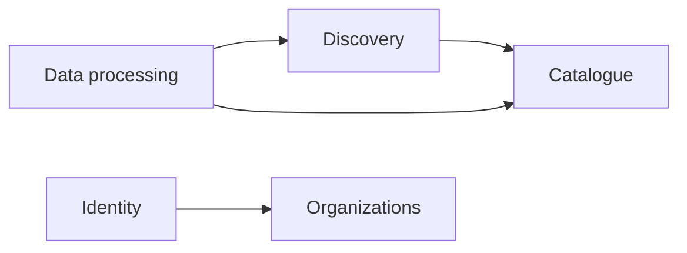

# Data model

Source of truth for the resources the system stores, which domain owns each one, and the rules they follow. The data model review in Claude Docs is where changes are worked out first. Once a change is agreed, this file is updated.

2026-11-23 · Meiring

## Terms

| Term | Meaning |
| --- | --- |
| Experience | Something a traveller can go to or do: a concert, a market, a show with many dates, an exhibition, a festival, a season such as whale watching |
| Domain event | Something that happened inside the system that another domain may care about. Never used for an experience |
| Listing | One item a source publishes: an API event, a web page, a post or a PDF calendar. Discovery keeps one record per listing and fetches it again on every run. A listing can describe one experience or several |
| Raw listing | One version of a listing's content, exactly as the source returned it, before any processing |
| Location | A place the system covers and clients search near, such as Hermanus |
| Tenant | A client organisation: a travel agency or travel app |

## Ownership

Each domain owns its tables and has one repository. Only that repository writes the domain's tables. A domain that needs another domain's data calls that domain's service; nothing is copied or kept in sync. All tables are in one Postgres database.

Arrows point from the service that calls to the service it calls. Catalogue and Organizations call nobody, so there are no cycles.

| Domain | Repository | What it holds |
| --- | --- | --- |
| Catalogue | Catalogue repository | Locations; published experiences with their sessions, attribute values, tags, source links and change history |
| Data processing | Data processing repository | Attribute definitions and their options, tags |
| Discovery | Discovery repository | Sources, runs, listings, raw listings |
| Organizations | Organizations repository | Tenants, their kind, status and configuration |
| Identity | Better Auth | People and agents, credentials, sessions |

How listings are fetched is in [discovery.md](discovery.md). How a raw listing becomes experiences is in [data-processing.md](data-processing.md).

## Catalogue

### Location

A place the system covers. System-managed and shared by every tenant.

- **Holds:** name, slug, country, region, timezone, centre point.
- **Rules:** the slug is unique. A location belongs to no tenant. Moving its centre changes no experience.

### Experience

The thing a client searches. System-managed and visible to every tenant. Every experience comes from discovery; clients only read. Catalogue creates an experience's ID when Data processing first saves it, and the ID never changes.

- **Holds:**
  - title, slug, summary, description
  - type: single, run (several consecutive days), recurring, season
  - status and booking (below)
  - when: start and end date, date precision (day, month, year), times, timezone, recurrence rule, opening hours, season months
  - where: location, venue name and address, city, position
  - price range, currency, on-sale time, booking close time, booking link, image
  - version
- **Rules:**
  - Belongs to one location. Stores no distance; distance comes from the caller's point and radius at query time.
  - Only a recurring experience can be open-ended. A recurring experience needs a recurrence rule, and a season needs its months.
  - Month and year precision dates sit on month and year boundaries, and times need day precision.
  - The version goes up on every real change, including changes to its sessions, attributes, tags and source links. Re-verifying a source does not count as a change, and an update that changes nothing doesn't bump the version.
  - An experience is not deleted while a source still lists it. There is no soft delete.
  - When its last source link is removed because no source lists it any more, the experience is set to Removed, unless it is already Past or Cancelled (see [discovery.md](discovery.md)).

Stored with each experience, in their own tables:

| Part | What it is | Rules |
| --- | --- | --- |
| Session | One dated occurrence of the experience (a show night, a market day) | Has its own start, end and label. Can be cancelled or sold out on its own |
| Attribute value | The experience's value for an attribute, such as its category | The value fits the attribute's type. A single-valued attribute has one value per experience |
| Tag | A tag on the experience | A tag appears once per experience |
| Source link | A listing that this experience was built from | One experience can have links from many listings and sources. A listing can link to several experiences, with at most one link to each. Data processing matches listings by these links |
| Change | One row per version: when, what kind of change, and the previous values | Written automatically on every version. Feeds changed-since (UC2) |

### Experience status

Two fields say where an experience stands: status says whether it is happening, and booking says whether it can be booked.

| Status | Means | Set by | Can move to |
| --- | --- | --- | --- |
| Expected | Likely to happen, not yet announced (an annual festival) | Data processing | Announced, Confirmed, Cancelled, Removed, Past |
| Announced | Announced; dates or details may still change | Data processing | Confirmed, Postponed, Cancelled, Removed, Past |
| Confirmed | Dates fixed and going ahead | Data processing | Postponed, Cancelled, Removed, Past |
| Postponed | Not happening on its dates; new dates unknown | Data processing | Announced, Confirmed (with new dates), Cancelled, Removed |
| Cancelled | The organisers cancelled it, and a source says so | Data processing | Nothing. Final |
| Removed | No source lists it any more, and it had not happened yet. The reason is not known | Catalogue, when the last source link is removed | Nothing. Final |
| Past | It is over: its last date has passed | Catalogue, on a schedule | Nothing. Final |

- Cancelled is only for an experience its organisers cancelled. A listing that disappears never makes an experience Cancelled; it makes it Removed.
- Catalogue sets an Expected, Announced or Confirmed experience to Past once its last date has passed. An experience with no last date, such as an open-ended recurring one, never becomes Past. A Postponed experience has no dates that still apply, so it does not become Past.
- Past and Cancelled experiences keep their status when their source links are removed. Sources drop listings that are over, and that changes nothing.

| Booking | Means | Allowed when status is |
| --- | --- | --- |
| None | Nothing to book: a market, a beach, a season | Any |
| Not yet | Will be bookable; the on-sale time says when, if known | Expected, Announced, Confirmed |
| Open | Can be booked now through the booking link | Confirmed |
| Sold out | Booking was open and nothing is left | Confirmed |
| Closed | Booking has ended | Any |

- Booking becomes Closed when the booking window has passed: Data processing sets it when a source says booking has ended, and Catalogue sets it when the booking close time passes.
- Moving to Postponed, Cancelled, Removed or Past sets booking to Closed, unless it is None.
- A session has a status (Scheduled or Cancelled) and can be Sold out while the experience stays Open.

What each status allows:

| Status | Returned by search (UC1) | Can be booked | Reported by changed-since (UC2) |
| --- | --- | --- | --- |
| Expected | Yes | No | Yes |
| Announced | Yes | No | Yes |
| Confirmed | Yes | Yes, while booking is Open | Yes |
| Postponed | Yes | No | Yes |
| Cancelled | No | No | Yes, as Cancelled |
| Removed | No | No | Yes, as Removed |
| Past | No | No | No |

- An experience is bookable only when status is Confirmed and booking is Open. Everything else is info only.
- A client can filter search to bookable experiences. An experience whose booking is Closed or Sold out is left out of that filter, and stays in search as info only while its status allows.

| Change | Reported by changed-since as |
| --- | --- |
| First published | New |
| Expected or Announced to Confirmed | Confirmed |
| Dates changed, or Postponed to new dates | Rescheduled |
| To Postponed | Postponed |
| To Cancelled | Cancelled |
| To Removed | Removed |
| To Past | Not reported |
| Anything else, booking included | Changed |

### Catalogue settings

System settings are environment variables, read through the settings provider (see [architecture.md](architecture.md)).

| Setting | Default | Meaning |
| --- | --- | --- |
| `CATALOGUE_PAST_CHECK_INTERVAL_MINUTES` | 60 | How often Catalogue moves finished experiences to Past and closes bookings whose close time has passed |
| `SEARCH_DEFAULT_RADIUS_KM` | 25 | The radius used when a client's search gives none |
| `SEARCH_MAX_RADIUS_KM` | 200 | The largest radius a client may ask for |

## Data processing

### Attributes and tags

A configurable list in the database that every experience is classified with. Attributes, their options and tags are rows, not enums: a category is added by adding a row, with no change to code or the schema. The system starts with a default set, listed in [data-processing.md](data-processing.md).

- **Attribute:** a key, a name, a description, a type (option, text, number, true/false, date), a default value, whether it takes several values, and whether clients can filter on it. Categories are an option attribute.
- **Attribute option:** an allowed value of an option attribute, with a description.
- **Tag:** a name, a slug and a description. Not tenant-scoped, and not freeform per tenant.

The description is the context the classifier reads to decide when a definition applies. Classification is improved by adding definitions or rewording descriptions.

## Discovery

Sources, runs, listings and raw listings are defined in [discovery.md](discovery.md).

## Organizations

### Tenant

- **Holds:** name, slug, kind (travel agency, travel app), status (active, suspended), configuration.

Users, membership and roles use Better Auth's own tables in v1, with no abstraction over them.

## Identity

Better Auth's tables hold users, sessions and accounts. Identity also records whether each caller is a person or an agent. Agents have the same access as clients and no separate role.

## Domain event log

Nothing in the prototype depends on domain events: domains call each other's services. Version 1 defines domain events only for sourcing and processing experiences: `raw_listing.captured` and `experience.processed`. Naming and the envelope are in [domain-events.md](domain-events.md).

## Decisions

| Decision | |
| --- | --- |
| Terms | "Experience" is the thing a traveller goes to; "event" means domain event only |
| Domain event names | `resource.verb`, lowercase, verb in the past tense |
| Domain events defined | Only for sourcing and processing experiences. Locations, tenants and users raise none |
| Listings | Discovery keeps one lasting record per listing and fetches it again on every run. Raw listings are the versions of its content |
| Locations | System-managed places the system covers, owned by Catalogue, not tied to a tenant |
| Experiences | System-managed and visible to every tenant |
| Client access | Read only. Clients cannot create or change experiences |
| Attributes and tags | Data processing owns the definitions: a configurable list in the database of attributes with a name, a description, a type and a default value, their options, and tags. They are rows with a default set, not enums. Catalogue owns each experience's attribute values and tags, which are what clients query |
| Distance | Not stored. Worked out at query time from the caller's point and radius |
| Deletion | No soft delete. An experience is not deleted while a source still lists it |
| Status | Status and booking are separate fields, as defined under Experience status. Cancelled means cancelled by the organisers. Removed means no source lists it any more. Past means it is over. All three are final and left out of search |
| Auth | Better Auth and its own tables in v1 |
| Domain dependencies | Services call each other's services. No table holds a copy of another domain's data, and no domain event is needed for the hand-off between domains |
| Raw content | Stored in Postgres in a `text` column, so JSON and HTML both fit and the copy stays exact. **Later:** move raw content to MinIO (S3) and store a key instead |
| Trip context | None. The system is an experience feed that serves results from the caller's search parameters |

## Open questions

- [ ] Does the prototype append domain events to the `events` table as an audit trail? Nothing reads them.

- [ ] If Better Auth's organization plugin is used, its organization and member tables overlap the tenant. Which one holds the tenant?
- [ ] A season has months and no dates, but only a recurring experience may be open-ended. A run is several consecutive days, but a show with 81 dates can skip days. Do the type rules allow both?
- [ ] A change row has one kind, but one version can both confirm an experience and move its dates. Which kind does changed-since report?
- [ ] An experience always has a location (Hermanus), but its own map position (the venue's coordinates) is optional, and radius search uses that position. When an experience has no position, should search use its location's centre instead, or must every experience have its own position?
