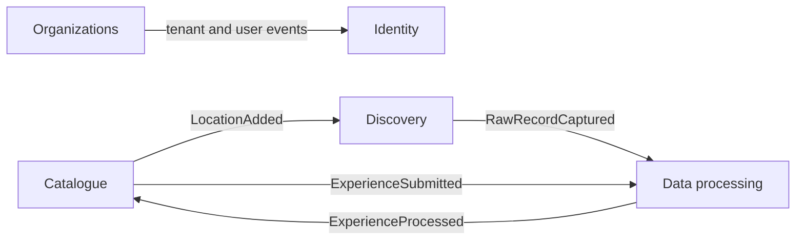

# Data model

Source of truth for the resources the system stores, which domain owns each one, and the rules they follow. The data model review in Claude Docs is where changes are worked out first. Once a change is agreed, this file is updated.

2026-11-23 · Meiring

## Terms

| Term | Meaning |
| --- | --- |
| Experience | Something a traveller can go to or do: a concert, a market, a show with many dates, an exhibition, a festival, a season such as whale watching |
| Domain event | Something that happened inside the system that another domain may care about. Never used for an experience |
| Listing | One experience as a single source publishes it |
| Raw listing | A listing exactly as the source returned it, before any processing |
| Location | A place the system covers and clients search near, such as Hermanus |
| Tenant | A client organisation: a travel agency, travel app or event organiser |

## Ownership

Each domain owns its resources. Only that domain's repositories write its tables, and no domain reads another domain's tables. Domains share data only through domain events, and a domain that needs another's data keeps its own copy.

| Domain | Aggregate | Repository | What it holds |
| --- | --- | --- | --- |
| Catalogue | Location | Location repository | Places the system covers |
| Catalogue | Experience | Experience repository | Published experiences, their sessions, attributes, tags, source links and change history |
| Catalogue | Submission | Submission repository | An organiser's create or change request |
| Data processing | Vocabulary | Vocabulary repository | Attributes (categories), their options, and tags |
| Data processing | Incoming listing | Incoming listing repository | Each listing or submission received for processing |
| Data processing | Processed experience | Processed experience repository | The canonical experience and its listing links |
| Discovery | Source | Source repository | Sources and which locations each covers |
| Discovery | Run | Run repository | Runs and the raw listings each one captured |
| Discovery | Covered location | Covered location repository | Discovery's copy of Catalogue's locations |
| Organizations | Tenant | Tenant repository | Tenants, their kind, status and configuration |
| Identity | User, session, account | Better Auth | People and agents, credentials, sessions |

Every domain also has a read position on the domain event log, owned by that domain.

## Catalogue

### Location

A place the system covers. System-managed and shared by every tenant.

- **Holds:** name, slug, country, region, timezone, centre point.
- **Rules:** the slug is unique. A location belongs to no tenant. Moving its centre changes no experience.
- **Raises:** LocationAdded.

### Experience

The aggregate root for everything a client searches. System-managed and visible to every tenant, organiser experiences included.

- **Holds:**
  - title, slug, summary, description
  - type: single, run (several consecutive days), recurring, season
  - status and booking (below)
  - when: start and end date, date precision (day, month, year), times, timezone, recurrence rule, opening hours, season months
  - where: location, venue name and address, city, position
  - price range, currency, on-sale time, booking link, image
  - version
- **Rules:**
  - Belongs to one location. Stores no distance; distance comes from the caller's point and radius at query time.
  - Only a recurring experience can be open-ended. A recurring experience needs a recurrence rule, and a season needs its months.
  - Month and year precision dates sit on month and year boundaries, and times need day precision.
  - The version goes up on every real change, including changes to its sessions, attributes, tags and source links. Re-verifying a source does not count as a change, and an update that changes nothing doesn't bump the version.
  - An experience is not deleted while a source still lists it. There is no soft delete.

Parts of the aggregate, stored in their own tables:

| Part | What it is | Rules |
| --- | --- | --- |
| Session | One dated occurrence of the experience (a show night, a market day) | Has its own start, end and label. Can be cancelled or sold out on its own |
| Attribute value | The experience's value for a vocabulary attribute, such as its category | The value fits the attribute's type. A single-valued attribute has one value per experience |
| Tag | A vocabulary tag on the experience | A tag appears once per experience |
| Source link | A source's listing that this experience was built from | One experience can have links from many sources. A source's listing links to one experience only |
| Change | One row per version: when, what kind of change, and the previous values | Written automatically on every version. Feeds changed-since (UC2) |

### Submission

An organiser's request to create or change an experience. The experience itself has no tenant. The submission records which tenant submitted it, and that is what lets the tenant maintain it.

- **Holds:** tenant, experience (empty until first published), the submitted details, status, rejection reason, submitted and processed times.
- **Status:** pending, processed, rejected. A rejection has a reason.
- **Raises:** ExperienceSubmitted.

### Experience status

Three separate questions get three separate fields: is it happening (status), can it be booked (booking), and is it over (worked out from the dates).

| Status | Means | Set by | Can move to |
| --- | --- | --- | --- |
| Expected | Likely to happen, not yet announced (an annual festival) | Data processing only | Announced, Confirmed, Cancelled |
| Announced | Announced; dates or details may still change | Data processing, or the organiser | Confirmed, Postponed, Cancelled |
| Confirmed | Dates fixed and going ahead | Data processing, or the organiser | Postponed, Cancelled |
| Postponed | Not happening on its dates; new dates unknown | Data processing, or the organiser | Announced, Confirmed (with new dates), Cancelled |
| Cancelled | Will not happen | Data processing, or the organiser | Nothing. Final |

| Booking | Means | Allowed when status is |
| --- | --- | --- |
| None | Nothing to book: a market, a beach, a season | Any |
| Not yet | Will be bookable; the on-sale time says when, if known | Any except Cancelled |
| Open | Can be booked now through the booking link | Confirmed |
| Sold out | Booking was open and nothing is left | Confirmed |
| Closed | Booking has ended | Any |

- An experience is bookable only when status is Confirmed and booking is Open. Everything else is info only.
- Postponing or cancelling sets booking to Closed.
- Past is not a status. An experience is past when its last date has passed.
- Search (UC1) returns Expected, Announced, Confirmed and Postponed experiences. It leaves out Cancelled and past ones.
- A session has a status (Scheduled or Cancelled) and can be Sold out while the experience stays Open.

| Change | Reported by changed-since as |
| --- | --- |
| First published | New |
| Expected or Announced to Confirmed | Confirmed |
| Dates changed, or Postponed to new dates | Rescheduled |
| To Postponed | Postponed |
| To Cancelled | Cancelled |
| Anything else, booking included | Changed |

## Data processing

### Vocabulary

The single set of attributes and tags every experience is described with. System-managed.

- **Attribute:** a key, a label, a type (option, text, number, true/false, date), whether it takes several values, and whether clients can filter on it. Categories are an option attribute.
- **Attribute option:** an allowed value of an option attribute.
- **Tag:** a name and slug. Not tenant-scoped, and not freeform per tenant.

### Incoming listing

One row for each RawRecordCaptured or ExperienceSubmitted that Data processing receives.

- **Holds:** where it came from (discovery or submission) and its ID there, received time, status, attempts, error, the experience it produced.
- **Status:** pending, processed, rejected, failed.
- **Rules:** the origin plus its ID is unique, so a domain event delivered twice is processed once.

### Processed experience

The canonical experience Data processing builds, before Catalogue publishes it. Our ID for an experience is created here once, the first time a listing matches nothing. It never changes, and Catalogue publishes under the same ID.

- **Listing link:** source, the source's listing ID, the raw listing it came from, the matching rule that linked it, and when.
- **Rules:** a source's listing ID links to one experience. If a source has no listing ID, its web address is used instead.
- **Matching:** a listing whose source and ID are already linked updates that experience. Otherwise Data processing compares place, dates, title and venue against existing experiences, and either links the listing or creates a new experience. Organiser submissions are matched the same way.
- **Raises:** ExperienceProcessed.

## Discovery

### Source

A site or feed that publishes experiences: a ticketing site, a tourism listing, a venue page, an API.

- **Holds:** name, kind, base address, fetch settings, status.
- **Source coverage:** which locations a source covers, with settings for each location.

### Run

One visit to one source for one location, on the schedule.

- **Holds:** source, location, start and finish times, status, number of listings found, error.

### Raw listing

A listing exactly as the source returned it on a run: a JSON response, an HTML page, or a feed item.

- **Holds:** run, source, location, the source's listing ID, address, fetched time, content type, the content itself, a fingerprint of the content.
- **Rules:** never changed after it is saved. If the fingerprint matches the last copy of the same listing, nothing is passed on.
- **Raises:** RawRecordCaptured, in the same transaction as the save.

### Covered location

Discovery's copy of a Catalogue location, built from LocationAdded, so it knows where to look.

## Organizations

### Tenant

- **Holds:** name, slug, kind (travel agency, travel app, event organiser), status (active, suspended), configuration.
- **Raises:** TenantCreated, TenantSuspended, UserAdded, RoleChanged, UserRemoved.

Users, membership and roles use Better Auth's own tables in v1, with no abstraction over them.

## Identity

Better Auth's tables hold users, sessions and accounts. Identity also records whether each caller is a person or an agent. Agents have the same access as clients and no separate role.

## Domain event log

The repo's append-only `events` table, ordered by global position. Each domain records how far it has read the log, so it can stop and resume without missing or repeating a domain event.

| Domain event | Raised by | Read by |
| --- | --- | --- |
| LocationAdded | Catalogue | Discovery |
| RawRecordCaptured | Discovery | Data processing |
| ExperienceSubmitted | Catalogue | Data processing |
| ExperienceProcessed | Data processing | Catalogue |
| TenantCreated | Organizations | Identity |
| UserAdded | Organizations | Identity |
| RoleChanged | Organizations | Identity |
| UserRemoved | Organizations | Identity |
| TenantSuspended | Organizations | Identity |

## Decisions

| Decision | |
| --- | --- |
| Terms | "Experience" is the thing a traveller goes to; "event" means domain event only |
| Locations | System-managed places the system covers, owned by Catalogue, not tied to a tenant |
| Experiences | System-managed and visible to every tenant. Organiser ownership lives on the submission |
| Vocabulary | One system-managed set of attributes and tags |
| Distance | Not stored. Worked out at query time from the caller's point and radius |
| Deletion | No soft delete. An experience is not deleted while a source still lists it |
| Status | Status, booking and past are separate, as defined under Experience status |
| Auth | Better Auth and its own tables in v1 |
| Admin review | No review of organiser experiences in v1 |
| Trip context | None. The system is an experience feed that serves results from the caller's search parameters |

## Open questions

- [ ] Does the `events` log carry the domain events above, and could the experience change history be read from it instead of its own table?
- [ ] If Better Auth's organization plugin is used, its organization and member tables overlap the tenant. Which one holds the tenant?
- [ ] Must every experience have a position? Without one it can never match a radius search.
- [ ] Does a raw listing's content live in Postgres or in object storage behind a reference?
- [ ] How does Catalogue get the vocabulary it filters on, and how do clients list it?
