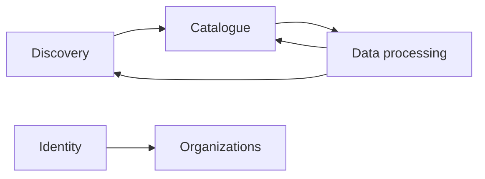

# Data model

Source of truth for the resources the system stores, which domain owns each one, and the rules they follow. The data model review in Claude Docs is where changes are worked out first. Once a change is agreed, this file is updated.

2026-11-23 · Meiring

## Terms

| Term | Meaning |
| --- | --- |
| Experience | Something a traveller can go to or do: a concert, a market, a show with many dates, an exhibition, a festival |
| Session | One unbroken stretch of time an experience is on: a show night, a market day, a three-day festival. An experience's dates are its sessions |
| Season | A named period of the year in one location, such as whale season in Hermanus. Predefined data, not an experience |
| Domain event | A stored record of something that happened inside the system. Never used for an experience |
| Listing | One item a source publishes: an API event, a web page, a post or a PDF calendar. Discovery keeps one record per listing and fetches it again on every run. A listing can describe one experience or several |
| Raw listing | One version of a listing's content, exactly as the source returned it, before any processing |
| Location | A place the system covers and clients search near, such as Hermanus |
| Tenant | A client organisation: a travel agency or travel app |

## Ownership

Each domain owns its tables and has one repository. Only that repository writes the domain's tables. A domain that needs another domain's data calls that domain's service; nothing is copied or kept in sync. All tables are in one Postgres database.

Arrows point from the service that calls to the service it calls. Catalogue and Data processing call each other: Data processing saves experiences through Catalogue, and Catalogue reads the attribute definitions and the tag and season slugs from Data processing to check a search's filters. Organizations calls nobody.

| Domain | Repository | What it holds |
| --- | --- | --- |
| Catalogue | Catalogue repository | Locations; published experiences with their sessions, attribute values, tags, source links and change history |
| Data processing | Data processing repository | Attribute definitions and their options, tags, seasons |
| Discovery | Discovery repository | Sources, runs, listings, raw listings |
| Organizations | Organizations repository | Tenants, their kind, status and configuration |
| Identity | Better Auth | People and agents, credentials, sessions |

How listings are fetched is in [discovery.md](discovery.md). How a raw listing becomes experiences is in [data-processing.md](data-processing.md).

## Catalogue

### Location

A place the system covers. System-managed and shared by every tenant.

- **Holds:** name, slug, country, region, timezone, centre point.
- **Rules:** the slug is unique. A location belongs to no tenant. Moving its centre changes no experience.

### Experience

The thing a client searches. System-managed and visible to every tenant. Every experience comes from discovery; clients only read. Catalogue creates an experience's ID when Data processing first saves it, and the ID never changes.

- **Holds:**
  - title, slug, summary, description
  - type: single, run, recurring (see Dates and sessions)
  - status and booking (below)
  - when: its sessions, its recurrence if it is recurring, timezone, opening hours (see Dates and sessions)
  - where: location, venue name and address, city, position
  - price range, currency, on-sale time, booking close time, booking link, image, its own page address if it has one
  - version
- **Rules:**
  - Belongs to one location. Stores no distance; distance comes from the caller's point and radius at query time.
  - Its dates are its sessions, and it is on no other date (see Dates and sessions).
  - A price of 0 and 0 means it is free. An empty price means the source states none. A lowest price of 0 beside a higher one means some get in free, such as children (see Price in [data-processing.md](data-processing.md)).
  - The version goes up on every real change, including changes to its sessions, attributes, tags and source links. Re-verifying a source does not count as a change, and an update that changes nothing doesn't bump the version. Sessions that Catalogue generates further ahead for an open-ended recurring experience do not count as a change either.
  - An experience is not deleted while a source still lists it. There is no soft delete.
  - When its last source link is removed because no source lists it any more, the experience is set to Removed, unless it is already Past or Cancelled (see [discovery.md](discovery.md)).

Stored with each experience, in their own tables:

| Part | What it is | Rules |
| --- | --- | --- |
| Session | One unbroken stretch of time the experience is on (a show night, a market day, a three-day festival) | Every date the experience is on is inside a session. Can be cancelled or sold out on its own (see Dates and sessions) |
| Attribute value | The experience's value for an attribute, such as its category | The value fits the attribute's type. A single-valued attribute has one value per experience |
| Tag | A tag on the experience | A tag appears once per experience |
| Source link | A listing that this experience was built from | One experience can have links from many listings and sources. A listing can link to several experiences, with at most one link to each. Data processing matches listings by these links |
| Change | One row per version: when, what kind of change, and the previous values | Written automatically on every version. When the dates changed, the previous values hold every session the experience had, generated ones included. Feeds changed-since (UC2) |

### Dates and sessions

An experience's dates are its sessions. Every date it is on is inside a session, and it is on no other date. Its first date is the start of its first session and its last date is the end of its last one. An open-ended recurring experience has no last date.

A session is one unbroken stretch of time: a show night, a market day, a three-day festival, the year an exhibition is open.

- **Holds:** start and end date, precision (day, month, year), start and end time, label, status (Scheduled, Cancelled), sold out, and whether a source listed it or Catalogue generated it from a recurrence.
- **Day precision.** The session covers every day from its start to its end. A day the experience is not on is never inside a session.
- **Month or year precision.** The experience is on in that month or year and its days are not announced yet, such as FynArts in June 2027. The session sits on month or year boundaries and has no times. When the days are announced, it is replaced by sessions with day precision.

The type says how an experience's sessions are known:

| Type | Is | Its sessions |
| --- | --- | --- |
| Single | Happens once, in one stretch: a concert, a match, a three-day festival, an exhibition open for a year | One session |
| Run | Several set dates, in a row or not: a show with 81 dates, or a show on Thursdays for three weeks and on Wednesdays for the two weeks after | One session per date, exactly as the source lists them. Nothing is filled in between |
| Recurring | Repeats by a rule, with or without an end: a market every Saturday | Generated by Catalogue from its recurrence, plus any extra dates a source lists |

A recurring experience holds its recurrence:

- **Holds:** the rule, written as an iCalendar recurrence rule such as `FREQ=WEEKLY;BYDAY=SA`, the first date, the last date, the start and end time, and the skipped dates.
- **Open-ended.** A recurrence with no last date is open-ended. Only a recurring experience can be open-ended.
- **Skipped dates** are dates the rule gives on which a source says the experience is not on, such as a Saturday market that skips 25 December. No session is generated for them.
- **Extra dates.** A date a source lists outside the rule, such as one Wednesday market before Christmas, is a listed session.
- **Generated sessions.** Catalogue generates one session for every date the rule gives, from the first date to the last, leaving out the skipped dates. For an open-ended recurrence it generates as far ahead as `CATALOGUE_SESSION_HORIZON_MONTHS`, and adds more as time passes, on the same schedule that moves experiences to Past.
- **When the recurrence changes,** Catalogue generates the sessions from today on again. Listed sessions are left as they are.

Search by dates:

- An experience is returned for the dates a client asks for only when one of its sessions overlaps them and that session is not Cancelled. Search never matches on the span from an experience's first date to its last, so a show that is on only on Thursdays is not returned for a Tuesday.
- The result carries the sessions that matched, so the client sees which dates inside its range the experience is on.
- A session with month or year precision matches any dates inside its month or year. Its precision is returned, so the client knows the days are not announced.
- An open-ended recurring experience is not returned for dates beyond the session horizon, because it has no sessions there yet.

### Experience status

Two fields say where an experience stands: status says whether it is happening, and booking says whether it can be booked.

| Status | Means | Set by | Can move to |
| --- | --- | --- | --- |
| Expected | Likely to happen, not yet announced (an annual festival) | Data processing | Announced, Confirmed, Cancelled, Removed, Past |
| Announced | Announced; dates or details may still change | Data processing | Confirmed, Postponed, Cancelled, Removed, Past |
| Confirmed | Dates fixed and going ahead | Data processing | Postponed, Cancelled, Removed, Past |
| Postponed | Not happening on its dates; new dates unknown | Data processing | Announced, Confirmed (with new dates), Cancelled, Removed |
| Cancelled | The organisers cancelled it, and a source says so | Data processing | Nothing. Final |
| Removed | No source lists it any more, and it had not happened yet. The reason is not known | Catalogue, when the last source link is removed | Nothing. Final |
| Past | It is over: its last date has passed | Catalogue, on a schedule | Nothing. Final |

- Cancelled is only for an experience its organisers cancelled. A listing that disappears never makes an experience Cancelled; it makes it Removed.
- Catalogue sets an Expected, Announced or Confirmed experience to Past once its last date has passed. An experience with no last date, such as an open-ended recurring one, never becomes Past. A Postponed experience has no dates that still apply, so it does not become Past.
- Past and Cancelled experiences keep their status when their source links are removed. Sources drop listings that are over, and that changes nothing.

| Booking | Means | Allowed when status is |
| --- | --- | --- |
| None | Nothing to book: a market, a beach | Any |
| Not yet | Will be bookable; the on-sale time says when, if known | Expected, Announced, Confirmed |
| Open | Can be booked now through the booking link | Confirmed |
| Sold out | Booking was open and nothing is left | Confirmed |
| Closed | Booking has ended | Any |

- Booking becomes Closed when the booking window has passed: Data processing sets it when a source says booking has ended, and Catalogue sets it when the booking close time passes.
- Moving to Postponed, Cancelled, Removed or Past sets booking to Closed, unless it is None.
- A session has a status (Scheduled or Cancelled) and can be Sold out while the experience stays Open.

What each status allows:

| Status | Returned by search (UC1) | Can be booked | Reported by changed-since (UC2) |
| --- | --- | --- | --- |
| Expected | Yes | No | Yes |
| Announced | Yes | No | Yes |
| Confirmed | Yes | Yes, while booking is Open and it has a link to book through | Yes |
| Postponed | Yes | No | Yes |
| Cancelled | No | No | Yes, as Cancelled |
| Removed | No | No | Yes, as Removed |
| Past | No | No | No |

- An experience is bookable only when status is Confirmed, booking is Open, and it has a link to book through: its booking link, or failing that its own page address. Everything else is info only. One that is Confirmed and Open with neither link gives a planner nothing to act on, so it is not bookable.
- A client can filter search and changed-since to bookable experiences. The filter and the `bookable` flag on each result follow the same rule, so the filter returns exactly the results marked bookable. An experience whose booking is Closed or Sold out, or that has no link to book through, is left out of that filter, and stays in search as info only while its status allows.

| Change | Reported by changed-since as |
| --- | --- |
| First published | New |
| Expected or Announced to Confirmed | Confirmed |
| Dates changed, or Postponed to new dates | Rescheduled |
| To Postponed | Postponed |
| To Cancelled | Cancelled |
| To Removed | Removed |
| To Past | Not reported |
| Anything else, booking included | Changed |

Dates changed means a session was added, moved or removed, or the recurrence changed.

Changed-since takes the same search parameters as a search, without the query text, and the time of the client's last search. It returns one entry for each experience with a change since then, the most recent change first. Each entry carries:

- **The change that matters most to a planner:** the first that applies of cancelled, removed, postponed, rescheduled, confirmed, new and changed. An experience first published since then is New, unless it has since been cancelled or removed.
- **Every change since then,** newest first.

Status and bookable narrow only the experiences that are going ahead. A Cancelled or Removed experience that matches the place, dates, attributes and tags is always reported. It is matched on its sessions in the dates, whatever each session's status.

An experience the client saw for its dates and that has since moved out of them is reported too, because that is the change a planner most needs to hear:

- **Matched on its sessions as they were.** Its first change row after the time given that holds previous sessions holds them as they were at that time. If one of them was Scheduled and overlapped the dates, the experience is reported, with the change kind it got, usually Rescheduled. One first published after that time was never seen by the client, so it is not matched this way. Place, attributes, tags, status and bookable apply as above, to the experience as it is now.
- **Marked as moved out.** An entry whose experience has no session in the dates now (no Scheduled one, or none at all for a Cancelled or Removed one) carries `movedOut: true`. Its sessions are then the ones it has now, all outside the dates: where it moved to, or none when it has no dates left. Every other entry has `movedOut: false` and carries its sessions in the dates.

### Catalogue settings

System settings are environment variables, read through the settings provider (see [architecture.md](architecture.md)).

| Setting | Default | Meaning |
| --- | --- | --- |
| `CATALOGUE_UPKEEP_CRON` | `0 * * * *` | When Catalogue's upkeep runs, as a cron expression in UTC: every hour. The upkeep moves finished experiences to Past, closes bookings whose close time has passed, and generates the sessions of open-ended recurring experiences further ahead |
| `CATALOGUE_SESSION_HORIZON_MONTHS` | 24 | How far ahead Catalogue generates the sessions of an open-ended recurring experience. Trips are booked up to 18 months ahead |
| `SEARCH_DEFAULT_RADIUS_KM` | 60 | The radius used when a client's search gives none. Wide enough to reach the neighbouring towns a location's sources cover, such as Gansbaai and Pringle Bay from Hermanus |
| `SEARCH_MAX_RADIUS_KM` | 200 | The largest radius a client may ask for |

## Data processing

### Attributes and tags

A configurable list in the database that every experience is classified with. Attributes, their options and tags are rows, not enums: a category is added by adding a row, with no change to code or the schema. The system starts with a default set, listed in [data-processing.md](data-processing.md).

- **Attribute:** a key, a name, a description, a type (option, text, number, true/false, date), a default value, whether it takes several values, and whether clients can filter on it. Categories are an option attribute.
- **Attribute option:** an allowed value of an option attribute, with a description.
- **Tag:** a name, a slug and a description. Not tenant-scoped, and not freeform per tenant.

The description is the context the classifier reads to decide when a definition applies. Classification is improved by adding definitions or rewording descriptions.

### Season

A named period of the year in one location, such as whale season in Hermanus. Seasons are predefined rows. A season has no source, and it is not an experience or an experience type.

- **Holds:** name, slug, description, the location it applies to, its dates.
- **Rules:** while it processes, Data processing gives each experience the seasons of its location that all of its dates fall inside, as tags (see [data-processing.md](data-processing.md)). Catalogue stores them with the experience's other tags. The tag is on the experience, not on a session, so a market that runs all year carries no season.
- The system starts with whale season, South African school holidays, high season, and summer, autumn, winter and spring. Their dates are rows.

## Discovery

Sources, runs, listings and raw listings are defined in [discovery.md](discovery.md).

## Organizations

### Tenant

- **Holds:** name, slug, kind (travel agency, travel app), status (active, suspended), configuration.

Users, membership and roles use Better Auth's own tables in v1, with no abstraction over them.

## Identity

Better Auth's tables hold users, sessions and accounts. Identity also records whether each caller is a person or an agent. Agents have the same access as clients and no separate role.

## Domain event log

The `events` table is an append-only record of what happened to raw listings and experiences. Discovery appends a domain event when it saves a raw listing and when one is marked processed, failed or superseded. Catalogue appends one with every version of an experience. Each is written in the same transaction as the change it records.

The table belongs to no domain: a domain's repository appends its own domain events, and nothing reads the table. The domain's service also publishes each one through the domain event port, once the change is saved. Domains call each other's services and no hand-off depends on a domain event. The names, the columns and the six domain events are in [domain-events.md](domain-events.md).

## Decisions

| Decision | |
| --- | --- |
| Terms | "Experience" is the thing a traveller goes to; "event" means domain event only |
| Domain event names | `resource.verb`, lowercase, verb in the past tense |
| Domain events defined | Six, only for sourcing and processing experiences, listed in [domain-events.md](domain-events.md). Locations, tenants and users raise none |
| Domain event log | Appended to the `events` table as a record of what happened, and published through the domain event port. Nothing reads the table, and nothing subscribes yet |
| Listings | Discovery keeps one lasting record per listing and fetches it again on every run. Raw listings are the versions of its content |
| Locations | System-managed places the system covers, owned by Catalogue, not tied to a tenant |
| Experiences | System-managed and visible to every tenant |
| Client access | Read only. Clients cannot create or change experiences |
| Attributes and tags | Data processing owns the definitions: a configurable list in the database of attributes with a name, a description, a type and a default value, their options, and tags. They are rows with a default set, not enums. Catalogue owns each experience's attribute values and tags, which are what clients query |
| Dates | An experience's dates are its sessions, and it is on no other date. Search by dates matches sessions, never the span from the first date to the last |
| Types | Single is one session. A run is one session per listed date, in a row or not. Recurring has a recurrence, from which Catalogue generates the sessions, with skipped and extra dates |
| Seasons | Not an experience and not an experience type. Predefined rows per location, owned by Data processing, and given as tags to the experiences whose dates all fall inside them |
| Distance | Not stored. Worked out at query time from the caller's point and radius |
| Position | An experience's own position, the venue's coordinates, is optional. One with no position is searched from its location's centre |
| Deletion | No soft delete. An experience is not deleted while a source still lists it |
| Bookable | Confirmed, booking Open, and a booking link or, failing that, the experience's own page address. The `bookable` flag and the bookable filter apply the same rule |
| Status | Status and booking are separate fields, as defined under Experience status. Cancelled means cancelled by the organisers. Removed means no source lists it any more. Past means it is over. All three are final and left out of search |
| Moved out of the dates | Changed-since matches an experience on its sessions now and on its sessions before the first change since the time given, read from that change row. One that matched only before is reported with `movedOut: true` and the sessions it has now |
| Change kind | A change row has one kind. When one version changes several things, it is the first that applies of cancelled, removed, postponed, rescheduled, confirmed and changed |
| Auth | Better Auth and its own tables in v1 |
| Tenant | Our own `tenant` table, owned by Organizations. A user's tenant and role are two fields on Better Auth's user table, and its organization plugin is not used. The seed creates the tenants, their users and their API keys. There is no sign-up. A system admin can also onboard a tenant through the API (UC4 in [architecture.md](architecture.md)) |
| Domain dependencies | Services call each other's services. No table holds a copy of another domain's data, and no domain event is needed for the hand-off between domains |
| Raw content | Stored in Postgres in a `text` column, so JSON and HTML both fit and the copy stays exact. **Later:** move raw content to MinIO (S3) and store a key instead |
| Trip context | None. The system is an experience feed that serves results from the caller's search parameters |

## Open questions

None. The working list is in [issues.md](issues.md).
