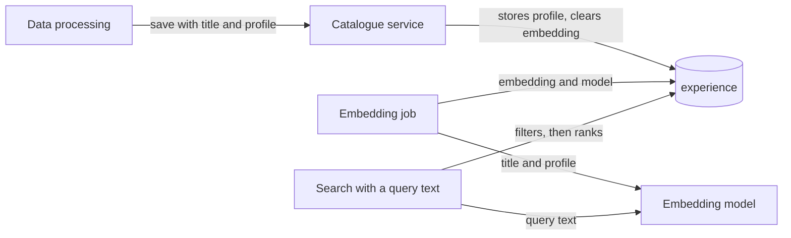

# Data processing

Source of truth for how a raw listing becomes published experiences, and for how a saved experience's profile is embedded and used to rank search results. How raw listings are fetched is in [discovery.md](discovery.md). The experience, its statuses and the other resources are defined in [data-model.md](data-model.md).

2026-11-23 · Meiring

## Overview

Data processing takes pending raw listings from Discovery and turns each one into zero or more experiences, which Catalogue saves. It does four things to a raw listing, in order: extract, classify, match, save. What it saved is then appended to the data warehouse.


Data processing owns the extractors, the classifier, the matching decision, and the attribute and tag definitions. Catalogue stores the experiences and Discovery stores the raw listings. Data processing's own tables are the definitions, the seasons, the data warehouse and the undefined values saved for review.

## Steps

One raw listing is processed in one transaction, from claim to mark. The claim locks the raw listing until the transaction ends, so no other worker, in this server or another, can claim it meanwhile. The work after the claim runs in a savepoint of that transaction. If the server stops part way, the transaction rolls back and the raw listing is pending again, with no attempt counted.

Processing runs as a job (see Background jobs in [architecture.md](architecture.md)). The job is added after a fetch that found something new, changed or gone, and once an hour as a safety net. It processes pending raw listings until none is left. When a raw listing fails, the job stops and the queue runs it again later, so a failing raw listing is not tried again at once.

1. **Claim.** Data processing claims a pending raw listing through the Discovery service. Only the latest version of a listing can be claimed (see Versions of a listing). The job keeps going while raw listings are pending. How many are processed side by side is a setting (see Settings). It comes with its source's kind and location, and Data processing gets the location (name, centre point, timezone) from the Catalogue service.
2. **Extract.** The extractor for the source's kind reads the content and returns zero or more extracted experiences (see Extractors).
3. **Classify.** Each extracted experience is given its attribute values, tags, seasons and profile (see Classification).
4. **Match.** Each extracted experience is matched to an existing experience or becomes a new one (see Matching).
5. **Save.** The Catalogue service saves each experience with its sessions, attribute values, tags, profile and source link. Catalogue bumps the version and writes the change row when something really changed.
6. **Append to the warehouse.** Data processing appends each experience it saved to the data warehouse (see Data warehouse).
7. **Mark.** Data processing marks the raw listing processed through the Discovery service.

Three cases need no extraction or end early:

- **Removed raw listing** (kind removed, no content). The Catalogue service removes that listing's link from every experience it was linked to. An experience left with no links is set to Removed by Catalogue.
- **Nothing extracted.** A post or page that describes no experience is marked processed. Any links the listing had are removed, as below.
- **Failure.** If any step fails, including a language model answer that does not fit the expected shape, the work rolls back to the savepoint, so nothing from that raw listing is saved to Catalogue and none of its domain events go out. It is then marked failed with the error and one more attempt in the same transaction, while the claim's lock is still held, so another worker cannot claim it before the attempt is counted, and each attempt is counted once. It goes back to pending until it reaches the source's max processing attempts.

### Versions of a listing

A listing can change twice before it is processed, so two of its versions can be waiting at once. Only the latest version of a listing can be claimed. An older version that is still pending or failed is set to Superseded and is never processed, so old values are never put back over newer ones.

### Processing again

Processed is not final. A listing can be processed again at any time: its latest version goes back to pending and runs through the same steps, and the experiences it links to are updated. That is how a listing picks up a fixed extractor or new definitions.

A system admin sends listings back from the command line, with `pipeline reprocess` and one of:

- `--listing ID`: one listing.
- `--experience ID`: every listing the experience is linked to. The experience is named by its ID or its slug.
- `--source NAME`: every listing of a source, by its name.
- `--location SLUG`: every listing of a location, by its slug.

Data processing works out what to send back, through the Catalogue service for an experience or a location and through the Discovery service for a source, and asks the Discovery service to send those listings back. For each selected listing that is still listed, Discovery sets its latest version back to pending, with its attempts at 0 and its error cleared.

- An older version is never sent back.
- A latest version that is already pending is left as it is, and a removed listing is skipped.
- An experience with no links has nothing to process again.
- Sending back raises no domain event. Processing raises `raw_listing.processed` as usual.
- It only sends listings back. The processing job picks them up, or `--now` processes them straight away.

Matching starts from the listing's own links, so processing again updates the experiences it is linked to and creates none twice. When nothing changed, an experience gets no new version.

## Extractors

An extractor is a plug-in, one per source kind, with the same kinds as Discovery's adapters. It turns one raw listing's content into extracted experiences. It does not classify, match or save.

Extractors are Data processing's own code, not adapters. The field-mapping ones reach nothing outside the domain, and the language model ones reach the model only through the language model port.

```ts
interface Extractor {
  kind: string;
  extract(input: {
    content: string;                    // the raw listing's content, as fetched
    contentType: string;
    url?: string;
    fetchedAt: Date;                    // resolves relative dates such as "this Saturday"
    location: Location;                 // the source's location, from the Catalogue service
  }): Promise<ExtractedExperience[]>;   // zero or more
}

interface ExtractedExperience {
  title: string;
  summary?: string;
  description?: string;
  type: "single" | "run" | "recurring";
  status: "expected" | "announced" | "confirmed" | "postponed" | "cancelled";
  booking: "none" | "not_yet" | "open" | "sold_out" | "closed";
  sessions: ExtractedSession[];         // the dates the listing lists: one for a single, one per date for a run, only the extra dates for a recurring experience
  recurrence?: {                        // for a recurring experience
    rule: string;                       // an iCalendar recurrence rule, such as FREQ=WEEKLY;BYDAY=SA
    start: string;                      // the first date
    end?: string;                       // the last date; left out when open-ended
    startTime?: string;
    endTime?: string;
    skipped?: string[];                 // dates the rule gives on which the listing says it is not on
  };
  openingHours?: string;
  venue?: { name?: string; address?: string; city?: string; position?: { lat: number; lng: number } };
  price?: { min?: number; max?: number; currency: string };
  onSaleAt?: string;
  bookingClosesAt?: string;
  bookingUrl?: string;
  imageUrl?: string;
  url?: string;                         // this experience's own page, if it has one: a link the listing gives, or the listing itself when it is a page about this experience alone. Saved as its page address
  hints: string[];                      // the source's own categories and labels, used by classification
}

interface ExtractedSession {
  start: string;                        // a date, a month or a year, to the precision given
  end?: string;                         // the last day, for a session of several days in a row
  precision: "day" | "month" | "year";
  startTime?: string;                   // times need day precision
  endTime?: string;
  label?: string;
  soldOut?: boolean;
  cancelled?: boolean;
}
```

The fields are the experience fields in [data-model.md](data-model.md). An extractor never returns Removed or Past; Catalogue sets those. A listing that describes several experiences is the own page of none of them, so the extractor drops a `url` that is the listing's own address when it returns more than one.

### Dates

An extractor returns the dates a listing gives and no others. Catalogue saves them as the experience's sessions, and search by dates matches only those (see Dates and sessions in [data-model.md](data-model.md)).

- **Listed dates** are returned as sessions, one per date. A show on Thursdays for three weeks and on Wednesdays for the two weeks after is five sessions. The days between a first and a last date are never filled in.
- **Several days in a row with no break**, such as a three-day festival or the period an exhibition is open, are one session with a start and an end.
- **A stated pattern**, such as "every Saturday" or "the first Friday of the month", is returned as a recurrence. The extractor does not work the pattern out into dates; Catalogue generates the sessions from the rule. Dates the listing says are skipped go in `skipped`, and dates it lists outside the pattern go in `sessions`.
- **Only a month or a year** is returned as one session with that precision.

| Kind | How it extracts | Returns |
| --- | --- | --- |
| Quicket | Maps the event's JSON fields in code | One experience |
| Ticketmaster | Maps the event's JSON fields in code | One experience |
| RSS feed | The language model, given the post's title and body as text | Every experience the post describes, often none |
| PDF calendar | The language model, given the PDF file itself | Every row that is an experience |
| Web page | The language model, given the page's visible text | Every experience on the page |

The three language model extractors share one implementation. Each kind only prepares the content differently. The model is given the content, the location's name and region, the fetch time and the extracted experience shape, and must answer in that shape. The model is reached through the language model port (see Ports).

Three things every extractor leaves out:

- **What is already over.** An experience whose last date is before the fetch time is not returned. A news post about last weekend produces nothing.
- **What is beyond the sourcing horizon.** An experience whose first date is more than `DISCOVERY_HORIZON_MONTHS` after the fetch time is not returned (see [discovery.md](discovery.md)). An open-ended recurring experience starts inside the horizon, so it is returned.
- **Festival programme items.** A festival is one experience. The talks, concerts and exhibitions on its programme are not extracted separately.

## Classification

One step, shared by every source kind. The language model assigns each extracted experience its attribute values and tags, and writes its profile.

- **Given:** the extracted experience (title, summary, description, venue, hints) and the definitions: every attribute with its options, and every tag, each with its description.
- **Returns:** a value for each attribute it can decide, the tags that apply, and the profile (see Profile).
- **Checked against the definitions:** an attribute, option or tag that is not defined is not put on the experience and is saved for review (see Undefined values). A value must fit the attribute's type, and a single-valued attribute gets one value. An attribute with no value gets its default, if it has one.

The definitions are configuration, not code. A definition's description is the context the language model reads to decide when it applies. Classification is improved by adding definitions or rewording descriptions, with no change to code or the schema. The shape of a definition is in [data-model.md](data-model.md).

### Default definitions

The system starts with this set. They are rows in the database and can be added to or changed. Clients can filter on every attribute.

| Attribute | Type | Values | Default | Says |
| --- | --- | --- | --- | --- |
| Category | Option, several values | The categories below | None | What the experience is about |
| Format | Option | The formats below | None | The form it takes |
| Audience | Option | Family, All ages, Adults | None | Who it is for |
| Minimum age | Number | | None | The age limit a source states, such as 18 for "No under 18s" |
| Language | Option, several values | English, Afrikaans, isiXhosa, Other | None | The language it is performed or presented in. Set where language matters: theatre, comedy, talks, film |
| Setting | Option | Indoor, Outdoor, Both | None | Where it takes place |
| Scale | Option | Local, Regional, Major | Local | How far people travel for it |
| Wheelchair accessible | True/false | | None | Set only when a source says so |

Category and Format are separate. Category says what an experience is about and Format says the form it takes, so a jazz festival is Music and Festival, and a farmers' market is Food and drink and Market.

| Category | Description |
| --- | --- |
| Music | Concerts, gigs, recitals and music festivals |
| Performing arts | Theatre, musicals, dance, opera, comedy and cabaret |
| Film | Screenings, film festivals and outdoor cinema |
| Visual arts | Exhibitions, gallery openings, art walks, craft and design |
| Food and drink | Tastings, pairings, harvest days and pop-up dinners |
| Sport | Matches, races and tournaments to watch |
| Outdoor and adventure | Things to take part in outdoors: trail runs, cycling, hiking, kayaking, golf days |
| Nature and wildlife | Whales, birding, fynbos, gardens, stargazing and other wildlife or botanical seasons and tours |
| Culture and heritage | History, heritage sites, museums, cultural celebrations, book and author events |
| Wellness | Yoga, retreats, spa and wellbeing days |
| Holidays and celebrations | Christmas, New Year's Eve, Easter, Heritage Day, Valentine's Day |
| Hobbies and lifestyle | Car and boat shows, garden shows, fashion, home and decor, collectors' fairs |
| Community and causes | Charity days, fundraisers, school and town events |
| Faith and spirituality | Services, carols and religious gatherings |
| Business and professional | Conferences, networking and trade expos |

| Format | Description |
| --- | --- |
| Performance | A concert, show, recital or gig |
| Festival | A programme that runs over several days or venues |
| Market | Farmers', craft and night markets |
| Fair or expo | Shows, expos and fêtes |
| Exhibition | An art or museum exhibition open over a period |
| Screening | A film showing |
| Match or tournament | A fixture to watch |
| Race | A trail run, cycle race, swim or regatta |
| Tour or excursion | A guided walk, boat trip or tasting tour |
| Class or workshop | Hands-on learning |
| Talk | A lecture, book launch or panel |
| Conference | A conference or networking event |
| Dining event | A pairing dinner, pop-up or gala |
| Party | A club night or New Year's Eve party |
| Retreat | A wellness or creative retreat over several days |
| Parade or ceremony | A parade, carols or lights switch-on |
| Attraction | Something to visit with no programme: a site, an open garden |

Format is not the experience's type. The type (single, run, recurring) says how its dates are known; the format says what form it takes.

| Audience | Description |
| --- | --- |
| Family | Made for children and their families: children's theatre, a holiday club, an egg hunt |
| All ages | Open to anyone, children welcome |
| Adults | Aimed at adults, whether or not a source states an age limit |

Audience is the only place that says an experience is for families. There is no family category.

Scale says how far people travel for it: Local draws the town, Regional draws the province, Major draws visitors from across the country or abroad.

Default tags, grouped by the category they usually go with. Tags are flat: a tag belongs to no category and can go on any experience.

| Usually with | Tags |
| --- | --- |
| Music | jazz, classical, rock and pop, folk and acoustic, electronic, choral, gospel |
| Performing arts | theatre, musical, dance, ballet, opera, comedy, cabaret, magic |
| Film | documentary, outdoor cinema |
| Visual arts | painting, sculpture, photography, ceramics, craft |
| Food and drink | wine, craft beer, gin, seafood, harvest |
| Sport | rugby, cricket, soccer, golf, sailing, motorsport |
| Outdoor and adventure | hiking, trail running, road running, cycling, mountain biking, surfing, kayaking, swimming, fishing |
| Nature and wildlife | whales, sharks, birding, fynbos, flowers, gardens, stargazing |
| Culture and heritage | history, books, museums |
| Wellness | yoga, spa, meditation |
| Holidays and celebrations | Christmas, New Year's Eve, Easter, Valentine's Day, school holidays |
| Hobbies and lifestyle | cars, gardening, fashion, antiques |
| Community and causes | charity |

### Profile

The classification step also writes each experience's profile: a short text in English, in the same shape for every source kind. It is the text a search with a query text is ranked against (see Embeddings and semantic ranking). Source descriptions cannot do that job, because they range from empty to marketing copy and some are in Afrikaans.

- **Says:** what it is, what you do there, who it suits, the setting and the feel, in two to four sentences.
- **Written from:** the extracted experience's fields and the attribute values and tags just assigned, and nothing else. A fact that is in neither is left out, so a profile never states an age limit, accessibility or suitability that no source gave.
- **Kept apart from the description:** the source's summary and description are saved as extracted. The profile is its own field on the experience, saved by Catalogue.
- **Written again:** every time the experience is processed. The new profile replaces the stored one, so the profile always reflects the latest version of the source.

An example, for the Hermanus Whale Festival: "Annual three-day festival on the Hermanus waterfront during whale season. Land-based whale watching, live music, a craft and food market, and children's activities. Outdoor and busy, suits families and all ages."

### Undefined values

The language model can return an attribute, option or tag that is not in the definitions. That value is not put on the experience, and the rest of the answer is saved as usual. The raw listing does not fail.

Each such value is saved for review, with as much detail as there is: the raw listing, the extracted experience, whether it was an attribute, an option or a tag, the value returned, and the model's whole answer. Version 1 only stores these rows. Nothing reads them or acts on them.

### Seasons

A season is a named period of the year in one location, such as whale season in Hermanus. Seasons are predefined rows that Data processing owns, each with its location and its dates (see [data-model.md](data-model.md)). A season has no source and is not an experience.

- **Applied while processing.** Each experience is given the seasons of its location that its dates fall inside, as tags. An ocean-side dinner in whale season gets whale season.
- **Stored by Catalogue** with the experience's other tags.
- **The default seasons:** whale season, South African school holidays, high season, and summer, autumn, winter and spring. Their dates are rows.

## Matching

Matching decides, for each extracted experience, whether it is an experience Catalogue already has. Data processing makes the decision; Catalogue supplies the source links and the candidates.

1. **The listing already links to experiences.** The extracted experience is compared with those first, and the one it matches is updated. A Quicket or Ticketmaster listing describes one experience, so it always updates the one it links to.
2. **Otherwise** Catalogue returns candidates: experiences in the same location with overlapping dates and a similar title. Cancelled, Removed and Past experiences are never candidates. A candidate with the same title, once normalised, and overlapping dates is a match, decided in code with no model. If no candidate matches that way, the language model is shown the extracted experience and the candidates and picks one or none. With none, a new experience is created.
3. **Links that fall away.** An experience the listing linked to before, which this version no longer describes, loses that link. If it has no links left, Catalogue sets it to Removed.

A listing can link to several experiences, and an experience has at most one link per listing. One experience can have links from many listings and sources.

### When sources disagree

The same experience appears on many sources, and they do not always agree. The Whale Festival is on Quicket, AllEvents, Wesgro, SA-Venues and the tourism PDF, and winetourism.com lists different FynArts 2027 dates from the organiser.

- Each source has a priority number.
- An experience's fields come from its highest-priority linked listing.
- A lower-priority listing only fills fields that are empty.
- When the highest-priority link is removed, the experience keeps the values it has. The next source taking over is for phase 2.
- Sessions and the recurrence are taken whole from the highest-priority listing that gives dates. Dates from two listings are never merged, so an experience never gets a date that only a lower-priority source lists.

## Data warehouse

After saving, Data processing appends each experience it saved to the data warehouse: a table in the same Postgres database, owned by Data processing.

- **One row per experience, per processing.** The row holds the experience as Catalogue saved it, and the raw listing it came from.
- **Append only.** A row is never changed or deleted, so the table is the history of what processing produced.
- **Inside the raw listing's transaction.** A raw listing that fails leaves no rows.
- **A copy, kept as history.** Catalogue's store stays the one that search and changed-since are served from.

Nobody reads the warehouse in version 1. It is loaded for the next version.

## Embeddings and semantic ranking

What happens to the profile after it is saved. This part belongs to Catalogue, which stores experiences and answers searches. It is described here because it starts with the profile.

A search takes filters and, optionally, a query text: what the traveller likes, in plain words, such as "romantic, quiet, something to do with art". The filters decide which experiences come back. The query text decides their order. Catalogue orders them by meaning, using embeddings, and by keyword, using Postgres full-text search, and combines the two.



### Embedding

An embedding is a list of 1024 numbers that stands for a text's meaning. Texts that mean similar things have embeddings that are close together.

- **Model:** the embedding model is reached through the embedding port (see Ports). Any model that returns 1024 dimensions fits. The one version 1 uses is under Adapters.
- **What is embedded:** the experience's title and profile as one text, with the title on the first line.
- **Stored on the experience:** the embedding and the name of the model that made it, in Postgres with the pgvector extension.
- **Save makes no call.** When Data processing saves an experience whose title or profile changed, Catalogue clears the embedding. It does not call the embedding model, so saving never waits on it or fails because of it.
- **The embedding job makes the call.** Embedding is the job `catalogue.embed-experiences`, which calls Catalogue's service (see Background jobs in [architecture.md](architecture.md)). It is queued after a processing job that processed anything, and every 15 minutes. It runs round after round until nothing is left to embed. Each round takes the experiences search can return (Expected, Announced, Confirmed, Postponed) whose embedding is empty or was made by a model other than the current one. It sends their texts to the embedding model, marked as documents, and stores the results.
- **Stored only if still current.** An embedding is stored only if the experience's title and profile are unchanged since its text was read. Otherwise the experience stays due and is embedded again.
- **Failure:** when a whole round fails, each text is tried alone, so one text the model fails on does not hold back the others. A text that fails is left as it is and taken again in a later round. Until then the experience has no embedding, and search still returns it, ranked by keyword alone. When a round embeds nothing because the model failed, the job fails and the queue runs it again.
- **Not a change:** storing or clearing an embedding never bumps the experience's version or writes a change row.
- **Changing the model or the provider:** change the embedding settings. Every stored embedding is then from another model, so the embedding job makes them all again from the stored profiles. Nothing is fetched or processed again, and the language model is not called. An embedding from another model is never compared with a query; until it is replaced, its experience is ranked by keyword alone. A model with a different number of dimensions also needs a schema change, because the column's size is fixed.

### Search text

For the keyword side, each experience has a search text: a Postgres `tsvector` column generated from its title, venue name, summary, description and profile. Postgres keeps it up to date itself. It finds what embeddings are weak at: names, such as "FynArts" or an artist.

### Search with a query text

- **Optional.** Without a query text, search applies the filters and returns the results in date order.
- **Filters stay exact.** Place and radius, dates, status, bookable, and every attribute and tag filter are applied first and are never loosened. An embedding cannot tell 10 June from 10 July, or a minimum age of 18 from 16, so anything that must hold is a filter. The dates filter matches an experience's sessions, never the span from its first date to its last (see [data-model.md](data-model.md)).
- **The query text only orders.** It never adds or removes a result. Every experience that passes the filters is returned, best match first, and paging applies after ordering.
- **Changed-since (UC2) takes no query text.** It reports changes to the experiences the filters select.
- **REST and MCP are the same.** Both pass the query text to the same search port. The MCP tool's description tells an agent to put what must hold (dates, place, audience, minimum age) in the filters and what the traveller likes in the query text.

### Ranking

1. Catalogue applies the filters. What passes is the candidate set.
2. Catalogue sends the query text to the embedding model, marked as a query, and gets its embedding. If the model fails or does not answer within `EMBEDDING_QUERY_TIMEOUT_SECONDS`, the search goes on with the keyword list alone. A search never fails because of the embedding model.
3. **Semantic list:** the candidates that have an embedding from the current model, nearest to the query's embedding first, by cosine distance.
4. **Keyword list:** the candidates whose search text contains any word of the query text, best full-text rank first.
5. **Combined** by reciprocal rank fusion: a candidate's score is 1 / (60 + its place) in each list it is in, added up. A candidate near the top of both lists scores highest, and a distance never has to be compared with a full-text rank.
6. **Order:** highest score first, then the start of its first session in the dates, then title, then ID. A candidate in neither list scores 0 and comes last.

The distance is worked out exactly, over the candidates only, with no vector index. The filters leave a small set, so this is fast. An approximate index (HNSW) searches before the filters are applied and can return too few results after them.

```sql
-- $1 the query's embedding, $2 the query text, $3 the current embedding model
WITH candidates AS (
  SELECT id, start_date, embedding, embedding_model, search_text
  FROM experience
  WHERE true                                  -- every filter: radius, dates, status, attributes, tags
),
query AS (                                    -- the query text's words, stemmed, joined with OR
  SELECT to_tsquery('english',
    array_to_string(tsvector_to_array(to_tsvector('english', $2)), ' | ')) AS words
),
semantic AS (
  SELECT id, row_number() OVER (ORDER BY embedding <=> $1) AS place
  FROM candidates
  WHERE embedding IS NOT NULL AND embedding_model = $3
),
keyword AS (
  SELECT id, row_number() OVER (ORDER BY ts_rank(search_text, query.words) DESC) AS place
  FROM candidates, query
  WHERE search_text @@ query.words
)
SELECT c.id,
       coalesce(1.0 / (60 + s.place), 0) + coalesce(1.0 / (60 + k.place), 0) AS score
FROM candidates c
LEFT JOIN semantic s USING (id)
LEFT JOIN keyword k USING (id)
ORDER BY score DESC, c.start_date;
```

The SQL above shows the ranking as separate steps. As built, the two places are window functions in the ordering, over the rows the filters leave, and ties are broken by start date, title and ID. The result is the same.

## Ports

Every model outside the system is reached through a port, so a provider can be changed without touching the steps above.

- **The domain owns what is asked and the shape of the answer:** the instructions, the experience shape, the definitions, the texts to embed.
- **An adapter owns everything about the provider:** its SDK, model name, keys, limits, caching and how its failures are read.
- **Changing provider** means writing one adapter and changing one setting. No step, instruction or shape in this document changes.

No part of the domain names a provider or imports a provider's SDK. The adapters version 1 uses are at the end, under Adapters.

### Language model port

Shared by Data processing and Discovery (see [discovery.md](discovery.md)). Like the settings provider it belongs to no domain, so Discovery does not depend on Data processing by using it. The instructions and the answer's shape stay with the domain that asks.

| Used for | The model is given | The model returns | Status |
| --- | --- | --- | --- |
| Extraction of an RSS feed post or web page | The text, the location's name and region, the fetch time | The extracted experiences | Version 1 |
| Extraction of a PDF calendar | The PDF file itself, with the same context | The extracted experiences | Version 1 |
| Classification | One extracted experience and the attribute, option and tag definitions with their descriptions | Attribute values, tags and the profile | Version 1 |
| The match decision, when no candidate matches in code | One extracted experience and the candidates from Catalogue | One candidate, or none | Version 1 |

Each use is one request with one answer in a set shape. None is an agent: the steps are fixed and the code controls them.

```ts
interface LanguageModel {
  ask<T>(input: {
    instructions: string;                               // what the model must do; the same for every call of one kind
    text: string;                                       // what this call is about
    document?: { mediaType: string; base64: string };   // a file to read, such as a PDF calendar
    schema: z.ZodType<T>;                               // the shape of the answer
  }): Promise<T>;                                       // the answer, already checked against the schema
}
```

- **One kind of failure.** `ask` fails with `LanguageModelFailed` and a reason: declined, cut off, wrong shape, too long, timed out, or unavailable. The caller does not read provider errors. Any of them fails the raw listing.
- **What every adapter must do:** return only answers that fit the schema, accept a PDF as a document, and never cut content to make it fit.
- **Instructions are the domain's.** The extraction and classification instructions are written once, in Data processing, and are the same whichever adapter runs them.

### Embedding port

Owned by Catalogue, which stores embeddings and ranks searches. Using it makes Catalogue depend on no other domain.

```ts
interface EmbeddingModel {
  model: string;        // saved with every embedding; a different name makes the embedding job embed again
  dimensions: number;   // must be 1024, the size of the column
  embed(texts: string[], purpose: "document" | "query"): Promise<number[][]>;   // one embedding per text, in the same order
}
```

- **Purpose.** A profile is a document and a search's query text is a query. An adapter whose model treats the two differently uses it; the others ignore it.
- **One kind of failure.** `embed` fails with `EmbeddingFailed`. A text too long for the model is a failure and is never cut.
- **Batching is the adapter's.** Catalogue hands over a round's texts. Whether they go in one request or one at a time is up to the adapter.

## Settings

System settings are environment variables, read through the settings provider (see [architecture.md](architecture.md)). Settings that belong to one provider are listed with its adapter, under Adapters.

| Setting | Default | Meaning |
| --- | --- | --- |
| `PROCESSING_WORKERS` | 1 | How many raw listings the processing job works on side by side |
| `LANGUAGE_MODEL_PROVIDER` | `anthropic` | Which language model adapter is used, by Data processing and Discovery |
| `LANGUAGE_MODEL` | `claude-opus-5-5` | The model name handed to that adapter |
| `LANGUAGE_MODEL_TIMEOUT_SECONDS` | 600 | How long to wait for an answer before the raw listing fails. A page of 20 experiences takes about 40 seconds, and a page of 50 or a year's calendar takes several minutes |

Catalogue's embedding settings:

| Setting | Default | Meaning |
| --- | --- | --- |
| `EMBEDDING_PROVIDER` | `bedrock` | Which embedding adapter is used |
| `EMBEDDING_MODEL` | `amazon.titan-embed-text-v2:0` | The model name handed to that adapter, for profiles and query texts alike |
| `EMBEDDING_BATCH_SIZE` | 100 | How many experiences the embedding job takes in one round |
| `EMBEDDING_QUERY_TIMEOUT_SECONDS` | 5 | How long a search waits for the query's embedding before ranking by keyword alone |

When embedding runs is not a setting: the job `catalogue.embed-experiences` is queued after a processing job that processed anything, and every 15 minutes (see Embedding).

The attribute, option and tag definitions are not settings. They are rows (see Classification).

## Service dependencies

| Service | Calls | For |
| --- | --- | --- |
| Data processing | Discovery | Claiming pending raw listings, marking them processed or failed, the priority of each listing's source, finding a source by its name, sending listings back to be processed again |
| Data processing | Catalogue | Getting a location, matching by source link or candidates, saving experiences, removing source links, the listings an experience is linked to |

## Decisions

| Decision | |
| --- | --- |
| Steps | Extract, classify, match, save, then append to the data warehouse. One raw listing is one transaction, from claim to mark, including while the language model answers. The work after the claim is a savepoint |
| Extraction | One extractor per source kind. Field mapping in code for Quicket and Ticketmaster. The language model for RSS feed, PDF calendar and web page |
| Several experiences per listing | An extractor returns zero or more experiences. A post, page or calendar is never forced into one |
| Classification | One step for every kind: the language model picks attribute values and tags from the definitions and their descriptions, and writes the profile |
| Category and format | Separate attributes. Category is what an experience is about, format is the form it takes. Festival, market and talk are formats |
| Audience | One attribute with Family, All ages and Adults. There is no family category |
| Profile | A short text the language model writes for every experience, from its extracted fields and assigned values only. Saved beside the source's description, never in place of it. Written again on every processing, so it always reflects the latest version of the source |
| Embeddings | Catalogue embeds each experience's title and profile, in a job of its own, `catalogue.embed-experiences`. Saving an experience never calls the embedding model |
| Ranking | A query text orders the results and never filters them. The order is by meaning and by keyword, combined by reciprocal rank fusion |
| Ports and adapters | The language model and the embedding model are each reached through a port. The domain names no provider. A provider is changed by writing an adapter and changing a setting |
| Adapters in version 1 | Language model: Claude, through the Anthropic API. Embedding model: Amazon Titan Text Embeddings V2, through Amazon Bedrock |
| Definitions | Configurable rows with a default set, not enums. Improving classification means adding or rewording definitions |
| Matching | By the listing's existing source links first, then by comparing candidates. The same normalised title and overlapping dates is a match in code. Otherwise the language model picks one candidate or none |
| Sources that disagree | Each source has a priority number. An experience's fields come from its highest-priority linked listing, and lower-priority listings only fill fields that are empty |
| Versions of a listing | Only the latest version of a listing can be claimed. Older pending or failed versions are set to Superseded |
| Processing again | Processed is not final. A listing's latest version can be processed again at any time. A system admin sends listings back with `pipeline reprocess`: one listing, the listings an experience was built from, a source's or a location's |
| Status and booking from a listing | Set by the rules under Status and booking from a listing. Expected is never set from a listing |
| Profile and versions | A change to the profile alone does not bump the version or write a change row, so a reworded profile is never reported by changed-since |
| When the leading listing goes | The experience keeps the values it has. The next source taking over, as Sources that disagree describes, is for phase 2 |
| Dates | An extractor returns the dates a listing gives and no others: listed dates as sessions, a stated pattern as a recurrence. It never fills in the days between a first and a last date, and never works a pattern out into dates |
| Seasons | Predefined rows per location, not experiences. An experience is given the seasons its dates fall inside, as tags |
| Already over | An extractor leaves out experiences whose last date is before the fetch time |
| Beyond the horizon | An extractor leaves out experiences whose first date is beyond the sourcing horizon, 24 months by default |
| Festival programmes | A festival is one experience. Its programme items are not extracted separately |
| Undefined values | An attribute, option or tag that is not defined is not put on the experience. It is saved for review with as much detail as possible, and version 1 does nothing more with it |
| Data warehouse | A table in the same Postgres database. After saving, Data processing appends each experience it saved |
| Failure | Nothing is saved from a raw listing that fails. Its failed attempt is counted in the claim's transaction, before another worker can claim it. It is retried up to the source's max processing attempts |

## Open questions

None. The working list is in [issues.md](issues.md).

## Status and booking from a listing

Extraction reads what a listing says and sets the experience's status and booking from it. A listing that says "cancelled" or "sold out" is clear. Most listings say neither: they give a date, or only a month, and perhaps a ticket link. These are the rules the extractors are given. Expected is never set from a listing.

| What the listing says or shows | Status | Booking |
| --- | --- | --- |
| The organisers cancelled it | Cancelled | Closed |
| Postponed, with no new date | Postponed | Closed |
| Tickets are on sale | Confirmed | Open |
| Sold out | Confirmed | Sold out |
| Exact dates, and tickets go on sale later | Announced | Not yet |
| Exact dates, and nothing to book | Confirmed | None |
| Only a month or a year | Announced | Not set by this |

## Adapters

Technical notes for whoever builds the adapters. Nothing above this heading depends on a provider, and nothing below it changes how processing or search works.

| Port | Adapter in version 1 | Selected by |
| --- | --- | --- |
| Language model | Claude, through the Anthropic API | `LANGUAGE_MODEL_PROVIDER=anthropic` |
| Embedding model | Amazon Titan Text Embeddings V2, through Amazon Bedrock | `EMBEDDING_PROVIDER=bedrock` |

Each adapter is the only code that imports its provider's SDK.

### Anthropic adapter (language model)

- **SDK:** the official TypeScript SDK, `@anthropic-ai/sdk`. The API key comes from the settings provider (`ANTHROPIC_API_KEY`), and the client is made on the first call, so a process that never asks the model starts without a key.
- **Model:** `LANGUAGE_MODEL`, by default `claude-opus-5-5`.
- **Thinking:** this model always thinks, so no `thinking` parameter is sent. How hard it thinks is `output_config.effort`, from `ANTHROPIC_EFFORT`.
- **Long answers:** the call is streamed (`client.beta.messages.stream`, then the final message), with the output limit at the model's maximum of 128,000 tokens. A page can list fifty experiences and a calendar a whole year, and the SDK only allows an answer that long on a streamed call.
- **Answer shape:** `output_config.format` is the JSON schema of the port's Zod schema. The adapter reads `stop_reason` first, then parses the answer and checks it against the Zod schema itself. The SDK's own parser is not used, because it fails on a declined or cut-off answer before `stop_reason` can be read.
- **Caching:** the port's `instructions` go in the system prompt, marked `cache_control: { type: "ephemeral" }`, so repeated calls read them from the cache. The port's `text` goes in the user message.
- **Documents:** a PDF is sent as a `document` block, before the text.
- **Refusal fallback:** turned on (`fallbacks: "default"` with the beta `server-side-fallback-2026-07-01`), so a request the model declines is run again on another model inside the same call. The answer is the text after the last fallback.
- **Timeout:** one deadline, `LANGUAGE_MODEL_TIMEOUT_SECONDS`, over the whole call, the SDK's own retries included.

Every failure becomes a `LanguageModelFailed`, and nothing else is thrown:

| What happened | Reason |
| --- | --- |
| The model declined (`stop_reason` `refusal`) | declined |
| The answer hit the output limit (`max_tokens`) | cut off |
| The content does not fit the model: its context window, a request too large, too many PDF pages | too long |
| The deadline passed, or the connection timed out | timed out |
| Any other API or connection error, or no API key | unavailable |
| The answer is not JSON, or does not fit the schema | wrong shape |

| Setting | Default | Meaning |
| --- | --- | --- |
| `ANTHROPIC_API_KEY` | None; needed where the model is called | The Anthropic API key |
| `ANTHROPIC_EFFORT` | `medium` | How hard the model thinks: `low`, `medium`, `high`, `xhigh` or `max` |

The adapter is `adapters/language-model/anthropic.ts`. Measured on real sources on 23 Nov 2026: a week's diary of 20 experiences took about 40 seconds, and a two-page monthly calendar of 48 took about 95.

### Bedrock adapter (embedding model)

- **SDK:** the AWS SDK for JavaScript, `@aws-sdk/client-bedrock-runtime`, calling `InvokeModel`. The SDK speaks HTTP/2. The client is made on the first call, so a process that never embeds starts without a region or credentials.
- **Model:** `EMBEDDING_MODEL`, by default `amazon.titan-embed-text-v2:0`.
- **Request:** `inputText`, with `dimensions` set to 1024 to match the column and `normalize` set to true. The embedding is the `embedding` field of the response.
- **One text per request.** Titan takes a single text, so the adapter sends a round's texts one after another, four at a time, and returns the embeddings in the order it was given the texts.
- **Purpose is ignored.** Titan embeds documents and queries the same way.
- **Length:** Titan accepts up to 8,192 tokens. A title and profile are a few sentences.
- **Credentials:** the AWS SDK's default credential chain, in the region from `AWS_REGION`. The AWS account needs access to the model in that region.

| Setting | Default | Meaning |
| --- | --- | --- |
| `AWS_REGION` | None; needed only where embeddings are made | The AWS region Bedrock is called in |
| AWS credentials | From the environment | Whatever the AWS SDK's default credential chain finds: access keys, a profile or a role |

```ts
import { BedrockRuntimeClient, InvokeModelCommand } from "@aws-sdk/client-bedrock-runtime";

const client = new BedrockRuntimeClient({ region: settings.awsRegion });

async function embedOne(text: string): Promise<number[]> {
  const response = await client.send(new InvokeModelCommand({
    modelId: settings.embeddingModel,               // amazon.titan-embed-text-v2:0
    contentType: "application/json",
    accept: "application/json",
    body: JSON.stringify({ inputText: text, dimensions: 1024, normalize: true }),
  }));
  return JSON.parse(new TextDecoder().decode(response.body)).embedding;
}
```

The adapter is `adapters/embedding/bedrock.ts`, the only code that imports the AWS SDK. Measured on 23 Nov 2026: one text took about 1.3 to 2.0 seconds, so a search with a query text takes that much longer, inside the 5 second limit.
