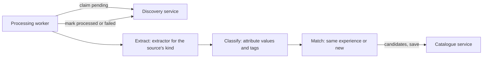

# Data processing

Source of truth for how a raw listing becomes published experiences. How raw listings are fetched is in [discovery.md](discovery.md). The experience, its statuses and the other resources are defined in [data-model.md](data-model.md).

2026-11-23 · Meiring

## Overview

Data processing takes pending raw listings from Discovery and turns each one into zero or more experiences, which Catalogue saves. It does four things to a raw listing, in order: extract, classify, match, save.



Data processing owns the extractors, the classifier, the matching decision, and the attribute and tag definitions. It has no table of experiences: Catalogue stores them, and Discovery stores the raw listings.

## Steps

One raw listing is processed in one transaction, from claim to mark. If the worker crashes, the transaction rolls back and the raw listing is pending again.

1. **Claim.** The processing worker runs on a loop and claims a pending raw listing through the Discovery service. It keeps going while raw listings are pending and waits the idle interval when there are none. The idle interval and the number of workers are settings (see Settings). It comes with its source's kind and location, and Data processing gets the location (name, centre point, timezone) from the Catalogue service.
2. **Extract.** The extractor for the source's kind reads the content and returns zero or more extracted experiences (see Extractors).
3. **Classify.** Each extracted experience is given its attribute values and tags (see Classification).
4. **Match.** Each extracted experience is matched to an existing experience or becomes a new one (see Matching).
5. **Save.** The Catalogue service saves each experience with its sessions, attribute values, tags and source link. Catalogue bumps the version and writes the change row when something really changed.
6. **Mark.** Data processing marks the raw listing processed through the Discovery service.

Three cases need no extraction or end early:

- **Removed raw listing** (kind removed, no content). The Catalogue service removes that listing's link from every experience it was linked to. An experience left with no links is set to Removed by Catalogue.
- **Nothing extracted.** A post or page that describes no experience is marked processed. Any links the listing had are removed, as below.
- **Failure.** If any step fails, including an answer from Claude that does not fit the expected shape, nothing from that raw listing is saved to Catalogue. It is marked failed with the error and one more attempt, and goes back to pending until it reaches the source's max processing attempts.

## Extractors

An extractor is a plug-in, one per source kind, with the same kinds as Discovery's adapters. It turns one raw listing's content into extracted experiences. It does not classify, match or save.

```ts
interface Extractor {
  kind: string;
  extract(input: {
    content: string;                    // the raw listing's content, as fetched
    contentType: string;
    url?: string;
    fetchedAt: Date;                    // resolves relative dates such as "this Saturday"
    location: Location;                 // the source's location, from the Catalogue service
  }): Promise<ExtractedExperience[]>;   // zero or more
}

interface ExtractedExperience {
  title: string;
  summary?: string;
  description?: string;
  type: "single" | "run" | "recurring" | "season";
  status: "expected" | "announced" | "confirmed" | "postponed" | "cancelled";
  booking: "none" | "not_yet" | "open" | "sold_out" | "closed";
  when: {
    start?: string;                     // dates, to the precision given
    end?: string;
    precision: "day" | "month" | "year";
    startTime?: string;
    endTime?: string;
    recurrence?: string;                // the recurrence rule, for a recurring experience
    seasonMonths?: number[];            // for a season
    openingHours?: string;
  };
  sessions?: { start: string; end?: string; label?: string; soldOut?: boolean; cancelled?: boolean }[];
  venue?: { name?: string; address?: string; city?: string; position?: { lat: number; lng: number } };
  price?: { min?: number; max?: number; currency: string };
  onSaleAt?: string;
  bookingClosesAt?: string;
  bookingUrl?: string;
  imageUrl?: string;
  url?: string;                         // this experience's own page, if it has one
  hints: string[];                      // the source's own categories and labels, used by classification
}
```

The fields are the experience fields in [data-model.md](data-model.md). An extractor never returns Removed or Past; Catalogue sets those.

| Kind | How it extracts | Returns |
| --- | --- | --- |
| Quicket | Maps the event's JSON fields in code | One experience |
| Ticketmaster | Maps the event's JSON fields in code | One experience |
| WordPress | Claude, given the post's title and body as text | Every experience the post describes, often none |
| PDF calendar | Claude, given the PDF file itself | Every row that is an experience |
| Web page | Claude, given the page's visible text | Every experience on the page |

The three Claude extractors share one implementation. Each kind only prepares the content differently. Claude is given the content, the location's name and region, the fetch time and the extracted experience shape, and must answer in that shape. The answer is checked against the shape before it is used. How Claude is called is under Claude, below.

## Classification

One step, shared by every source kind. Claude assigns each extracted experience its attribute values and tags.

- **Given:** the extracted experience (title, summary, description, venue, hints) and the definitions: every attribute with its options, and every tag, each with its description.
- **Returns:** a value for each attribute it can decide, and the tags that apply.
- **Checked against the definitions:** an attribute, option or tag that is not defined is dropped. A value must fit the attribute's type, and a single-valued attribute gets one value. An attribute with no value gets its default, if it has one.

The definitions are configuration, not code. A definition's description is the context Claude reads to decide when it applies. Classification is improved by adding definitions or rewording descriptions, with no change to code or the schema. The shape of a definition is in [data-model.md](data-model.md).

### Default definitions

The system starts with this set. They are rows in the database and can be added to or changed.

| Attribute | Type | Values | Default | Clients can filter |
| --- | --- | --- | --- | --- |
| Category | Option, several values | The categories below | None | Yes |
| Setting | Option | Indoor, Outdoor, Both | None | Yes |
| Scale | Option | Local, Regional, Major | Local | Yes |
| Family friendly | True/false | | None | Yes |
| Minimum age | Number | | None | Yes |

| Category | Description |
| --- | --- |
| Music | Concerts, gigs, recitals and music festivals |
| Performing arts | Theatre, dance, comedy, opera and film screenings |
| Visual arts | Exhibitions, gallery openings, art walks and craft fairs |
| Festivals | Festivals of any theme that run over several days or venues |
| Food and wine | Tastings, pairings, harvest days, pop-up dinners and food festivals |
| Markets | Farmers', craft and night markets |
| Sport | Matches, races and tournaments to watch |
| Outdoor and adventure | Things to take part in outdoors: trail runs, cycling, hiking, kayaking, golf days |
| Nature and wildlife | Whale watching, birding, fynbos and other wildlife or botanical seasons and tours |
| Culture and heritage | History, heritage sites and cultural celebrations |
| Wellness | Yoga, retreats, spa and wellbeing days |
| Talks and workshops | Lectures, book launches, classes and workshops |
| Community | Charity days, fairs, fundraisers and parades |

Scale says how far people travel for it: Local draws the town, Regional draws the province, Major draws visitors from across the country or abroad.

Default tags: whales, wine, fynbos, birding, hiking, trail running, cycling, golf, surfing, rugby, cricket, live music, jazz, classical, comedy, theatre, craft, farmers' market, charity, school holidays.

## Matching

Matching decides, for each extracted experience, whether it is an experience Catalogue already has. Data processing makes the decision; Catalogue supplies the source links and the candidates.

1. **The listing already links to experiences.** The extracted experience is compared with those first, and the one it matches is updated. A Quicket or Ticketmaster listing describes one experience, so it always updates the one it links to.
2. **Otherwise** Catalogue returns candidates: experiences in the same location with overlapping dates and a similar title. Cancelled, Removed and Past experiences are never candidates. Data processing links the listing to one of them, or creates a new experience.
3. **Links that fall away.** An experience the listing linked to before, which this version no longer describes, loses that link. If it has no links left, Catalogue sets it to Removed.

A listing can link to several experiences, and an experience has at most one link per listing. One experience can have links from many listings and sources.

## Claude

Data processing uses Claude, through the Anthropic API, for the steps that need reading and judgement. Where Discovery uses Claude is in [discovery.md](discovery.md).

| Place | Claude is given | Claude returns | Status |
| --- | --- | --- | --- |
| Extraction of a WordPress post or web page | The text, the location's name and region, the fetch time | The extracted experiences | Version 1 |
| Extraction of a PDF calendar | The PDF file itself, with the same context. Claude reads its tables and layout directly | The extracted experiences | Version 1 |
| Classification | One extracted experience and the attribute, option and tag definitions with their descriptions | Attribute values and tags | Version 1 |
| The match decision | One extracted experience and the candidates from Catalogue | One candidate, or none | Proposed (see Open questions) |

Each of these is one request with a structured answer. None is an agent: the steps are fixed and the code controls them.

How Claude is called:

- Through the official TypeScript SDK, `@anthropic-ai/sdk`, in one adapter behind an outbound port. Nothing else imports the SDK.
- The SDK reads the API key from `ANTHROPIC_API_KEY`.
- The model is `claude-opus-5-5`, set by `CLAUDE_MODEL`.
- This model always thinks, so no `thinking` parameter is sent. How hard it thinks is set by `output_config.effort`, from `CLAUDE_EFFORT`.
- The answer's shape is a zod schema. The call is `client.messages.parse` with `output_config.format` set to `zodOutputFormat(schema)`, and the result is read from `parsed_output`.
- Check `stop_reason` before reading the answer. `refusal`, `max_tokens` or an empty `parsed_output` fails the raw listing.
- Everything that stays the same between calls (the instructions, the experience shape, the definitions) goes in the system prompt, marked `cache_control: { type: "ephemeral" }`, so repeated calls read it from the cache. What changes (the content, the location, the fetch time) goes in the user message.
- A PDF is sent as a `document` block, before the text.
- Content is never cut to make it fit. A raw listing that is too long fails with that reason.
- Server-side refusal fallback is turned on (`fallbacks: "default"` with the beta `server-side-fallback-2026-07-01`), so a request the model declines is run again on another model inside the same call.

```ts
import Anthropic from "@anthropic-ai/sdk";
import { zodOutputFormat } from "@anthropic-ai/sdk/helpers/zod";

const client = new Anthropic();                     // reads ANTHROPIC_API_KEY

const response = await client.messages.parse({
  model: settings.claudeModel,                      // claude-opus-5-5
  max_tokens: 16000,
  output_config: {
    effort: settings.claudeEffort,                  // medium
    format: zodOutputFormat(ExtractionResult),      // z.object({ experiences: z.array(ExtractedExperience) })
  },
  system: [{ type: "text", text: EXTRACTION_INSTRUCTIONS, cache_control: { type: "ephemeral" } }],
  messages: [{
    role: "user",
    content: [
      // PDF calendars only: the file, before the text
      { type: "document", source: { type: "base64", media_type: "application/pdf", data: pdfBase64 } },
      { type: "text", text: `Location: ${location.name}, ${location.region}\nFetched: ${fetchedAt.toISOString()}\n\n${text}` },
    ],
  }],
});

if (response.stop_reason === "refusal" || response.stop_reason === "max_tokens" || !response.parsed_output) {
  throw new ExtractionFailed(response.stop_reason);
}
return response.parsed_output.experiences;
```

## Settings

System settings are environment variables, read through the settings provider (see [architecture.md](architecture.md)).

| Setting | Default | Meaning |
| --- | --- | --- |
| `PROCESSING_IDLE_INTERVAL_SECONDS` | 30 | How long the processing worker waits before looking again when nothing is pending |
| `PROCESSING_WORKERS` | 1 | How many processing workers run at once |
| `ANTHROPIC_API_KEY` | None; required | The Anthropic API key |
| `CLAUDE_MODEL` | `claude-opus-5-5` | The Claude model used by Data processing and Discovery |
| `CLAUDE_EFFORT` | `medium` | How hard Claude thinks: `low`, `medium`, `high`, `xhigh` or `max` |
| `CLAUDE_TIMEOUT_SECONDS` | 120 | How long to wait for an answer before the raw listing fails |

The attribute, option and tag definitions are not settings. They are rows (see Classification).

## Service dependencies

| Service | Calls | For |
| --- | --- | --- |
| Data processing | Discovery | Claiming pending raw listings, marking them processed or failed |
| Data processing | Catalogue | Getting a location, matching by source link or candidates, saving experiences, removing source links |

## Decisions

| Decision | |
| --- | --- |
| Steps | Extract, classify, match, save. One raw listing is one transaction, from claim to mark |
| Extraction | One extractor per source kind. Field mapping in code for Quicket and Ticketmaster. Claude for WordPress, PDF calendar and web page |
| Several experiences per listing | An extractor returns zero or more experiences. A post, page or calendar is never forced into one |
| Classification | One step for every kind: Claude picks attribute values and tags from the definitions and their descriptions |
| Language model | Claude, through the Anthropic API and its TypeScript SDK. Every use is one request with a structured answer |
| Definitions | Configurable rows with a default set, not enums. Improving classification means adding or rewording definitions |
| Matching | By the listing's existing source links first, then by comparing candidates |
| Failure | Nothing is saved from a raw listing that fails. It is retried up to the source's max processing attempts |

## Open questions

Each has a proposed answer. None is agreed yet.

- [ ] **Sources that disagree.** The same experience appears on many sources (the Whale Festival is on Quicket, AllEvents, Wesgro, SA-Venues and the tourism PDF), and they disagree (winetourism.com lists different FynArts 2027 dates from the organiser). Which one's fields win? *Proposed:* each source has a priority number. An experience's fields come from its highest-priority linked listing, and lower-priority listings only fill fields that are empty. When that link is removed, the next one takes over.
- [ ] **The match decision.** What makes a candidate the same experience? *Proposed:* a candidate with the same title, once normalised, and overlapping dates is a match without a model. Otherwise Claude is shown the candidates and picks one or none.
- [ ] **Status and booking from a listing.** What in a listing sets each status? *Proposed:* says cancelled: Cancelled, Closed. Says postponed with no new date: Postponed, Closed. Tickets on sale: Confirmed, Open. Sold out: Confirmed, Sold out. Exact dates with an on-sale time ahead: Announced, Not yet. Exact dates and nothing to book: Confirmed, None. Only a month or year: Announced. Expected is never set from a listing.
- [ ] **Version order.** Two versions of one listing can both be pending, and a failed older version can be retried after a newer one was processed. *Proposed:* only the latest version of a listing can be claimed. Older pending or failed versions get a new status, Superseded.
- [ ] **Processing again.** Processed is final, so listings already processed never pick up a fixed extractor or new definitions. *Proposed:* a system admin action sets the latest version of chosen raw listings, by source or by kind, back to pending.
- [ ] **Already over.** A news post can describe something that has already happened. *Proposed:* an extractor leaves out experiences whose last date is before the fetch time.
- [ ] **Festival programmes.** A festival page can list hundreds of programme items. *Proposed:* a festival is one experience, and its programme items are not extracted separately.
- [ ] **Data warehouse.** The architecture gives Data processing a port that loads the data warehouse, but no step here loads it. See the open question in [architecture.md](architecture.md).
