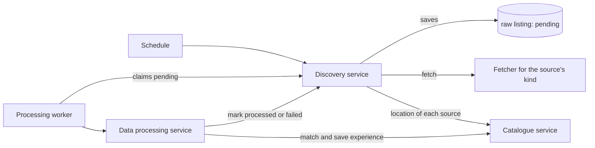

# Discovery and processing

Source of truth for how experiences are fetched from sources and turned into published experiences. Resources outside this flow are defined in [data-model.md](data-model.md).

2026-11-23 · Meiring

## Overview

Discovery fetches listings from sources and saves each new or changed one as a raw listing with status pending. Data processing picks up pending raw listings, turns each one into an experience, and saves it through the Catalogue service. The raw listing's status is the whole hand-off between the two.



Services call each other's services directly. Nothing is copied between domains and no domain event is needed for the hand-off. All tables are in one Postgres database.

## Tables

### Source (Discovery)

A site or feed that publishes experiences for one location.

| Holds | Notes |
| --- | --- |
| Name, kind | Kind picks the adapter that fetches it and the parser that reads it (see Source kinds) |
| Location | One location per source. A site that covers two places is entered twice, once per location |
| Settings | JSON the adapter reads: address, query, organiser ID, page pattern. Each kind defines its own |
| Credentials | The name of an environment variable holding the API key. Keys are never stored in the table |
| Sync state | JSON the adapter keeps between runs, such as Quicket's last-modified time for incremental fetches |
| Fetch interval | How often this source is fetched |
| Missed runs before removal | How many successful runs in a row may miss a listing before it counts as gone |
| Max processing attempts | How many times a failed raw listing is retried |
| Active | Only active sources are fetched |

### Run (Discovery)

One fetch of one source. This is the log of what was fetched and when.

| Holds | Notes |
| --- | --- |
| Source | The source fetched |
| Started, finished | Finished is empty while it runs |
| Status | Running, succeeded, failed |
| Counts | Listings found, new or changed, unchanged |
| Error | Why it failed, if it did |

### Raw listing (Discovery)

One version of one listing, exactly as the source returned it. A new row is saved only when the listing is new or its content changed.

| Holds | Notes |
| --- | --- |
| Run, source | Where and when it was fetched |
| Source's listing ID | The source's own ID for the listing, or its web address if the source has none |
| Address, fetched time, content type | |
| Content | The JSON, HTML or feed item as returned, in a Postgres `text` column |
| Fingerprint | A hash of the content, used to skip unchanged listings |
| Status | Pending, processed, failed |
| Attempts, error | For failed ones |
| Kind | Listing (fetched content) or removed (the listing is gone from the source; no content) |
| Last seen | The last run that returned this listing. Kept on the latest version of each listing |
| Experience | The experience it produced, once processed |

The content is never changed after it is saved. Only the status and last-seen fields change.

### Attributes and tags (Data processing)

The system-defined list of attributes (name, type, default value), their options, and tags. Data processing uses it to describe each experience. Defined in [data-model.md](data-model.md).

### Experience and source link (Catalogue)

The published experience and the links from source listings to it. A source's listing ID links to one experience only. Data processing reads these links through the Catalogue service to match listings. Defined in [data-model.md](data-model.md).

## Source kinds

Each source has a kind, and each kind has one adapter. The kinds come from the Hermanus source research (23 Nov 2026).

| Kind | Sources it covers | What a run returns | Listing ID |
| --- | --- | --- | --- |
| Ticketing API | Quicket (free key, all public events, no location filter, incremental by last-modified); Ticketmaster Discovery (free key, filters by point) | One listing per event, as JSON | The platform's event ID |
| Paid events API | PredictHQ, SerpApi Google Events, Bandsintown partner search | One listing per event, as JSON | The platform's event ID |
| WordPress REST | Hermanus Times posts | One listing per post, as JSON. A post can describe several experiences | The post ID |
| PDF calendar | whalecoast.info annual and monthly events PDFs, Overstrand weekly diary. File names change with each reissue, so the adapter finds the latest file from the calendar page | One listing per table row | Derived by the adapter |
| HTML page | Organiser sites, Wesgro, AllEvents.in, SA-Venues, Xplorio, Webtickets, Computicket, estates and hotels | One listing per event on the page, as HTML | The event's own page address |

Sources the research found closed (Facebook events, Eventbrite search) have no kind.

## Adapter interface

An adapter is a plug-in behind Discovery's fetch port. Discovery picks it by the source's kind, calls it, and does everything after: fingerprints, saving raw listings as pending, and closing the run. Adding a source of a new kind means adding one adapter, plus a parser for it in Data processing.

```ts
interface SourceAdapter {
  kind: string;
  fetch(input: {
    settings: unknown;          // the source's settings JSON
    credentials?: string;       // read from the environment variable the source names
    location: Location;         // from the Catalogue service
    syncState: unknown;         // what this adapter saved last run
  }): Promise<{
    listings: FetchedListing[];
    complete: boolean;          // true if this run returned everything the source currently lists
    syncState: unknown;         // saved on the source for the next run
  }>;
}

interface FetchedListing {
  sourceListingId: string;      // stable across runs; derived by the adapter when the source has none
  url?: string;
  contentType: string;          // application/json, text/html, text/plain
  content: string;              // exactly as returned, or the extracted row for PDFs
}
```

An adapter that filters by place does it here. Quicket has no location filter, so its adapter keeps only events near the source's location.

## Fetching

1. The schedule starts Discovery for each active source, at that source's fetch interval.
2. Discovery gets the source's location (name, centre point, timezone) from the Catalogue service and inserts a run with status running.
3. Discovery calls the fetcher for the source's kind with the source's settings and the location.
4. The fetcher calls the source and splits the response into listings. For each listing it returns the source's listing ID, the address, the content type and the raw content. It does not clean or interpret anything.
5. For each listing, Discovery computes the fingerprint and compares it with the last raw listing saved for the same source and listing ID:
   - same fingerprint: counted as unchanged; only the last-seen run is updated
   - new listing or different fingerprint: saved as a raw listing with status pending
6. Discovery closes the run with its status, counts and any error.
7. If the run succeeded and the adapter reported it complete, Discovery checks for listings that have gone missing (below). An incremental run only returns what changed, so it never counts as a miss.

If the fetch fails part way, the listings already saved stay saved and the run is marked failed. A failed run never counts as a miss.

## Listings that disappear

A listing that a source stops returning is checked again before anything changes:

1. After each successful, complete run, Discovery looks at every listing this source has returned before, whose latest version is not a removal.
2. If the number of successful, complete runs since the listing was last seen reaches the source's missed runs before removal, Discovery saves a raw listing of kind removed, with status pending.
3. Data processing processes it like any other raw listing: the Catalogue service removes that source's link from the experience.
4. If the experience has no source links left, Catalogue sets its status to Cancelled and booking to Closed. If another source still lists it, it stays as it is.
5. If the listing comes back later, it is saved as a new raw listing and processed as usual.

## Processing

1. A processing worker runs on a loop. It asks the Discovery service for pending raw listings, which are claimed with `FOR UPDATE SKIP LOCKED` so two workers never take the same one.
2. Data processing parses the content with the parser for the source's kind and maps it to experience fields, attribute values and tags, checked against the attribute definitions.
3. It matches the listing to an experience through the Catalogue service:
   - the source and listing ID already have a source link: that experience is updated
   - otherwise Catalogue returns candidates in the same location with overlapping dates and a similar title, and Data processing links the listing to one of them or creates a new experience
4. The Catalogue service saves the experience, its sessions, attribute values, tags, the source link and a change row.
5. Data processing marks the raw listing processed with the experience, or failed with the error and one more attempt. A failed raw listing goes back to pending until it reaches the source's max processing attempts, then stays failed.

Steps 4 and 5 run in one transaction, so a raw listing is never marked processed without its experience saved.

## Raw listing status

| Status | Means | Moves to |
| --- | --- | --- |
| Pending | Saved by a run, waiting for processing | Processed, Failed |
| Processed | Turned into an experience | Nothing |
| Failed | Processing failed; the error and attempts are recorded | Pending, while attempts are below the source's max processing attempts |

## Service dependencies

| Service | Calls | For |
| --- | --- | --- |
| Discovery | Catalogue | The location of each source |
| Data processing | Discovery | Claiming pending raw listings, marking them processed or failed |
| Data processing | Catalogue | Matching by source link or candidates, saving experiences |

Catalogue calls neither, so the dependencies have no cycles.

## Decisions

| Decision | |
| --- | --- |
| Hand-off | The raw listing's status. No domain event or queue is needed |
| No copies | Services call each other's services. No table holds a copy of another domain's data |
| One location per source | A source row carries its location and settings |
| Configuration | Fetch interval, missed runs before removal and max processing attempts are set per source |
| Adapters | One adapter per source kind, behind one interface. Adapters fetch and split; Discovery saves; Data processing parses |
| Credentials | API keys live in environment variables; a source stores only the variable's name |
| Disappeared listings | Checked again over the configured number of successful, complete runs, then the source link is removed. An experience with no source links left is cancelled |
| Matching | By Catalogue's source links first, then by comparing candidates |
| Raw content | Postgres `text` column. **Later:** move to MinIO (S3) and store a key instead |

## Open questions

- [ ] How often does the processing worker look for pending raw listings?
- [ ] The same experience appears on many sources (the Whale Festival is on Quicket, AllEvents, Wesgro, SA-Venues and the tourism PDF), and sources disagree (winetourism.com lists different FynArts 2027 dates from the organiser). When linked sources disagree, which one's fields win? One option is a priority number per source.
- [ ] A PDF row or HTML event with no ID of its own needs a derived listing ID. If it is built from the name and date, a changed date looks like a removed listing plus a new one. What should a derived ID be built from?
- [ ] The location has only a centre point, but the sources cover Hermanus and the wider Overstrand (Stanford, Gansbaai, Kleinmond). Does a location need a radius for adapters to filter by?
- [ ] Seasons (whale season, the fynbos bloom) and many recurring experiences (First Fridays, Art in the Park, parkrun) have no feed. Clients can't create experiences, so how do these get in?
- [ ] A WordPress post can describe several experiences. Does its parser create one experience per post, or split it?
