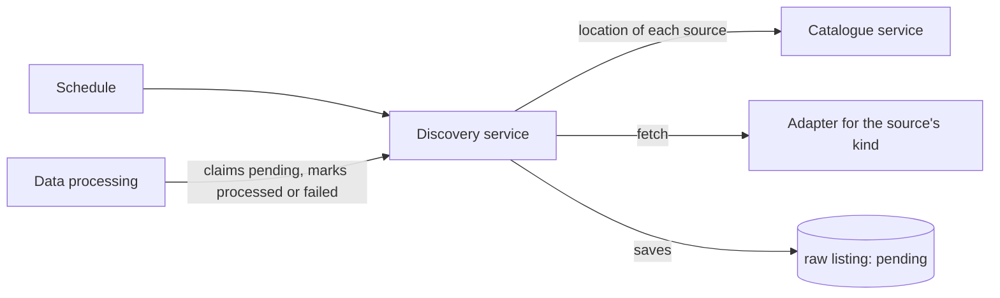

# Discovery

Source of truth for how listings are fetched from sources and handed to Data processing. How a raw listing becomes an experience is in [data-processing.md](data-processing.md). Resources outside this flow are defined in [data-model.md](data-model.md).

2026-11-23 · Meiring

## Overview

Discovery keeps a record of every listing a source publishes and fetches it again on every run, for as long as the source lists it. When a listing is new or its content has changed, Discovery saves the content, whole, as a raw listing with status pending. Data processing picks up pending raw listings and turns them into experiences, so an experience follows its listings: a date, price or booking change at the source reaches the experience on the next run. The raw listing's status is the whole hand-off between the two.

Version 1 is a tracer bullet: five source kinds, with one adapter and one extractor each, working end to end from fetch to published experience.



Services call each other's services directly, through the other domain's inbound port. Nothing is copied between domains and no domain event is needed for the hand-off. All tables are in one Postgres database.

## Tables

### Source

A site or feed that publishes experiences for one location.

| Holds | Notes |
| --- | --- |
| Name, kind | Kind picks the adapter that fetches it and the extractor that reads it (see Source kinds) |
| Location | One location per source. A site that covers two places is entered twice, once per location |
| Settings | JSON the adapter reads: page addresses, organiser ID, calendar name. Each kind defines its own |
| Credentials | The name of the setting that holds the API key, such as `QUICKET_API_KEY`. Discovery gets the key from the settings provider. Keys are never stored in the table |
| Sync state | JSON the adapter keeps between runs, such as Quicket's last-modified time for incremental fetches |
| Fetch interval | How often this source is fetched |
| Missed runs before removal | How many successful, complete runs in a row may miss a listing before it counts as gone |
| Max processing attempts | How many times a failed raw listing is retried |
| Active | Only active sources are fetched |

### Run

One fetch of one source. This is the log of what was fetched and when.

| Holds | Notes |
| --- | --- |
| Source | The source fetched |
| Started, finished | Finished is empty while it runs |
| Status | Running, succeeded, failed |
| Complete | Whether the run returned everything the source currently lists. Only complete runs count towards a missed listing |
| Counts | Listings found, new or changed, unchanged |
| Error | Why it failed, if it did |

### Listing

One item a source publishes: one API event, one web page, one post or one PDF calendar. It is the lasting record that Discovery keeps in sync with the source. There is one row per source and listing ID, and every run that returns the listing updates it. A listing can describe one experience or several.

| Holds | Notes |
| --- | --- |
| Source | The source that publishes it |
| Source's listing ID | The source's own ID for the listing, or its web address if the source has none. Stable across runs, and unique within the source |
| Web address | Where the listing can be seen |
| First seen, last seen | The first and the last run that returned it. Last seen is when the listing was last verified against the source |
| Fingerprint | A hash of the content last fetched, used to tell whether the listing changed |
| State | Listed, or removed once the source has stopped returning it |

### Raw listing

One version of a listing's content, whole and exactly as the source returned it. A new row is saved only when the listing is new or its content changed, so a listing's raw listings are its history.

| Holds | Notes |
| --- | --- |
| Listing, run | Which listing, and the run that fetched this version |
| Fetched time, content type | |
| Content | The JSON, HTML, XML or text as returned, in a Postgres `text` column. A PDF is stored as base64 |
| Fingerprint | The hash of this version's content |
| Status | Pending, processed, failed |
| Attempts, error | For failed ones |
| Kind | Listing (fetched content) or removed (the listing is gone from the source; no content) |

A raw listing's content is never changed after it is saved. Only its status changes. Which experiences a listing produced is recorded by Catalogue's source links, not here.

## Source kinds

Version 1 defines five kinds and builds three: RSS feed, PDF calendar and web page. The Quicket and Ticketmaster kinds use an API, and version 1 has no API access to either, so their adapters and extractors are not built. That is the decision for version 1. Each source has a kind, and each kind has one adapter in Discovery and one extractor in Data processing. The sources come from the Hermanus source research, and each address was checked on 23 Nov 2026 (see [hermanus-sources.md](hermanus-sources.md)).

| Kind | Sources it covers | How it is fetched | One listing is | Listing ID | Extracted by |
| --- | --- | --- | --- | --- | --- |
| Quicket | Quicket | API with a free key. Returns all public events with no location filter, incremental by last-modified | One event, as JSON | Quicket's event ID | Field mapping |
| Ticketmaster | Ticketmaster Discovery | API with a free key. Filters by point | One event, as JSON | Ticketmaster's event ID | Field mapping |
| RSS feed | Hermanus Times | Fetches the feed address in the source's settings | One post: its item in the feed, as XML, with the post's full text | The item's GUID | Language model |
| PDF calendar | whalecoast.info annual and monthly events PDFs. Each calendar is its own source | The adapter fetches the calendar page, asks the language model which link is the current file, because file names change with each reissue, and downloads it | One calendar's current PDF file | The calendar's name from the source's settings | Language model, which reads the PDF itself |
| Web page | The Overstrand weekly diary, Quicket's public search pages, organiser sites (FynArts, the Whale Festival), Wesgro, AllEvents.in, Xplorio | Fetches the page addresses in the source's settings | One page, as HTML | The page's address | Language model, given the page's visible text, its structured data and its map links |

A kind is named for how a source is fetched, never for the software its site runs on. Two kinds have an API: Quicket and Ticketmaster. RSS feeds, PDF calendars and web pages are fetched as feeds, files and pages.

Adding another RSS feed, web page or PDF calendar is adding a source row with its address in the settings. It needs no new code.

A web page's content is what it says: its visible text, its structured data (JSON-LD), and its links to a map that carry coordinates, such as a Directions link to `maps?q=-34.42,19.23`. Many listing sites put their events in structured data, and Quicket's public search pages put them nowhere else. A map link's address is not visible text, and it is often the only place a page states where its venue is. All three are given to the language model.

The page's fingerprint is taken from the same three, without the frame the site puts around every page: its navigation, sidebars and footer (`nav`, `aside` and `footer`, and the elements with their ARIA roles) where they stand outside the page's main part, its articles and its sections. Sites fill the frame with lists that change on every fetch: AllEvents.in's footer lists trending searches and upcoming events in a new order each time. A footer inside an article, such as an event card's price, is part of what the page says and stays in the fingerprint. The language model is still given the frame, since it can name an event the page itself does not. When ten pages or more of a source are fetched in one run, the lines of visible text that every one of them shows are the site's, and are left out of each page's fingerprint too. A site need not mark its banner, menus and tickers: The Village NEWS shows today's weather, tides and events at the top of every page, and its wind changes between fetches minutes apart. A line only some of the pages show is kept, so a page whose own date, time or price changes still changes its fingerprint. Fewer pages are not enough to tell: on a festival's home, programme and booking pages, a line on all three can be the festival's own dates. A captured page's fingerprint leaves out its first two lines, its address and the time it was read, so a page captured again unchanged keeps its fingerprint.

Quicket's events come in through its public search pages, which need no key and are fetched as web pages. The Quicket kind, which uses its API, is not built in version 1. Ticketmaster's public site returns no events for Hermanus or the Overstrand, so nothing is lost by leaving its kind out.

A page that only fills in with JavaScript does not answer a plain request, so the web page adapter cannot fetch it. Such pages are read with the agent-browser CLI, a headless Chrome, and loaded through the pipeline as captured pages (see [sources.md](sources.md)). Putting a headless browser inside the adapter is for the next version.

The paid APIs the research found (PredictHQ, SerpApi Google Events, Bandsintown) and the sources it found closed (Facebook events, Eventbrite search) have no kind.

### Runs and model use by kind

| Kind | A run is | Language model in the fetch | Language model in extraction |
| --- | --- | --- | --- |
| Quicket | Not built in version 1 | No | No |
| Ticketmaster | Not built in version 1 | No | No |
| RSS feed | Never complete. A feed holds only the latest posts, so a post that leaves the feed is not a removed listing | No | Yes |
| PDF calendar | Complete | Yes, to find the current file | Yes |
| Web page | Complete. An address that answers not found is a missing listing. Any other failure fails the run | No | Yes |

Classification uses the language model for every experience, whatever its kind. The embedding model is no part of any kind: Catalogue embeds the profile of every saved experience. Both models and their providers are in [data-processing.md](data-processing.md).

### Access

Checked on 23 Nov 2026 by calling each one without a key.

| Kind | What is needed | Result of the check |
| --- | --- | --- |
| Quicket | An API key. Sign up at developer.quicket.co.za and get a key there | The API answers 401 without a key. Not yet tested with one |
| Ticketmaster | An API key. Sign up at developer.ticketmaster.com. 5000 calls a day, 5 a second | The API answers 401 without a key. Its public site returns no events for Hermanus or the Overstrand |
| RSS feed | Nothing | The Hermanus Times feed at novanews.co.za/hermanustimes/feed/ answers a plain request: 10 posts a page with their full text, and `?paged=N` reaches older posts. Its article pages are open too. Its posts API, category pages and sitemaps answer 403 behind a Cloudflare browser check, which a headless browser did not pass either. Most posts are national news and sport. The site's own events calendar has listed nothing since November 2025 |
| PDF calendar | Nothing | whalecoast.info is reachable. The annual and monthly PDFs are linked from the site menu and have a text layer. Its weekly diary is an image there, and the same diary is a web page on overstrand.gov.za |
| Web page | Nothing | Checked one by one: the Overstrand diary, Quicket search, AllEvents.in, Wesgro, FynArts and Xplorio answer a plain request with their events. SA-Venues has no Overstrand events, Webtickets has no page that lists a place's events, and Computicket shows none for Hermanus and guards its API |

## Fetch port and adapters

Discovery's fetch port is one interface, `SourceFetcher`, and each kind's adapter implements it. Discovery picks the adapter by the source's kind, calls it, and does everything after: fingerprints, saving raw listings as pending, and closing the run. Adding a source of a new kind means adding one adapter, plus an extractor for it in Data processing.

```ts
interface SourceFetcher {
  kind: string;
  fetch(input: {
    settings: unknown;          // the source's settings JSON
    credentials?: string;       // the API key, from the settings provider, by the setting the source names
    location: Location;         // from the Catalogue service
    syncState: unknown;         // what this adapter saved last run
  }): Promise<{
    listings: FetchedListing[];
    complete: boolean;          // true if this run returned everything the source currently lists
    syncState: unknown;         // saved on the source for the next run
  }>;
}

interface FetchedListing {
  sourceListingId: string;      // the source's own ID or the web address; stable across runs
  url?: string;
  contentType: string;          // application/json, text/html, application/xml, application/pdf
  content: string;              // exactly as returned; a PDF as base64
}
```

An adapter is built with the outbound ports it needs and reaches nothing else. The PDF calendar adapter is built with the language model port, which is how it asks for the current file. No adapter imports another adapter or a provider's SDK.

An adapter returns each listing whole. It does not split a page, post or calendar into experiences; that is extraction, and it belongs to Data processing.

An adapter that filters by place does it here. Quicket has no location filter, so its adapter keeps only events near the source's location.

## Fetching

1. The schedule starts Discovery for each active source, at that source's fetch interval. A source is fetched once a week unless its row says otherwise, and each fetch is a full update of everything the source lists. Each source keeps its own time: it is due one interval after its last fetch started. Every 15 minutes a job asks Discovery which sources are due and adds a fetch job for each (see Background jobs in [architecture.md](architecture.md)).
2. Discovery gets the source's location (name, centre point, timezone) from the Catalogue service and inserts a run with status running.
3. Discovery calls the adapter for the source's kind with the source's settings, credentials, sync state and the location.
4. The adapter calls the source and returns the listings whole: one per API event, page, post or calendar. For each listing it returns the source's listing ID, the web address, the content type and the raw content. It does not clean, split or interpret anything.
5. For each listing returned, Discovery takes out what a Postgres text column cannot hold (the NUL character, which some pages carry, and a lone half of a surrogate pair, which becomes U+FFFD), computes the fingerprint of what is left, and finds the listing record for the same source and listing ID:
   - no record: the listing is new. Discovery creates the record and saves the content as a raw listing with status pending
   - same fingerprint: counted as unchanged. Only the listing's last seen is updated
   - different fingerprint: the listing changed. Discovery updates the record's fingerprint and last seen, and saves the content as a new raw listing with status pending
6. Discovery closes the run with its status, whether it was complete, its counts and any error. The error is one line of at most 500 characters that says what failed. A query the database refused gives the database's own reason, never the query, its parameters or the page. If closing the run fails, Discovery closes it again as failed with a fixed error, so a run is never left running and the caller always gets a result.
7. If the run succeeded and the adapter reported it complete, Discovery checks for listings that have gone missing (below). An incremental run only returns what changed, so it never counts as a miss.

If the fetch fails part way, the listings already saved stay saved and the run is marked failed. A failed run never counts as a miss.

### When a fetch fails

A failed fetch is tried again, with a longer wait each time. It does not wait for the next weekly fetch.

- **The job queue tries it again.** A fetch is a job. A run that fails fails its job, and the queue runs the job again. Discovery itself holds no retry rule.
- **Five retries.** The first comes 15 minutes after the failure, and the wait doubles each time: 15, 30, 60, 120 and 240 minutes. pg-boss adds a random extra of up to as much again, so that failed jobs do not all come back at once: each wait is between the one given here and twice it.
- **When the retries are used up,** the job is given up. The source is due again one fetch interval after its last run started, and starts with a fresh set of retries.
- **A success ends it.** The next fetch is one interval after the run that succeeded started.
- **A run that never finished.** A run still running an hour after it started, because the server stopped part way, is closed as failed, so it never blocks its source.

**Later:** the queue behind the job queue port becomes a durable workflow engine in the next version. Version 1 uses pg-boss, with its queues in the same Postgres database. Changing it means writing one adapter.

### How far ahead

Experiences are sourced from today to 24 months ahead, the sourcing horizon (`DISCOVERY_HORIZON_MONTHS`). Trips are booked up to 18 months before they start.

- An adapter whose source can be asked for a range of dates asks for today to the horizon.
- A page, feed or calendar is fetched whole, so the horizon is applied in extraction: an experience whose first date is beyond the horizon is left out (see [data-processing.md](data-processing.md)). It is picked up by a later run, once its date is inside the horizon.

### Fetching on demand

A system admin can fetch now from the command line, whether or not a source is due, with `pipeline refetch` and one of:

- `--location SLUG`: every active source of the location, one after another.
- `--source NAME`: one source.
- `--listing ID`: the source of one listing.

A listing is never fetched on its own, because an adapter fetches a whole source. A fetch on demand is a run like any other, and a source that is already being fetched is not fetched twice. A listing whose content has not changed is not processed again; sending it back is what processing again is for (see [data-processing.md](data-processing.md)).

## Listings that disappear

A listing that a source stops returning is checked again before anything changes:

1. After each successful, complete run, Discovery looks at every listing of this source whose state is listed.
2. If the number of successful, complete runs since the listing was last seen reaches the source's missed runs before removal, Discovery sets the listing's state to removed and saves a raw listing of kind removed, with status pending.
3. Data processing processes it like any other raw listing: the Catalogue service removes that listing's link from every experience it was linked to.
4. If an experience has no source links left, Catalogue sets its status to Removed and booking to Closed. If another listing still links to it, it stays as it is. An experience that is already Past or Cancelled keeps its status, so a listing a source drops after the experience is over changes nothing.
5. If the listing comes back later, its state is set to listed again and its content is saved as a new raw listing and processed as usual. Removed is final for an experience, so the returning listing becomes a new experience.

Removed is not Cancelled. Cancelled means a source said the organisers cancelled it. Removed means no source lists it any more, whatever the reason. Statuses are defined in [data-model.md](data-model.md).

## Hand-off to Data processing

Data processing never reads Discovery's tables. It uses three calls on the Discovery service:

- **Claim** pending raw listings. Two workers never get the same one: Discovery's repository claims them with `FOR UPDATE SKIP LOCKED`, and the lock is held until Data processing's transaction ends. Each comes with its source's kind and location.
- **Mark** a raw listing processed, or failed with the error and one more attempt. Both marks are made in the claim's transaction, so a failed raw listing cannot be claimed again until its attempt is counted. A failed raw listing goes back to pending until it reaches the source's max processing attempts, then stays failed.
- **Send back** listings to be processed again: the latest version of each listing that is still listed goes back to pending, with its attempts at 0 and its error cleared. One that is already pending is left as it is, and a removed listing is skipped (see Processing again in [data-processing.md](data-processing.md)).

| Status | Means | Moves to |
| --- | --- | --- |
| Pending | Saved by a run, waiting for processing | Processed, Failed |
| Processed | Its experiences are extracted and saved | Pending, when it is sent back |
| Failed | Processing failed; the error and attempts are recorded | Pending, while attempts are below the source's max processing attempts, or when it is sent back |
| Superseded | An older version of a listing that was still pending or failed when a newer version was claimed. It is never processed | Nothing |

Discovery appends a domain event when it saves a raw listing and when one is marked processed, failed or superseded, and publishes it (see [domain-events.md](domain-events.md)). Nothing depends on them; the hand-off is the status.

## Language model in Discovery

Discovery uses a language model where finding something takes judgement and not a fixed rule. It reaches the model through the language model port defined in [data-processing.md](data-processing.md), so it names no provider and changes with the same setting.

| Place | What the model does | Kind of call | Status |
| --- | --- | --- | --- |
| Finding the current calendar file | The PDF calendar adapter gives the model the links on the calendar page and the calendar's name from the source's settings. The model returns the address of the current file | One request with one answer, through the language model port | Version 1 |
| Research source | For experiences with no feed, such as standing recurring experiences. The model is given a research question about the location, searches the web and reads pages, and returns its findings with the addresses it used. Each answer is a listing and goes through processing like any other | An agent that searches the web. It needs a port of its own | Proposed |
| Source scouting | For a new location, the model searches the web for sites, calendars and organisers that publish experiences there, and proposes source rows with a kind and an address. A system admin approves them | An agent that searches the web. It needs a port of its own | Proposed |

Apart from finding the current calendar file, the language model is not used in fetching, fingerprints, saving, or deciding that a listing has disappeared.

The two proposed agents search the web, which the language model port does not offer. If they are taken up they get a research port, and its first adapter would be Claude with Anthropic's web search and web fetch tools.

## Settings

System settings are environment variables, read through the settings provider (see [architecture.md](architecture.md)). Settings that differ per source are on the source row (see Source).

| Setting | Default | Meaning |
| --- | --- | --- |
| `DISCOVERY_SCHEDULE_CRON` | `*/15 * * * *` | When the schedule looks for sources that are due a fetch, as a cron expression in UTC: every 15 minutes |
| `DISCOVERY_RUN_TIMEOUT_MINUTES` | 60 | How long a run may take. A run still running after this did not finish, and counts as failed |
| `DISCOVERY_FETCH_RETRIES` | 5 | How many times a failed fetch is tried again before the source waits for its next regular fetch |
| `DISCOVERY_FETCH_RETRY_BACKOFF_MINUTES` | 15 | How long after a failed fetch the first retry comes. The wait doubles with each retry |
| `DISCOVERY_USER_AGENT` | `Mozilla/5.0 (compatible; magic-events/1.0)` | The User-Agent every adapter sends |
| `DISCOVERY_FETCH_TIMEOUT_SECONDS` | 30 | How long an adapter waits for a source to answer |
| `DISCOVERY_DEFAULT_FETCH_INTERVAL_HOURS` | 168 | Fetch interval given to a new source: once a week |
| `DISCOVERY_HORIZON_MONTHS` | 24 | How far ahead experiences are sourced |
| `DISCOVERY_DEFAULT_MISSED_RUNS_BEFORE_REMOVAL` | 3 | Missed runs before removal given to a new source |
| `DISCOVERY_DEFAULT_MAX_PROCESSING_ATTEMPTS` | 3 | Max processing attempts given to a new source |
| `QUICKET_API_KEY` | None | The Quicket API key. The Quicket source row names this setting |
| `TICKETMASTER_API_KEY` | None | The Ticketmaster API key. The Ticketmaster source row names this setting |

The language model settings (`LANGUAGE_MODEL_PROVIDER`, `LANGUAGE_MODEL`, `LANGUAGE_MODEL_TIMEOUT_SECONDS`) are listed in [data-processing.md](data-processing.md) and apply here too.

## Service dependencies

| Service | Calls | For |
| --- | --- | --- |
| Discovery | Catalogue | The location of each source, and a location by its slug for a fetch on demand |
| Data processing | Discovery | Claiming pending raw listings, marking them processed or failed, sending listings back to be processed again |

Catalogue calls neither of these two for fetching or the hand-off. It calls Data processing for the attribute definitions and the tag and season slugs (see How domains talk in [architecture.md](architecture.md)).

## Decisions

| Decision | |
| --- | --- |
| Hand-off | The raw listing's status. No domain event or queue is needed |
| No copies | Services call each other's services. No table holds a copy of another domain's data |
| One location per source | A source row carries its location and settings |
| Configuration | Fetch interval, missed runs before removal and max processing attempts are set per source. System settings, such as how often the schedule runs and the defaults a new source gets, are environment variables listed under Settings |
| Schedule | Every source is fetched once a week by default, as a full update of everything it lists. The interval is set per source, and each source keeps its own time. A job looks for due sources every 15 minutes |
| Background jobs | Fetching and processing run as jobs on a job queue, behind a port. Version 1's adapter is pg-boss, on queues in the same Postgres database. **Later:** a durable workflow engine, by writing one adapter |
| Failed fetches | Tried again by the job queue five times with a doubling wait, starting at 15 minutes. Then the source waits one interval and starts again |
| Horizon | Experiences are sourced from today to 24 months ahead. An experience that starts later is left out until a later run |
| Language model | Discovery uses the language model port to find the current calendar file. PDFs are stored whole and read by the language model in processing, so no PDF text is extracted here |
| Source kinds | Five are defined: Quicket, Ticketmaster, RSS feed, PDF calendar and web page. One adapter and one extractor per kind. A kind is named for how a source is fetched, not for the software its site runs on |
| API kinds | Not built in version 1. There is no API access to Quicket or Ticketmaster. Quicket's events come in through its public pages, as web pages, whose runs are complete |
| Pages that need a browser | Read with the agent-browser CLI and loaded as captured pages. A headless browser inside the web page adapter is for the next version |
| What a location covers | A location has a centre and no radius. Extraction keeps experiences in the location and in neighbouring towns within about half an hour by road, as an instruction to the language model |
| Recurring experiences with no feed | They come in from the organisers' own pages and the pages a browser scrape captures. A research source, where a language model researches the location on the web, is for the next version |
| Last verified | Not in version 1. Discovery knows when each listing was last seen, and Catalogue is not told. Stamping last verified on source links is for the next version |
| Fingerprint of a web page | Taken from its visible text, its structured data and its map links, without the site's navigation, sidebars and footer outside the page's main part, articles and sections, so tokens, timestamps, adverts and the lists a site's frame changes on every fetch do not make every fetch look like a change. The language model is still given the frame. When ten pages or more of a source are fetched in one run, the lines every one of them shows are left out too. A captured page's fingerprint leaves out its address and the time it was read |
| Listing | The lasting record of one item a source publishes: an API event, a page, a post or a calendar. Fetched again on every run and kept in sync. It can describe several experiences |
| Raw listing | One version of a listing's content, whole as fetched. Saved only when the listing is new or changed |
| Adapters | Behind one port, the fetch port. Adapters fetch; Discovery saves; Data processing extracts |
| Credentials | API keys are settings, read through the settings provider; a source stores only the setting's name |
| Disappeared listings | Checked again over the configured number of successful, complete runs, then the source link is removed. An experience with no source links left is set to Removed, a final status that is separate from Cancelled. A Past or Cancelled experience keeps its status |
| Returning listings | Removed is final. A listing that comes back becomes a new experience |
| Raw content | Postgres `text` column. **Later:** move to MinIO (S3) and store a key instead |

## Open questions

None. The working list is in [issues.md](issues.md).
