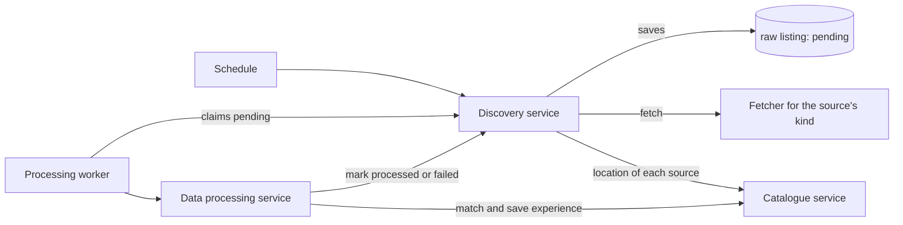

# Discovery and processing

Source of truth for how experiences are fetched from sources and turned into published experiences. Resources outside this flow are defined in [data-model.md](data-model.md).

2026-11-23 · Meiring

## Overview

Discovery fetches listings from sources and saves each new or changed one as a raw listing with status pending. Data processing picks up pending raw listings, turns each one into an experience, and saves it through the Catalogue service. The raw listing's status is the whole hand-off between the two.

Services call each other's services directly. Nothing is copied between domains and no domain event is needed for the hand-off. All tables are in one Postgres database.

## Tables

### Source (Discovery)

A site or feed that publishes experiences for one location.

| Holds | Notes |
| --- | --- |
| Name, kind | Kind picks the fetcher and the parser: ticketing API, HTML page, iCal or RSS feed |
| Location | One location per source. A site that covers two places is entered twice, once per location |
| Address and fetch settings | What the fetcher needs to call this source for this location |
| Active | Only active sources are fetched |

### Run (Discovery)

One fetch of one source. This is the log of what was fetched and when.

| Holds | Notes |
| --- | --- |
| Source | The source fetched |
| Started, finished | Finished is empty while it runs |
| Status | Running, succeeded, failed |
| Counts | Listings found, new or changed, unchanged |
| Error | Why it failed, if it did |

### Raw listing (Discovery)

One version of one listing, exactly as the source returned it. A new row is saved only when the listing is new or its content changed.

| Holds | Notes |
| --- | --- |
| Run, source | Where and when it was fetched |
| Source's listing ID | The source's own ID for the listing, or its web address if the source has none |
| Address, fetched time, content type | |
| Content | The JSON, HTML or feed item as returned, in a Postgres `text` column |
| Fingerprint | A hash of the content, used to skip unchanged listings |
| Status | Pending, processed, failed |
| Attempts, error | For failed ones |
| Experience | The experience it produced, once processed |

The content is never changed after it is saved. Only the status fields change.

### Attributes and tags (Data processing)

The system-defined list of attributes (name, type, default value), their options, and tags. Data processing uses it to describe each experience. Defined in [data-model.md](data-model.md).

### Experience and source link (Catalogue)

The published experience and the links from source listings to it. A source's listing ID links to one experience only. Data processing reads these links through the Catalogue service to match listings. Defined in [data-model.md](data-model.md).

## Fetching

1. The schedule starts Discovery for each active source.
2. Discovery gets the source's location (name, centre point, timezone) from the Catalogue service and inserts a run with status running.
3. Discovery calls the fetcher for the source's kind with the source's settings and the location.
4. The fetcher calls the source and splits the response into listings. For each listing it returns the source's listing ID, the address, the content type and the raw content. It does not clean or interpret anything.
5. For each listing, Discovery computes the fingerprint and compares it with the last raw listing saved for the same source and listing ID:
   - same fingerprint: counted as unchanged, nothing saved
   - new listing or different fingerprint: saved as a raw listing with status pending
6. Discovery closes the run with its status, counts and any error.

If the fetch fails part way, the listings already saved stay saved and the run is marked failed.

## Processing

1. A processing worker runs on a loop. It asks the Discovery service for pending raw listings, which are claimed with `FOR UPDATE SKIP LOCKED` so two workers never take the same one.
2. Data processing parses the content with the parser for the source's kind and maps it to experience fields, attribute values and tags, checked against the attribute definitions.
3. It matches the listing to an experience through the Catalogue service:
   - the source and listing ID already have a source link: that experience is updated
   - otherwise Catalogue returns candidates in the same location with overlapping dates and a similar title, and Data processing links the listing to one of them or creates a new experience
4. The Catalogue service saves the experience, its sessions, attribute values, tags, the source link and a change row.
5. Data processing marks the raw listing processed with the experience, or failed with the error and one more attempt.

Steps 4 and 5 run in one transaction, so a raw listing is never marked processed without its experience saved.

## Raw listing status

| Status | Means | Moves to |
| --- | --- | --- |
| Pending | Saved by a run, waiting for processing | Processed, Failed |
| Processed | Turned into an experience | Nothing |
| Failed | Processing failed; the error and attempts are recorded | Pending, when retried |

## Service dependencies

| Service | Calls | For |
| --- | --- | --- |
| Discovery | Catalogue | The location of each source |
| Data processing | Discovery | Claiming pending raw listings, marking them processed or failed |
| Data processing | Catalogue | Matching by source link or candidates, saving experiences |

Catalogue calls neither, so the dependencies have no cycles.

## Decisions

| Decision | |
| --- | --- |
| Hand-off | The raw listing's status. No domain event or queue is needed |
| No copies | Services call each other's services. No table holds a copy of another domain's data |
| One location per source | A source row carries its location and settings |
| Matching | By Catalogue's source links first, then by comparing candidates |
| Raw content | Postgres `text` column. **Later:** move to MinIO (S3) and store a key instead |

## Open questions

- [ ] What happens when a listing disappears from its source without being marked cancelled?
- [ ] How often does the schedule run each source, and how often does the processing worker look for pending raw listings?
- [ ] After how many failed attempts does a raw listing stop being retried?
