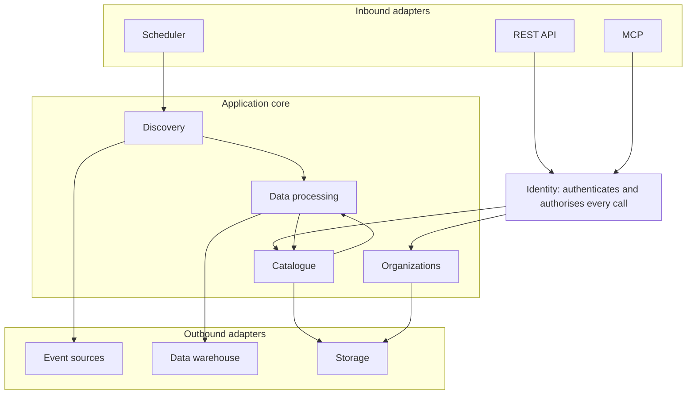

# Rev 1: Domains, architecture and use cases

2026-11-23 · Meiring

## System overview

The system is a multi-tenant platform that finds, processes and serves events by location. Travel businesses query it to plan trips, and event organisers add their own events. Clients reach it through a REST API and an MCP interface. This revision defines the domains, their boundaries and the main use cases, and makes no technology choices.

Version 1 is an event feed. It holds no trip context and serves events from the search parameters the client sends.

| Capability | What it means | Owning domain |
| --- | --- | --- |
| Discover events | Find events in the locations the system covers and capture the raw data as received | Discovery |
| Process events | Clean, de-duplicate, categorise and tag raw data, then make it ready for the data warehouse | Data processing |
| Search events | Find processed events by location, dates and traveller interests | Catalogue |
| Track changes | Show what is new, changed or cancelled since a time the client gives | Catalogue |
| Submit events | Let an event organiser create and maintain their own events | Catalogue |
| Authenticate and authorise | Know who is calling and decide what they may do | Identity |
| Manage tenants | Tenant setup and configuration, users, and their roles | Organizations |

## Actors and roles

Version 1 has two roles. Every person or agent that calls the system acts as one of them.

| Role | Kind | Who holds it | What they can do |
| --- | --- | --- | --- |
| System admin | System role | The platform operator | Onboard and configure tenants, manage users and roles, manage locations and sources, oversee discovery and processing |
| Client | User role | Users of a client tenant | Search events, track changes, and create and maintain their tenant's own events |

Client tenants come in several kinds. All of them hold the client role, and they use the system differently:

- **Travel agencies and travel agents** search for events to plan trips for their travellers.
- **Travel apps** search events on behalf of their own users.
- **Event organisers** create and maintain events they run, and can search like any other client.

A client can call through the REST API, or through MCP using an AI agent acting for that client. Both paths carry the same identity, tenant and role. Agents can do exactly what clients can and have no separate role. Identity knows whether a caller is an agent or a person.

## Domains

There are five domains: Discovery, Data processing, Catalogue, Identity and Organizations. Catalogue owns the processed events that clients search, track changes on, and that organisers create. Each domain owns its own data, and no other domain changes that data directly.

### Discovery

Finds events and captures the raw data as received.

- **Owns:** sources (where events are found), which sources cover which location, discovery runs, raw records exactly as fetched.
- **Boundary:** does not interpret, categorise or decide what clients see. It hands raw records to Data processing and stops there.

### Data processing

Turns raw records into clean, categorised, tagged events ready for the data warehouse.

- **Owns:** the processing pipeline, the category and tag vocabulary, matching rules (is this the same event as one we already have), and the processed result.
- **Boundary:** does not fetch from sources or answer client queries. It processes events from Discovery and events submitted by organisers the same way, so every event gets the same categories and tags.

### Catalogue

The events as clients see them, and everything clients do with them.

- **Owns:** published events, the locations the system covers and clients search by, search by location, dates and interests, the change history clients track, and organiser-submitted events.
- **Boundary:** does not process or categorise. An organiser's new event goes to Data processing before it is published.

All events are discoverable by every tenant, including organiser events.

### Identity

Knows who is calling and decides what they may do.

- **Owns:** credentials for people and for agents calling through MCP, whether each caller is an agent or a person, authentication, and authorisation decisions.
- **Boundary:** does not decide who belongs to which tenant or which role they hold. It reads that from Organizations and turns it into an allow or deny on each request.

### Organizations

The tenants and the people in them.

- **Owns:** tenants, tenant kind (agency, travel app, event organiser), tenant configuration, users, membership and role assignment.
- **Boundary:** does not authenticate anyone or hold credentials. It does not hold events.

## Architecture

The API uses ports and adapters. Each domain defines inbound ports for what it offers and outbound ports for what it needs, with no technology in either. Adapters connect those ports to the outside world, and an adapter can be swapped without changing the domain.

REST and MCP are two adapters on the same inbound ports, so a person and an agent get identical behaviour. The scheduler starts discovery without passing through Identity, because no client is involved.

| Domain | Inbound ports (what it offers) | Outbound ports (what it needs) |
| --- | --- | --- |
| Discovery | Run discovery for a location | Fetch from a source; store raw records; announce RawRecordCaptured |
| Data processing | Process a raw record; process a submitted event | Store processed events; load the data warehouse; announce EventProcessed |
| Catalogue | Search events; get changes since; submit an event; manage locations | Store published events and their history; announce EventSubmitted and LocationAdded |
| Identity | Authenticate a caller; authorise an action | Store credentials; know each user's tenant and role |
| Organizations | Manage tenants; manage users and roles | Store tenants and users; announce tenant and user changes |

## How domains talk

Domains never reach into each other's data. One domain raises a domain event when something happens, and the domains that care keep their own copy of what they need.

| Domain event | Raised by | Listened to by | Means |
| --- | --- | --- | --- |
| LocationAdded | Catalogue | Discovery | A new place is covered; start finding events there |
| RawRecordCaptured | Discovery | Data processing | A source returned an event record, as fetched |
| EventSubmitted | Catalogue | Data processing | An organiser created or changed one of their events |
| EventProcessed | Data processing | Catalogue | A clean, categorised, tagged event is ready, either new or changed |
| TenantCreated | Organizations | Identity | A new tenant exists and can have users |
| UserAdded | Organizations | Identity | A person joined a tenant with a role; issue credentials |
| RoleChanged | Organizations | Identity | A user's role changed; update what they may do |
| UserRemoved | Organizations | Identity | Revoke that user's access |
| TenantSuspended | Organizations | Identity | Revoke access for everyone in the tenant |

## Use cases

Each step names the domain that does it, so you can see where every responsibility sits.

### UC1: A travel agent sources events for a luxury trip

A travel agent is planning a trip to Hermanus from 10 to 20 June 2027 for a couple who like art and nature. They ask the system what is on while the couple is there.

1. The agent calls through REST, or their AI agent calls through MCP.
2. **Identity** authenticates the caller, then authorises the search for a client in an active tenant.
3. **Catalogue** finds published events in Hermanus that overlap 10 to 20 June 2027 and match art or nature. That includes single dates, recurring markets, festivals and seasons such as whale watching.
4. **Catalogue** returns the events with their categories, tags, dates and how certain those dates are.

### UC2: The travel agent checks back months later

Eight months later, the agent refines the trip and books activities. They want only what changed.

1. **Identity** authenticates and authorises the caller, as in UC1.
2. **Catalogue** takes the same search parameters and the time of the agent's last search.
3. **Catalogue** returns what is new, rescheduled, changed or cancelled since then.

### UC3: An event organiser creates an event

An organiser adds their festival in Hermanus so travel agents can find it.

1. **Identity** authenticates the organiser and authorises event creation for their tenant.
2. **Catalogue** records the submission against the organiser's tenant and raises EventSubmitted.
3. **Data processing** cleans, categorises and tags it, checks it against events already discovered, and raises EventProcessed.
4. **Catalogue** publishes it, and the event appears in searches like UC1. There is no system admin review in v1.

### UC4: The system discovers events in a location

1. **Discovery** runs on its schedule for each covered location and fetches from that location's sources.
2. **Discovery** stores each raw record as received and raises RawRecordCaptured.
3. **Data processing** cleans and de-duplicates the records, categorises and tags them, prepares them for the data warehouse, and raises EventProcessed.
4. **Catalogue** publishes new events and records changes to existing ones, which feeds UC2.

### UC5: A system admin onboards a travel agency

1. **Identity** authenticates the system admin and authorises tenant management.
2. **Organizations** creates the tenant as a travel agency, sets its configuration, and raises TenantCreated.
3. **Organizations** adds the agency's first user with the client role and raises UserAdded.
4. **Identity** issues that user's credentials for REST and MCP.

## Glossary

| Term | Meaning |
| --- | --- |
| Event | Something a traveller can go to or experience: a concert, a match, a market, a show with many dates, an exhibition, a festival months away, or a season such as whale watching |
| Domain event | Something that happened inside the system that another domain may care about, such as EventProcessed. Not a thing to go to. |
| Raw record | An event as a source returned it, before any processing |
| Source | A place Discovery finds events, such as a ticketing site, tourism listing or venue page |
| Location | A place the system covers and clients search by, such as Hermanus |
| Tenant | A client organisation: a travel agency, travel app or event organiser |
| Client | The user role. A person, or an agent acting for them, inside a tenant |
| System admin | The system role that operates the platform |
| Port | A domain's own definition of what it offers (inbound) or what it needs (outbound), with no technology in it |
| Adapter | A plug that connects a port to the outside world, such as REST, MCP, a scheduler, a source, storage or the data warehouse |

## Decisions

| Question | Decision |
| --- | --- |
| Is Catalogue its own domain? | Yes |
| Is a location a place the system covers or a tenant's site? | A place the system covers, owned by Catalogue |
| Can every tenant see every event? | Yes. All events are discoverable by every tenant, including organiser events |
| Does an organiser's event need admin review before publishing? | Not in v1. Organiser events publish once processed |
| Do agents need their own role? | No. Agents can do exactly what clients can. Identity knows whether a caller is an agent or a person |
| Where does trip context live? | Nowhere in the system. It is an event feed that serves events from the client's search parameters |

## Open questions

- [ ] Does an agent's credential belong to a specific user or to the tenant? The MCP question was closed on roles, but this part is still unanswered, and no flow issues or revokes an agent credential.
- [ ] The client role includes creating and maintaining events, so travel agencies and travel apps can submit events too. Is that intended, or does tenant kind limit submission to organisers?
- [ ] How does the system learn that a discovered event was cancelled or dropped by its source? UC2 returns cancellations, but no flow produces one for discovered events.
- [ ] When an organiser's event matches an already discovered event (UC3 step 3), which version is published, and can the organiser then edit it?
- [ ] How does an organiser change or cancel their own event? EventSubmitted covers create and change; nothing covers cancel or delete.
- [ ] Can an organiser submit an event in a location the system does not cover?
- [ ] When a tenant is suspended, do its organiser events stay published?
- [ ] Who reads the data warehouse in v1? Data processing loads it, and Catalogue serves search from its own store.
- [ ] How does Catalogue get the category and tag vocabulary it searches by interest, and how does a client list it? No port or domain event shares it.
- [ ] How long is change history kept? UC2 checks back eight months later.
- [ ] Discovery's inbound ports have only "run discovery for a location". Where does the system admin manage sources and which sources cover which location?
- [ ] How does a client's location parameter map to a covered location: by name, by slug, or by coordinates and radius?
