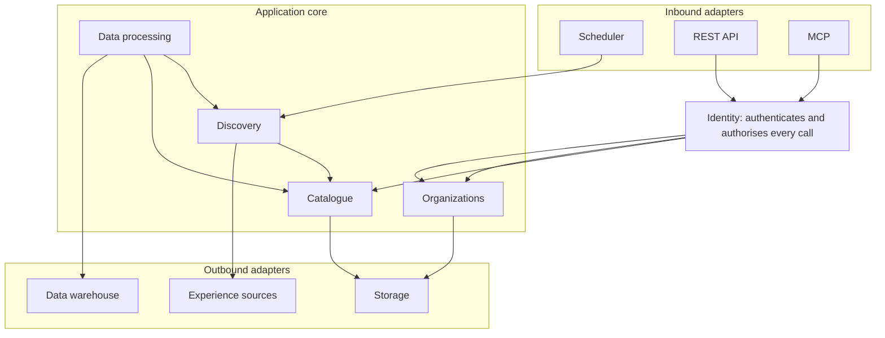

# Rev 1: Domains, architecture and use cases

2026-11-23 · Meiring

## System overview

The system is a multi-tenant platform that finds, processes and serves experiences by location. Travel businesses query it to plan trips. Clients only read; they cannot create or change experiences. Clients reach it through a REST API and an MCP interface. This revision defines the domains, their boundaries and the main use cases, and makes no technology choices.

Version 1 is an experience feed. It holds no trip context and serves experiences from the search parameters the client sends.

| Capability | What it means | Owning domain |
| --- | --- | --- |
| Discover experiences | Find experiences in the locations the system covers and capture the raw data as received | Discovery |
| Process experiences | Clean, de-duplicate, categorise and tag raw data, then make it ready for the data warehouse | Data processing |
| Search experiences | Find processed experiences by location, dates and traveller interests | Catalogue |
| Track changes | Show what is new, confirmed, rescheduled, postponed, cancelled or otherwise changed since a time the client gives | Catalogue |
| Authenticate and authorise | Know who is calling and decide what they may do | Identity |
| Manage tenants | Tenant setup and configuration, users, and their roles | Organizations |

## Actors and roles

Version 1 has two roles. Every person or agent that calls the system acts as one of them.

| Role | Kind | Who holds it | What they can do |
| --- | --- | --- | --- |
| System admin | System role | The platform operator | Onboard and configure tenants, manage users and roles, manage locations and sources, oversee discovery and processing |
| Client | User role | Users of a client tenant | Search experiences and track changes |

Client tenants come in two kinds. All of them hold the client role, and they use the system differently:

- **Travel agencies and travel agents** search for experiences to plan trips for their travellers.
- **Travel apps** search experiences on behalf of their own users.

A client can call through the REST API, or through MCP using an AI agent acting for that client. Both paths carry the same identity, tenant and role. Agents can do exactly what clients can and have no separate role. Identity knows whether a caller is an agent or a person.

## Domains

There are five domains: Discovery, Data processing, Catalogue, Identity and Organizations. Catalogue owns the processed experiences that clients search and track changes on. Each domain owns its own data, and no other domain changes that data directly. A domain that needs another domain's data calls its service; nothing is copied. How fetching and processing work is in [discovery.md](discovery.md).

### Discovery

Finds experiences and captures the raw data as received.

- **Owns:** sources (where experiences are found, one location each), runs, raw listings exactly as fetched.
- **Boundary:** does not interpret, categorise or decide what clients see. It saves raw listings as pending for Data processing and stops there.

### Data processing

Turns raw listings into clean, categorised, tagged experiences ready for the data warehouse.

- **Owns:** the processing pipeline, the system-defined attributes (categories) and tags, and matching rules (is this the same experience as one we already have).
- **Boundary:** does not fetch from sources or answer client queries. It processes the raw listings Discovery captures.

### Catalogue

The experiences as clients see them, and everything clients do with them.

- **Owns:** published experiences, the locations the system covers and clients search by, search by location, dates and interests, and the change history clients track.
- **Boundary:** does not process or categorise. Every experience it publishes comes from Data processing.

All experiences are discoverable by every tenant.

### Identity

Knows who is calling and decides what they may do.

- **Owns:** credentials for people and for agents calling through MCP, whether each caller is an agent or a person, authentication, and authorisation decisions.
- **Boundary:** does not decide who belongs to which tenant or which role they hold. It reads that from Organizations and turns it into an allow or deny on each request.

### Organizations

The tenants and the people in them.

- **Owns:** tenants, tenant kind (travel agency, travel app), tenant configuration, users, membership and role assignment.
- **Boundary:** does not authenticate anyone or hold credentials. It does not hold experiences.

## Architecture

The API uses ports and adapters. Each domain defines inbound ports for what it offers and outbound ports for what it needs, with no technology in either. Adapters connect those ports to the outside world, and an adapter can be swapped without changing the domain.

REST and MCP are two adapters on the same inbound ports, so a person and an agent get identical behaviour. The scheduler starts discovery without passing through Identity, because no client is involved.

| Domain | Inbound ports (what it offers) | Outbound ports (what it needs) |
| --- | --- | --- |
| Discovery | Run discovery for a source; manage sources; claim pending raw listings; mark them processed or failed | Fetch from a source; store runs and raw listings; get a source's location from Catalogue |
| Data processing | Process pending raw listings | Claim and mark raw listings through Discovery; match and save experiences through Catalogue; load the data warehouse |
| Catalogue | Search experiences; get changes since; manage locations; get a location; find an experience by source link or candidates; save an experience | Store locations, published experiences and their history |
| Identity | Authenticate a caller; authorise an action | Store credentials (Better Auth); get a user's tenant and its status from Organizations |
| Organizations | Manage tenants; manage users and roles; get a tenant | Store tenants |

## How domains talk

A domain that needs another domain's data calls that domain's service. Nothing is copied between domains and nothing is kept in sync. All tables are in one Postgres database.

| Service | Calls | For |
| --- | --- | --- |
| Discovery | Catalogue | The location of each source |
| Data processing | Discovery | Claiming pending raw listings, marking them processed or failed |
| Data processing | Catalogue | Matching listings to experiences, saving experiences |
| Identity | Organizations | A user's tenant and whether it is active |

Catalogue and Organizations call nobody, so there are no cycles. The hand-off from fetching to processing is the raw listing's status: Discovery saves it as pending, and Data processing marks it processed or failed.

## Use cases

Each step names the domain that does it, so you can see where every responsibility sits.

### UC1: A travel agent sources experiences for a luxury trip

A travel agent is planning a trip to Hermanus from 10 to 20 June 2027 for a couple who like art and nature. They ask the system what is on while the couple is there.

1. The agent calls through REST, or their AI agent calls through MCP.
2. **Identity** authenticates the caller, then authorises the search for a client in an active tenant.
3. **Catalogue** finds published experiences within the radius the agent gives around Hermanus that overlap 10 to 20 June 2027 and match art or nature. That includes single dates, recurring markets, festivals and seasons such as whale watching.
4. **Catalogue** returns the experiences with their categories, tags, dates, status (expected, announced, confirmed or postponed) and whether they can be booked.

### UC2: The travel agent checks back months later

Eight months later, the agent refines the trip and books activities. They want only what changed.

1. **Identity** authenticates and authorises the caller, as in UC1.
2. **Catalogue** takes the same search parameters and the time of the agent's last search.
3. **Catalogue** returns what is new, confirmed, rescheduled, postponed, cancelled or otherwise changed since then.

### UC3: The system discovers experiences in a location

1. **Discovery** runs on its schedule for each active source, gets the source's location from Catalogue, and fetches from the source.
2. **Discovery** saves each new or changed listing as a raw listing with status pending, and logs the run.
3. **Data processing** claims pending raw listings, cleans, categorises and tags them, and matches each one to an experience through Catalogue.
4. **Catalogue** saves new experiences and changes to existing ones, with a change record that feeds UC2. Data processing marks the raw listing processed.

### UC4: A system admin onboards a travel agency

1. **Identity** authenticates the system admin and authorises tenant management.
2. **Organizations** creates the tenant as a travel agency and sets its configuration.
3. **Organizations** adds the agency's first user with the client role.
4. **Identity** issues that user's credentials for REST and MCP.

## Glossary

| Term | Meaning |
| --- | --- |
| Experience | Something a traveller can go to or do: a concert, a match, a market, a show with many dates, an exhibition, a festival months away, or a season such as whale watching |
| Domain event | Something that happened inside the system that another domain may care about, such as `experience.processed`. Not an experience. |
| Raw listing | An experience as one source returned it, before any processing |
| Source | A place Discovery finds experiences, such as a ticketing site, tourism listing or venue page |
| Location | A place the system covers and clients search by, such as Hermanus |
| Tenant | A client organisation: a travel agency or travel app |
| Client | The user role. A person, or an agent acting for them, inside a tenant |
| System admin | The system role that operates the platform |
| Port | A domain's own definition of what it offers (inbound) or what it needs (outbound), with no technology in it |
| Adapter | A plug that connects a port to the outside world, such as REST, MCP, a scheduler, a source, storage or the data warehouse |

## Decisions

| Question | Decision |
| --- | --- |
| Is Catalogue its own domain? | Yes |
| Is a location a place the system covers or a tenant's site? | A place the system covers, owned by Catalogue |
| Can every tenant see every experience? | Yes. All experiences are discoverable by every tenant |
| Can clients create or change experiences? | No. Clients only read. Every experience comes from discovery |
| Do agents need their own role? | No. Agents can do exactly what clients can. Identity knows whether a caller is an agent or a person |
| Where does trip context live? | Nowhere in the system. It is an experience feed that serves experiences from the client's search parameters |
| How does a client search by place? | With a point and a radius the client chooses. Distance is worked out at query time |
| Where are sources managed? | In Discovery. Each source has one location |
| How do domains share data? | By calling each other's services. Nothing is copied or kept in sync |

## Open questions

- [ ] Does an agent's credential belong to a specific user or to the tenant? The MCP question was closed on roles, but this part is still unanswered, and no flow issues or revokes an agent credential.
- [ ] A source that marks an experience cancelled is covered: Data processing sets the status from the source. What happens when a listing disappears from its source without being marked cancelled?
- [ ] Who reads the data warehouse in v1? Data processing loads it, and Catalogue serves search from its own store.
- [ ] How long is change history kept? UC2 checks back eight months later.
