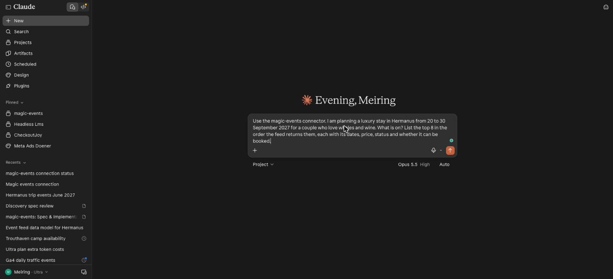
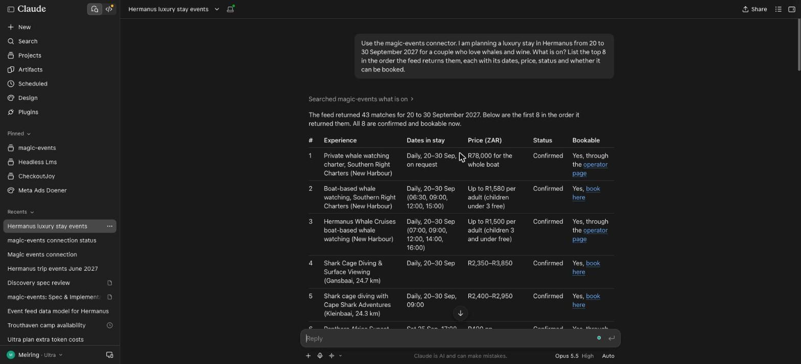
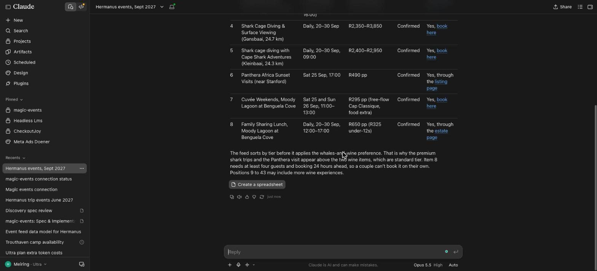
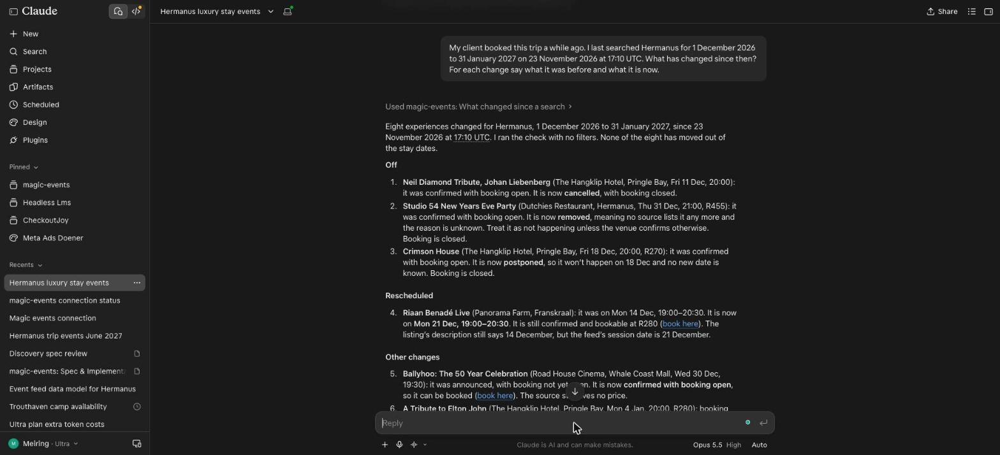
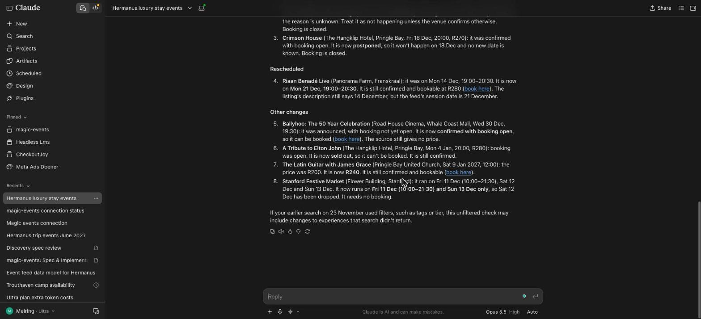
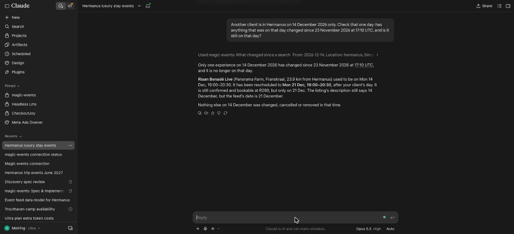
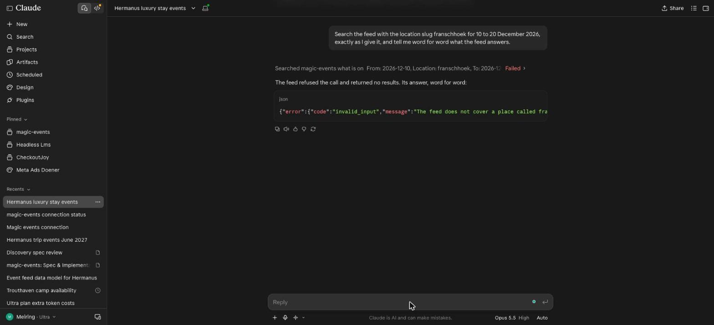
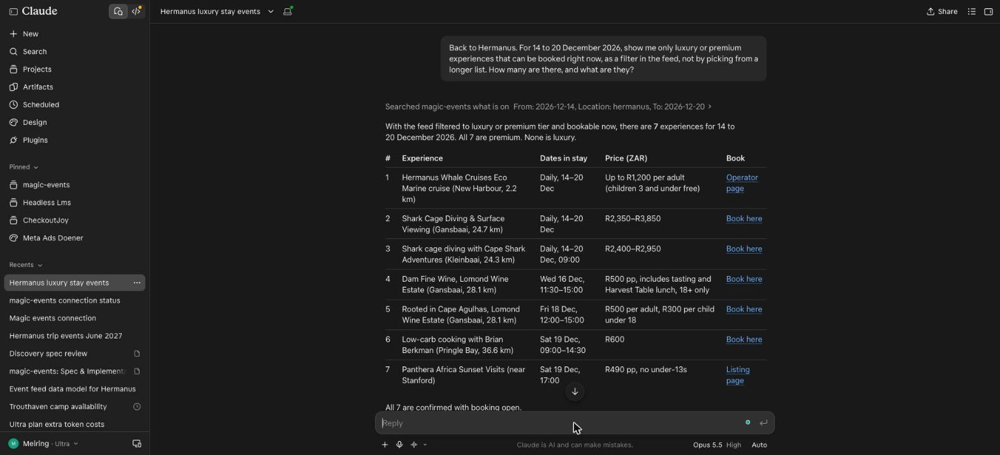
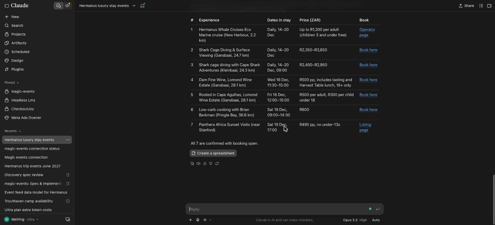
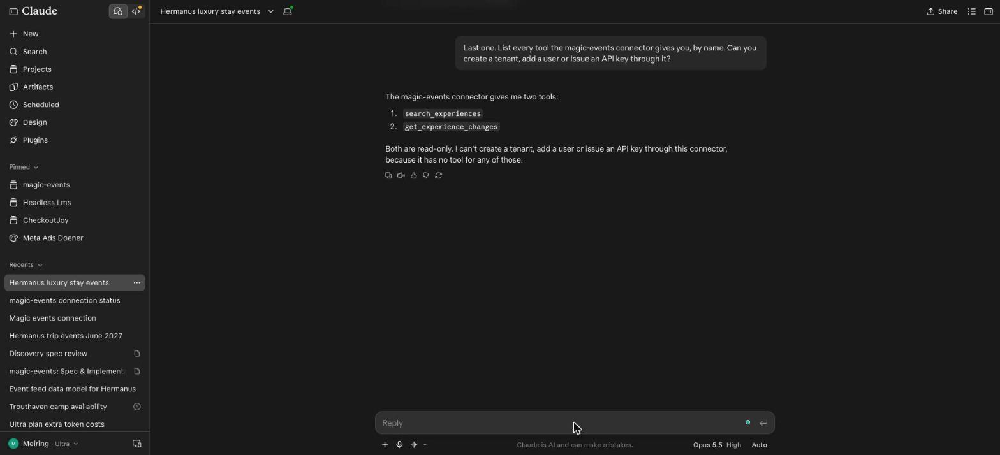

# Test report, 23 November 2026

This is the record of the end-to-end testing of magic-events version 1: what was tested, how, what came back, and the evidence for each. The criteria it was tested against are the 44 scenarios and 9 checks of [end-to-end.md](end-to-end.md), which also holds the result of every one, line by line.

## The result

Every scenario and every check passes.

| What | Result |
| --- | --- |
| The end-to-end suite, `pnpm e2e` | 48 pass, none fail |
| The same with the outside world, `pnpm e2e:live` | 49 pass, none fail |
| The three items a suite cannot do | All pass, done by hand |
| The automated tests, inside the suite's own check | 896 pass, none fail or skipped |
| Type check, lint and build | Clean |
| The API's answers against the database, worked out independently | 10 of 10 searches match, over REST and MCP |
| Questions asked of Claude through the connector | 6 asked, every answer matches the feed |

The code tested is commit `3176602` for the two suite runs and `b35dbcd` for the fresh checkout. Nothing but documents and evidence was committed between them.

## How it was tested

Four ways, each covering what the others cannot.

1. **A black-box suite.** `apps/e2e` starts the real server as its own process on its own database and drives it as a client does: REST with `fetch`, MCP with the official SDK's client, and the command-line tools as child processes. It imports nothing from the system. After every scenario it reads what the server logged and checks that too. One row of its results is the API itself: every operation in `apps/api/openapi.json` is called with a valid request and in each refusal it documents, and every answer is checked against its schema.
2. **The same suite against the outside world.** `pnpm e2e:live` adds real fetches of live sites, the real language model and real embeddings from Bedrock.
3. **An independent check of the answers.** A script asks the API a set of searches, pages through each answer in full, and compares it with a list that a separate SQL statement works out from the documented rules, not from the API's code.
4. **A real AI client.** Six questions were put to Claude through the custom connector, and each answer was read against the feed, the database and the server's log.

## 1. The end-to-end suite

| Run | When, UTC | Took | Result | Full table |
| --- | --- | --- | --- | --- |
| `pnpm e2e` | 23 Nov 2026, 17:41 | 270 s | 48 pass, 3 by hand, 1 live only | [evidence/e2e/default-run.md](evidence/e2e/default-run.md) |
| `pnpm e2e:live` | 23 Nov 2026, 17:46 | 892 s | 49 pass, 3 by hand | [evidence/e2e/live-run.md](evidence/e2e/live-run.md) |

Each table has one line of evidence per scenario: what was asked and what came back, with counts and names, and the log lines a scenario checks.

What the scenarios cover, by use case:

| Use case | Scenarios | What they show |
| --- | --- | --- |
| Planning a trip | E2E-01 to E2E-17, E2E-44 | Search by place or point, dates, attributes, tags, status and what can be booked; paging; a query text that orders and never filters; the same answers over REST and MCP; each kind of experience in the brief; 18 months ahead; nothing past 24 months; the most premium first |
| The feed keeps itself current | E2E-18 to E2E-25 | The schedule fills an empty feed; a failed fetch is retried; captured pages load through the pipeline; an unchanged page writes nothing; a changed page updates its experience; a page that disappears leads to Removed; one experience from many sources; the operator fetches and processes again |
| Checking back later | E2E-26 to E2E-30 | Nothing changed gives nothing; every kind of change with what changed and what it was before; cancelled and removed are reported; an experience that moved out of the stay; the same over MCP |
| Onboarding | E2E-31 to E2E-36 | An operator onboards a tenant from the command line and its keys work at once; suspension and revocation refuse the next call; several tenants at once; no admin endpoint exists |
| Trust and safety | E2E-37 to E2E-41 | No key and a wrong key are refused; wrong input is answered in plain words; the database going away gives 503 and comes back; rate limits; every request is traced to who made it |
| Quality | E2E-42, E2E-43 | A sample of answers matches the source pages field by field; nothing false in the feed |

Two examples of the evidence, from the default run:

- **A failed fetch is tried again (E2E-19).** A source's page is at a closed port. The run fails with its reason, "A job failed and will be tried again" is logged at warn with a wait of 60 to 120 seconds, the port opens, and the same job's second attempt succeeds. Nothing was counted as missing. The server's log of it: [evidence/e2e/retry.log](evidence/e2e/retry.log).
- **Every operation in the API (the API row).** 7 operations, 299 requests, each answer valid against its schema, and the served `/openapi.json` equal to the committed file.

## 2. The checks around the scenarios

| Check | Result | Evidence |
| --- | --- | --- |
| C-01 A clean install | Pass | A fresh export into an empty folder: frozen-lockfile install, `.env` from the example, `pnpm quickstart`, type check, lint, build, then the server and three calls. [evidence/fresh-checkout.txt](evidence/fresh-checkout.txt) |
| C-02 Type check, lint, build | Pass | Each exits 0 |
| C-03 Every automated test | Pass | 896 passed, none skipped |
| C-04 Migrations on an empty database | Pass | 8 applied; a second run applies nothing |
| C-05 The seed twice | Pass | The second run prints the same counts and "No new API keys", and changes no row of any table |
| C-06 Clean start and stop | Pass | "Server started", `/health` 200, and on SIGTERM a search in hand finishes before "Stopped" |
| C-07 The background jobs run | Pass | All four jobs completed on the served copy, none failed. [evidence/background-jobs.txt](evidence/background-jobs.txt) |
| C-08 Upkeep keeps the feed current | Pass | No searchable experience is over; recurring ones reach 24 months ahead |
| C-09 A new checkout starts with a full feed | Pass | The snapshot restores, the seed prints keys, a search returns 281 with every one embedded, and the nine demonstration changes come back with what they were before |

## 3. The API's answers against the database

The script [evidence/answers/verify-answers.py](evidence/answers/verify-answers.py) holds its own SQL for which experiences a search should return and in what order: a searchable status, a scheduled session inside the stay, within the radius, then most premium first, then the first matching session, then the title. It compares that with the API's answer over REST and over MCP: the same experiences in the same order, and for each one its title, status, booking, whether it can be booked, price, tier and the number of sessions in the stay.

All ten match. The table, with each request: [evidence/answers/answers-against-database.md](evidence/answers/answers-against-database.md).

The ten: a whale-season stay; a week before Christmas; luxury and premium only over a year; what can be booked now in December; tagged whales in the season; a family with a child of 10 in July; within 10 km of Stanford; the expected next editions of 2027; eighteen months ahead; beyond what is known.

## 4. Claude, through the connector

Claude Opus 5.5 on claude.ai, with the custom connector `magic-events` pointed at the API's `/mcp` through a Cloudflare tunnel, using the seeded agency's agent key. Claude chose the tool and its arguments itself each time.

The whole conversation is in [evidence/claude/transcript.md](evidence/claude/transcript.md). Each of Claude's tool calls was then taken from the server's log and sent again over REST with the same arguments, and the answer set beside Claude's words: [evidence/claude/answers-checked.md](evidence/claude/answers-checked.md). The server's own log lines for the five calls are in [evidence/claude/server-log.jsonl](evidence/claude/server-log.jsonl).

These screenshots are of claude.ai in Chrome. The Claude Desktop app uses the same account and the same connector, but it could not be driven from the test machine, which lacked the macOS accessibility permission.

### Planning a stay

Asked for the top 8 for a luxury stay of 20 to 30 September 2027. Claude searched with the dates and a query text of its own, and listed the feed's first eight in the feed's order: the private whale charter (luxury), then the two operators' boat trips, two shark trips and a wildlife visit (premium), then two wine lunches (standard). It explained the order unprompted: "The feed sorts by tier before it applies the whales-and-wine preference."





Checked: the feed returns the same eight in the same order, 43 in all, and most premium first holds.

### Checking back: what changed

Asked what changed for 1 December 2026 to 31 January 2027 since 23 November at 17:10 UTC, with what each was before. Claude reported eight changes, each with before and now: "it was confirmed with booking open. It is now cancelled"; "the price was R200. It is now R240"; "it was on Mon 14 Dec, 19:00–20:30. It is now on Mon 21 Dec".




Checked: the feed returns the same eight, with the same kinds, fields and earlier values. These are the demonstration changes described in the [snapshot's notes](../packages/db/snapshot/README.md).

### A stay of one day

Asked whether anything on 14 December had changed. Claude found the one show that had been on that day and said it "is no longer on that day".



Checked: one item, rescheduled, marked as moved out of the stay, its session now on 21 December.

### A place the feed does not cover

Asked to search a place the feed does not have, and to give the feed's answer word for word.



The feed's words: "The feed does not cover a place called franschhoek. It covers: hermanus. Give one of them, or a point with near." Checked: the same refusal over REST, with the same request ID in the log.

### Filters

Asked for only luxury or premium experiences that can be booked now, 14 to 20 December 2026, as a filter. Claude sent the tier filter and `bookable: true`, and listed seven.




Checked: the database, asked separately for the same filters and order, gives the same seven titles in the same order.

### What the connector offers



Two tools, both read-only, and no way to manage tenants, users or keys.

### The log of one of Claude's calls

Every line of the first call, from the request arriving to its answer. The request came from Anthropic's address through the tunnel. Each line after authentication says which tenant, user and key called, and no line holds the key.

| Level | Message | What it carries |
| --- | --- | --- |
| debug | Request started | `POST /mcp`, address 160.79.106.168, request ID `40e9cded-…` |
| info | Tool called | `search_experiences`, its arguments, the tenant, the user, an agent key's ID |
| debug | Searching experiences | The resolved search |
| debug | Embedded texts | Bedrock, `amazon.titan-embed-text-v2:0`, 1 text, 2,115 ms |
| info | Searched experiences | 8 returned of 43, ordered by meaning, 2,134 ms |
| info | Request completed | 200, 2,151 ms |

## What the data is

The feed tested is the snapshot in the repository: 283 experiences for Hermanus and the towns near it, built from empty through the pipeline on 23 November 2026. How it was built, what was corrected by hand, and the nine changes made for demonstration, which are not true of the real events, are in [packages/db/snapshot/README.md](../packages/db/snapshot/README.md).

The decisions that bear on what was tested, each with what it costs, are in [v1-decisions.md](v1-decisions.md) and [issues.md](issues.md).

## Running it again

```sh
pnpm e2e          # the suite, about five minutes, its own database, no keys needed
pnpm e2e:live     # adds live sites, the language model and Bedrock; needs the keys in .env
```

`E2E_KEEP_LOGS=1` keeps every server's log and the results table in `apps/e2e/results/`.

The two check scripts run against a served API and its database:

```sh
python3 docs/evidence/answers/verify-answers.py http://127.0.0.1:4000 <api key> answers.md
python3 docs/evidence/claude/verify-claude.py <server log> http://127.0.0.1:4000 <api key> <folder>
```
